# 新一代模拟赛车门店商业计划书

> 面向对象：深圳两家门店、合计 30+ 台模拟器的现有经营者  
> 方案性质：存量门店的数字化、赛事化与内容化升级，不是从零开店预算  
> 文档版本：v0.1，2026-11-05  
> 产品底座：Racing Memory

## 0. 阅读说明

本文把内容分为三种口径：

- **已验证事实**：来自现有门店数量、用户访谈笔记、Racing Memory 代码与公开资料。
- **方案建议**：建议门店试点的经营机制，尚需 A/B 测试。
- **测算假设**：为了比较方案而设置的参数，不代表门店当前真实经营数据。

运营规则、财务模型、来源和事实边界已全部合并到本文。通过下方目录可在正文、执行
手册、财务模型与资料附录之间来回跳转。

如需先判断这套模式是否值得投入，再阅读具体执行方案，可先看
[《线上线下模拟赛车门店前景分析》](viability-analysis.md)。

<a id="目录"></a>

## 目录

### 商业方案

- [1. 执行摘要](#执行摘要)
- [2. 用户洞察：门店真正售卖什么](#用户洞察)
- [3. 定位与价值主张](#定位与价值主张)
- [4. 产品体验：从一次到店到长期车手](#产品体验)
- [5. Racing Memory：把机时变成可传播内容](#内容产品)
- [6. 排行榜与赛季](#排行榜与赛季)
- [7. 运营增长飞轮](#运营增长飞轮)
- [8. 商业模式](#商业模式)
- [9. 产品能力与交付边界](#产品能力边界)
- [10. 竞争差异化](#竞争差异化)
- [11. 组织与门店 SOP](#组织与门店sop)
- [12. 风险与应对](#风险与应对)
- [13. 90 天试点路线图](#试点路线图)
- [14. 核心 KPI](#核心kpi)
- [15. 需要门店老板补充的数据](#待补经营数据)

### 执行与附录

- [16. 详细运营执行手册](#运营执行手册)
- [17. 财务模型与三情景测算](#财务模型)
- [18. 来源、假设与事实边界](#来源与事实边界)
- [19. 最终建议](#19-最终建议)

---

<a id="执行摘要"></a>

## 1. 执行摘要

[↑ 返回目录](#目录)

### 1.1 机会

传统模拟赛车门店主要售卖“设备使用时间”。顾客开完一小时，体验在离店时结束：
成绩难以被记住，进步缺乏持续反馈，玩家之间关系薄弱，门店也很难形成比设备和价格
更持久的差异化。

本方案把两家现有门店升级为一个持续运营的赛车社区：

> **每次到店都有可量化进步，每场比赛都有可分享回忆，每个月都有值得争取的排名。**

核心不是再采购一批方向盘，而是把 30+ 台模拟器连接成一套体验系统：

1. 顾客完成驾驶后，自动得到圈速、分段、线路、成绩单和优化点；
2. 系统从录像和遥测中生成 Racing Memory 图片与 60/90 秒短视频；
3. 店内榜、双店榜、进步榜和月度赛事创造下一次到店理由；
4. 车手主页、视频分享和俱乐部把一次消费延长为线上关系；
5. 运营数据帮助门店把低峰机时转化为训练、排位和社区活动。

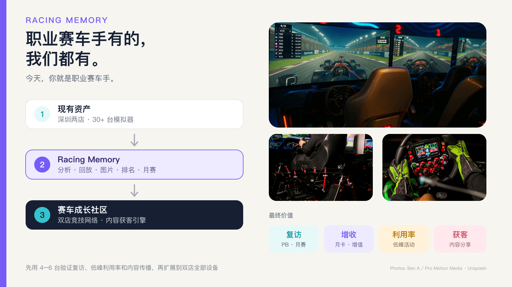

### 1.2 核心主张：职业赛车技术平权

职业赛车手拥有遥测分析、圈间对比、视频复盘、工程师建议、阶段目标和持续反馈。普通
模拟赛车爱好者通常只有一个圈速数字，很难知道时间丢在哪里，也很难获得“像职业车手
一样被认真对待”的体验。

Racing Memory 要做的不是把专业工具原样堆给用户，而是把职业赛车的分析能力和正反馈
翻译成人人看得懂、带得走、愿意再次回来验证的产品。

> **职业赛车手有的，我们都有。**
>
> **今天，你就是职业赛车手。**

这句话既是产品终点，也是门店体验标准：每位顾客都应获得职业车手式的记录、分析、
复盘、荣誉与下一目标，而不只是购买一小时设备使用权。

### 1.3 为什么现在适合现有两店试点

- **资产已在场**：两店合计 30+ 台设备，试点不需要承担从零开店的大额固定成本。
- **真实需求已出现**：用户笔记反复提到圈速反馈、机械掌控、比赛心流、本地排名、
  仪式感、专业服务和交通便利，而不是只追求更贵硬件。
- **软件底座已具备**：Racing Memory 已能解析 iRacing 遥测，完成圈速分析、视频同步、
  精彩事件识别、成绩单、短视频和驾驶建议；云侧已有分享、公开榜和车手主页。
- **内容天然适合传播**：一场体验可以产生赛道图、成绩卡、PB、精彩超车、事故片段
  和进步对比，比普通“到店打卡照”更能证明体验价值。
- **成熟游戏已验证长期循环**：赛季、段位、任务、俱乐部和赛事能把单局体验变成
  长期参与；门店可借鉴机制，但必须使用自己的品牌、规则和视觉。

### 1.4 建议的最小试点

先在一家店选择 **4–6 台统一规格设备**，运行 30 天：

- 固定一辆车、一条赛道、一套辅助与天气设置；
- 每位参与者获得成绩单、个人视频回放和精彩图片，作为基础权益或付费增值项目；
- 同时运行绝对圈速榜与个人进步榜；
- 每周举办一次分组赛，月底举办一次决赛；
- 月榜冠军奖励可在 **300 元京东卡或一张月卡**中二选一；
- 所有高价值成绩必须绑定账号、设备、遥测、设定版本和完整录像；
- 测量复访、低峰利用率、月卡转化、内容分享和正式计分参与率。

达到第 13 节的门槛后，再扩到双店和 30+ 台设备。

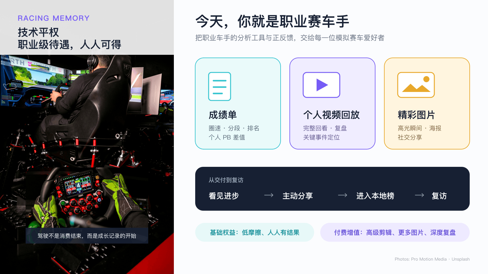

---

<a id="用户洞察"></a>

## 2. 用户洞察：门店真正售卖什么

[↑ 返回目录](#目录)

15 条模拟赛车主题笔记呈现出一致的动机结构。

### 2.1 一小时内获得“我变强了”

模拟赛车的优势不是无限内容，而是反馈极短：

- 圈速、分段和排名当场可见；
- 失误能归因到具体弯道、制动点和油门；
- 同一车、同一赛道可以反复练习；
- 用户不必先击败别人，也能通过 PB 证明进步；
- 一小时就能形成完整的练习—反馈—再尝试循环。

这使它特别适合工作日下班后的短时高沉浸消费。

### 2.2 机械掌控与高质量心流

方向盘、踏板、座舱和车身动态提供即时身体反馈。用户不是被动看屏幕，而是在控制
一台可学习的“机械”。当挑战与能力接近时，容易进入高质量心流；离店后兴奋感仍可
持续。门店应保护这种感受：设备稳定、工作人员专业、流程少打断、反馈可信。

### 2.3 单练会疲劳，比赛会让体验活起来

只跑圈可能变得单调；进入比赛后，超车、防守、避碰和策略会立刻增加意义。因此产品
不能只做计时器，还要提供同水平分组、周赛、俱乐部赛和安全评级。

### 2.4 全球榜太远，本地榜才有行动感

普通玩家很难进入全国或全球前列，但“本店第 10”“本月进步最大”“击败店员幽灵”
都是可触达目标。本地榜还会创造熟人关系：玩家知道自己在和谁竞争，也更愿意回来。

### 2.5 仪式感与专业服务决定复访

纸质奖状、冠军墙、车手卡、主持人口播和赛后复盘成本不高，却能把一次娱乐变成一场
正式事件。反面同样明显：环境差、员工不专业、设备设定不一致，会直接破坏公平感。

### 2.6 交通与时间成本不能忽略

用户会比较地铁、打车与总通勤时间。门店营销应明确地铁口、停车和预计到店时间，
活动时段也应围绕下班后一小时、周末半天和企业团建设计。

### 2.7 潜在用户缺少的不是兴趣，而是职业级正反馈

职业车手身边有数据、录像、工程师和训练计划，每一次驾驶都有可以分析和改进的证据。
潜在爱好者往往接触不到这些工具，第一次体验后只知道“好玩”或“很难”，无法形成清晰
的成长路径。技术平权的价值，是让普通人第一次到店就感到自己被当作真正的车手对待。

---

<a id="定位与价值主张"></a>

## 3. 定位与价值主张

[↑ 返回目录](#目录)

### 3.1 定位

**一家有真实竞技体系和个人成长记录的模拟赛车俱乐部。**

核心品牌口号：

> **职业赛车手有的，我们都有。今天，你就是职业赛车手。**

它同时提供四种价值：

| 价值层 | 顾客得到什么 | 门店得到什么 |
| --- | --- | --- |
| 体验 | 高质量设备、低门槛上手、即时心流 | 单次机时收入 |
| 成长 | PB、分段、线路、优化建议、阶段目标 | 训练课与复访 |
| 竞技 | 本店榜、双店榜、分组赛、赛季与俱乐部 | 月卡、赛事与低峰利用率 |
| 内容 | 成绩单、图片、Racing Memory、车手主页 | 自传播、品牌资产和获客 |

### 3.2 技术平权如何落地

| 职业车手的待遇 | 面向普通参与者的产品化交付 |
| --- | --- |
| 遥测与圈间对比 | 自动生成圈速、分段、线路和 PB 差值 |
| 工程师复盘 | 把最大时间损失点翻译成可执行建议 |
| 完整比赛录像 | 个人视频回放与关键事件定位 |
| 媒体与高光内容 | 精彩图片、成绩海报和 60/90 秒 Racing Memory |
| 赛季与车手身份 | 本店榜、双店榜、段位、月赛和车手主页 |
| 持续训练目标 | 下一名差距、个人进步榜和下次训练任务 |

“平权”不意味着降低专业性，而是通过自动化、模板和清晰表达降低获得专业反馈的门槛。

### 3.3 品牌承诺

1. **公平**：计分设备与设定统一，规则公开，成绩可审计。
2. **看得见的进步**：新手也有 PB、稳定性和进步榜，不只服务冠军。
3. **带得走的回忆**：每场正式体验都能留下图片或视频。
4. **专业但不排外**：高手有竞技深度，新手有定级、引导和同水平对手。
5. **数据由用户决定**：核心分析本地完成，公开与分享均需主动选择。

---

<a id="产品体验"></a>

## 4. 产品体验：从一次到店到长期车手

[↑ 返回目录](#目录)

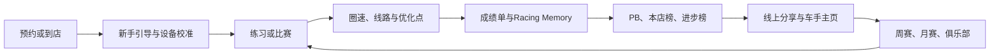

### 4.1 到店前

- 小程序/社群展示当前月赛道、规则、榜单和可预约时段；
- 新客选择“娱乐体验”“个人挑战”“正式排位”；
- 老客能看到个人 PB、距上一名差值和本周任务；
- 清晰展示地铁、停车、门店照片和设备规格。

### 4.2 到店与定级

- 工作人员确认账号、座椅、方向盘、踏板和辅助设置；
- 新客先完成安全教学和 3 个有效圈；
- 系统按速度与事故表现给出初始组别；
- 娱乐体验不强制入榜，正式成绩才进入竞技系统。

### 4.3 驾驶中

- 大屏显示当前圈、最佳圈、分段和有效性；
- 工作人员只在必要时介入，避免打断心流；
- 同水平玩家优先安排在一起比赛；
- 正式计分场次锁定车、赛道、天气、辅助和设备配置。

### 4.4 驾驶后

顾客在 1–3 分钟内拿到：

- 最快圈、平均圈、圈速稳定性和分段成绩；
- 赛道线路图与关键弯道建议；
- 一张适合朋友圈/小红书的横版或竖版成绩卡；
- 一条 60/90 秒精彩视频，或若干最佳圈、超车、事故片段；
- 本次 PB、月榜排名、进步幅度和下一目标。

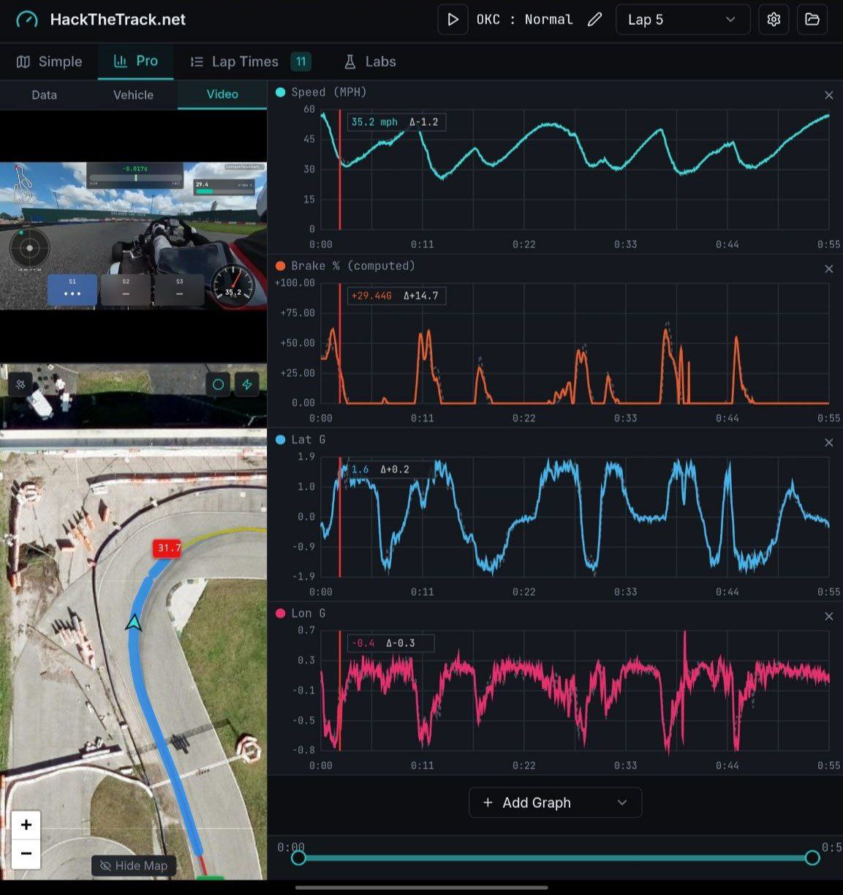

### 4.5 离店后

- 车手主页保留个人记录和用户主动公开的内容；
- 系统在“距上一名只差 0.3 秒”时触发有意义的召回；
- 周赛、月决赛和俱乐部活动提供明确回店节点；
- 内容发布必须获得昵称、语音、人脸和视频的单独授权。

---

<a id="内容产品"></a>

## 5. Racing Memory：把机时变成可传播内容

[↑ 返回目录](#目录)

### 5.1 内容产品

Racing Memory 不是简单录屏，而是由遥测决定“哪里值得看”：

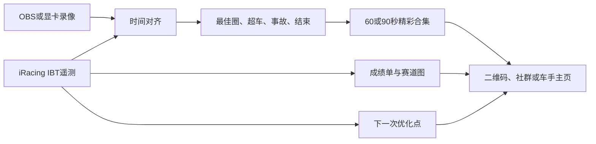

建议输出两档：

- **基础回忆**：成绩卡 + 1 张赛道图 + 1 个短片，包含在正式排位或会员权益中；
- **高级复盘**：60/90 秒合集 + 多张成绩卡 + 详细优化建议，可作为付费增值或训练课交付。

未来可增加“双音轨”：纯享版保留原始声音，教练版加入文本转语音提示。但 TTS、
自动字幕、模板音乐和完整片头转场目前属于路线图，不应作为已交付能力销售。

### 5.2 样例画面

以下静态帧来自本地 Racing Memory 测试视频，用于说明自动选取驾驶过程和事件画面的
效果；它们不是最终门店模板。对外商业发布前需要重新确认游戏画面与录制内容许可。

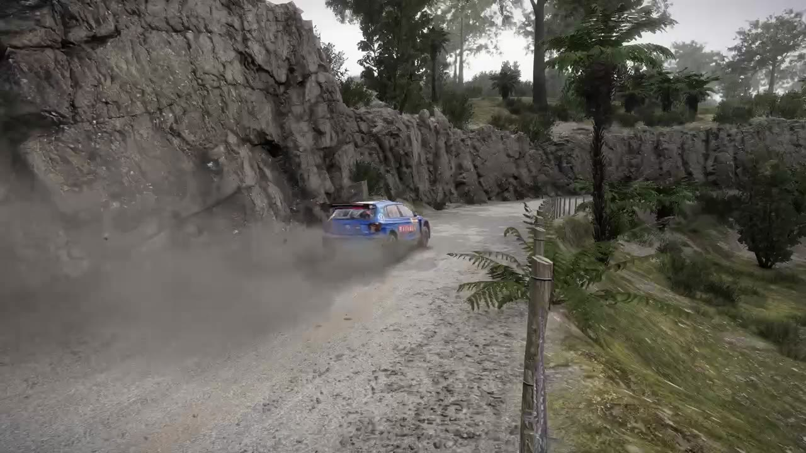

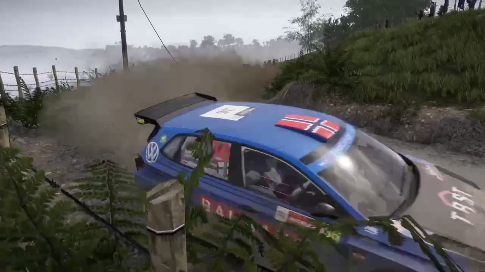

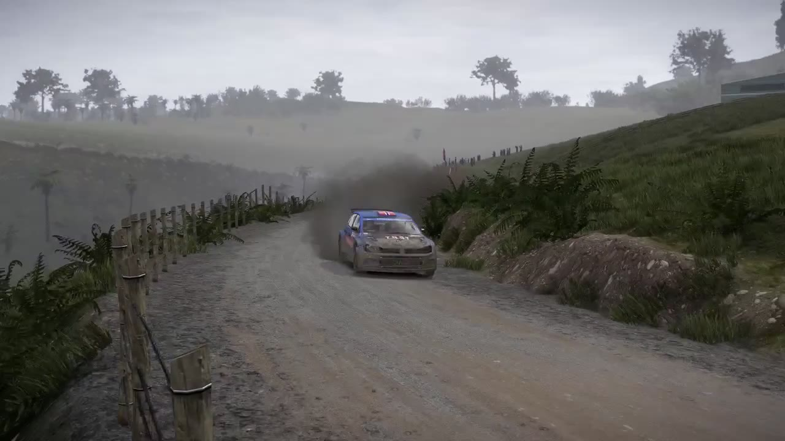


### 5.3 为什么它有商业价值

- 顾客离店后仍能回看和分享，延长体验寿命；
- 视频天然带门店品牌、赛道、圈速和活动入口；
- “最大进步”“最佳超车”“最稳车手”让非冠军也能成为内容主角；
- 同一份内容既是用户纪念，也是门店获客素材；
- 数据驱动剪辑比员工逐场手工找片段更容易规模化。

---

<a id="排行榜与赛季"></a>

## 6. 排行榜与赛季：制造持续回来的理由

[↑ 返回目录](#目录)

### 6.1 四类榜单

| 榜单 | 目的 | 更新频率 | 奖励建议 |
| --- | --- | --- | --- |
| 本店绝对圈速榜 | 高手竞争与品牌标杆 | 实时/每日 | 月决赛资格 |
| 双店总榜 | 跨店话题与城市感 | 实时/每日 | 冠军荣誉与主奖 |
| 个人进步榜 | 让新手持续参与 | 每周/月 | 训练券、月卡候选 |
| 安全/稳定榜 | 鼓励干净驾驶 | 每周/月 | 优先预约、车手徽章 |

不建议只设一张绝对圈速榜。否则高水平玩家会垄断曝光，新手在第一次到店就知道自己
不可能获奖。

### 6.2 月度奖励

建议把 **300 元京东卡或一张月卡**设为月度主奖，获奖者二选一：

- 京东卡传播直观、预算封顶；
- 月卡能把冠军留在社区并产生陪练、内容和标杆价值；
- 奖项可轮换给绝对圈速冠军、进步冠军或月决赛冠军；
- 同一用户连续获奖可转为冠军墙、决赛席位等身份奖励，避免奖金被固定高手长期包揽。

奖励必须建立在审计规则上，且不与无限购买计分圈数直接绑定。详细规则见
[第 16 节运营执行手册](#运营执行手册)。

### 6.3 首个 8 周赛季

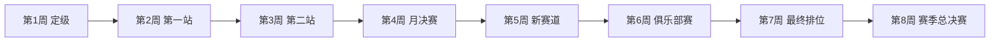

赛季取最佳若干站，而不是要求全勤；这样既鼓励稳定参与，也允许工作繁忙的用户缺席。

---

<a id="运营增长飞轮"></a>

## 7. 运营增长飞轮

[↑ 返回目录](#目录)

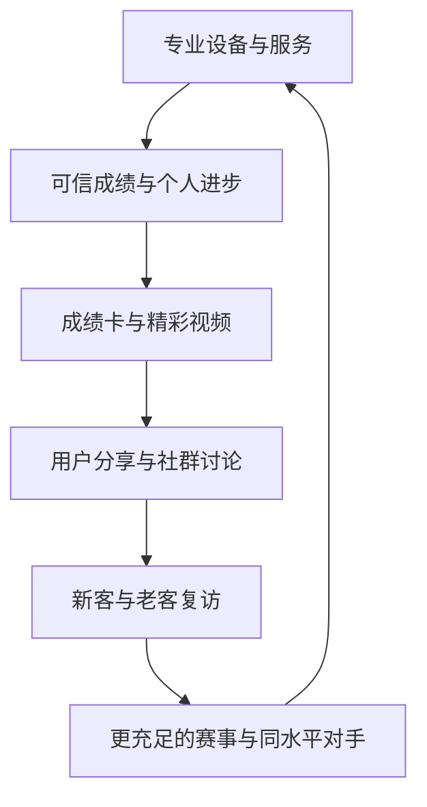

### 7.1 获客

- 把内容重点从“我们有多贵的设备”转向“普通人第一次也能留下什么”；
- 每周固定发布最佳超车、最大进步和教练拆圈；
- 与高校、汽车社群、企业 HR、卡丁车俱乐部合作；
- 用低门槛计时挑战做商场、车展和品牌活动入口；
- 所有内容附带当前月赛道、门店位置和预约入口。

### 7.2 转化

- 新客首单不只卖 1 小时，而是卖“定级 + 成绩单 + 回忆”；
- 体验结束时展示下一名差距和可执行目标；
- 月卡权益围绕正式排位、低峰训练、视频额度和赛事报名，而非单纯打折；
- 训练课以数据前后对比交付，避免“教练说了很多但用户不知道是否变快”。

### 7.3 留存

- 每周有小目标，每月有主赛事，每 8 周有赛季总结；
- 30/45 天未到店用户收到 PB 对比和状态评估邀请；
- 俱乐部提供队内复盘、接力赛、新手带教和企业联赛；
- 保留历史荣誉，新赛季只软重置竞技分。

---

<a id="商业模式"></a>

## 8. 商业模式

[↑ 返回目录](#目录)

### 8.1 收入结构

| 收入项 | 交付 | 作用 |
| --- | --- | --- |
| 普通机时 | 自由练习或娱乐比赛 | 基础现金流 |
| 主题体验包 | 定级、固定赛道挑战、成绩卡 | 新客高感知首单 |
| 月卡/次卡 | 低峰训练、排位额度、活动权益 | 锁定复访 |
| 正式赛事 | 周赛/月赛/企业联赛 | 提升低峰利用率和社群密度 |
| 数据复盘/教练 | 圈速拆解、参考圈、优化建议 | 高毛利增值 |
| Racing Memory | 高级视频、更多图片、定制模板 | 内容增值与传播 |
| 企业团建 | 包场、分组赛、主持、奖项、视频 | 高客单、工作日填充 |
| 品牌合作 | 车企、轮胎、饮品、电竞外设 | 成熟阶段收入 |

### 8.2 定价原则

- 先保证基础体验包含一份“带得走”的产物，不能所有价值都二次收费；
- 月卡用低峰时段和赛事权益创造价值，避免高峰无限占机；
- 正式计分限制每周有效场次，额外练习不限，防止付费次数直接购买排名；
- 视频高级包应按自动化后的边际成本定价，不按传统人工剪辑报价；
- 企业团建按整场结果交付：赛制、主持、成绩、奖项和集体回忆，而非简单机时相加。

### 8.3 经济性判断

由于现有两店的真实机时价格、利用率、会员结构和人力成本尚未提供，本文不写一个
看似精确但不可验证的回本月数。决策应观察“增量贡献”：

> 增量贡献 = 新增有效机时毛利 + 新增会员/赛事/内容毛利 − 软件、内容、人力与奖品增量成本

完整变量和三情景见[第 17 节财务模型](#财务模型)。

---

<a id="产品能力边界"></a>

## 9. 产品底座与可交付边界

[↑ 返回目录](#目录)

### 9.1 当前可复用

- iRacing `.ibt` 与多种遥测格式解析；
- 自动赛道、方向、圈次、sector、optimal 和 delta；
- 赛道地图、速度热力、制动区、多通道图和多圈对比；
- 普通视频同步、遥测 overlay 与本地 MP4 导出；
- Racing Memory 最佳圈、名次提升、事故和会话结束识别；
- CLI 60/90 秒 reel、成绩单图片、会话分析和确定性驾驶建议；
- 可选云同步、分享链接、公开排行榜和车手主页；
- 离线优先：核心分析不依赖账号或服务器。

### 9.2 需要门店产品化

- 店铺、分店、机位、员工角色和多租户数据模型；
- 本店榜、双店榜、赛季榜、进步榜与大屏；
- 门店账号/会员系统和预约/POS 的对接；
- 自动采集、任务队列、二维码交付与失败重试；
- 统一车、赛道、天气、辅助和硬件设定版本；
- 内容授权、审核、保留和删除流程；
- 门店经营看板与 KPI。

### 9.3 不能提前承诺

- Windows iRacing + OBS 的无人值守采集尚需真实长赛和断线验收；
- 浏览器 Racing Memory 当前以单片段为主，完整 60/90 秒合集由 CLI 生成；
- TTS 双音轨、背景音乐、片头片尾和自动字幕尚未完成；
- 当前云排行榜不是现成的多门店 SaaS 榜；
- “Finish”事件接近记录结束，不等同于官方方格旗；
- 超车识别不能完全区分主动超车、对手事故、掉线和黄旗；
- AI Coach 是可选插件，不能写成默认离线能力。

---

<a id="竞争差异化"></a>

## 10. 竞争差异化

[↑ 返回目录](#目录)

### 10.1 与普通模拟赛车馆

普通场馆的核心资产是硬件和位置，容易陷入价格、设备型号和装修竞争。本方案增加四层
难复制资产：

1. 连续的车手数据与成长记录；
2. 两店共享的真实竞技社区；
3. 自动生产的个人内容和门店内容库；
4. 由赛事规则、员工能力和数据公平共同形成的品牌信誉。

### 10.2 与纯线上赛车游戏

- 有真实座舱、力反馈、现场社交和仪式感；
- 无需用户先购买整套设备；
- 工作人员可帮助完成设定、教学和复盘；
- 线上系统服务于线下关系，而不是替代线下体验。

### 10.3 与卡丁车和实车赛道

- 到店成本更低，不受天气影响；
- 可快速更换车辆和赛道；
- 更容易获得完整遥测与录像；
- 安全风险和损耗较低；
- 但真实速度、身体负荷和户外体验不可替代，应定位为训练、竞技和娱乐入口，而非声称
  完全替代实车。

---

<a id="组织与门店sop"></a>

## 11. 组织与门店 SOP

[↑ 返回目录](#目录)

### 11.1 关键角色

- **项目负责人**：对试点 KPI、产品范围和跨店执行负责；
- **赛事运营**：赛程、规则、报名、主持、申诉和社群；
- **技术运营**：设备设定、采集、数据、内容任务和故障恢复；
- **门店教练/工作人员**：新手引导、座舱调节、赛后讲解；
- **内容运营**：模板、审核、授权、发布和转化追踪。

小规模试点可一人兼任多岗，但“设备故障处理”和“赛事裁决”应有明确责任人。

### 11.2 服务标准

- 开店前完成踏板、方向盘、帧率、网络和录制检查；
- 正式排位前自动或人工确认设定版本；
- 新客 5 分钟内完成座椅与控制器教学；
- 赛后 3 分钟内交付基础成绩；
- 内容失败时先保证成绩可用，再异步补视频；
- 争议成绩不当场公开指控，进入证据复核流程；
- 每日收店检查失败任务、异常成绩与设备偏差。

---

<a id="风险与应对"></a>

## 12. 风险与应对

[↑ 返回目录](#目录)

| 风险 | 影响 | 应对 |
| --- | --- | --- |
| 设备规格或校准不一致 | 榜单失去公信力 | 正式计分机位统一，记录设备与设定版本 |
| 高手垄断榜单 | 新手流失 | 进步榜、分组榜、安全榜、获奖冷却 |
| 奖励诱发刷榜 | 成本和争议上升 | 限定计分场次、绑定录像与遥测、申诉机制 |
| 自动采集失败 | 无视频或成绩延迟 | 分阶段试点、离线队列、人工补录和降级交付 |
| 内容侵犯隐私 | 投诉和品牌风险 | 主动授权、最小公开、撤回与删除流程 |
| 游戏商业许可不清 | 经营与赛事风险 | 向发行商确认场馆、赛事、直播和素材许可 |
| 游戏游艺监管适用不明 | 合规风险 | 开展前咨询深圳属地文旅主管部门与律师 |
| 活动热度短期化 | 投入无法持续 | 固定节奏、社群角色、进步目标而非只靠奖金 |
| 员工不专业 | 破坏高端体验 | 设备/服务认证、脚本、复盘和神秘顾客检查 |
| 内容生产成本过高 | 毛利下降 | 自动模板、失败重试、只对重点赛事做高级包装 |

---

<a id="试点路线图"></a>

## 13. 90 天试点路线图

[↑ 返回目录](#目录)

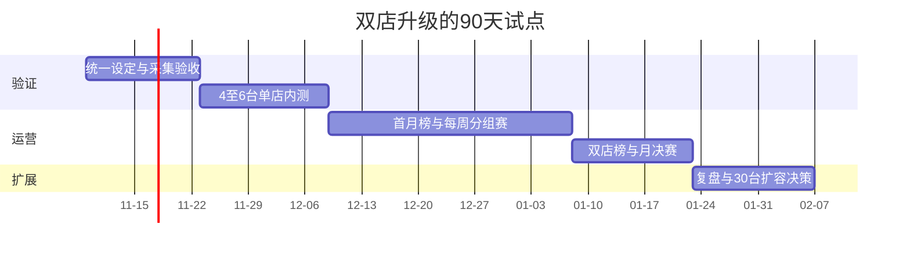

### 阶段 A：第 1–30 天，技术与服务闭环

- 选一店 4–6 台统一规格设备；
- 固化车、赛道、天气、辅助、控制器和录制设置；
- 验证 IBT、视频、同步、成绩单和短视频的成功率；
- 培训工作人员完成新客引导和基础复盘；
- 只做内部榜，不发高价值奖品。

**进入下一阶段门槛**：

- 成绩采集成功率 ≥ 98%；
- 基础成绩交付中位时间 ≤ 3 分钟；
- 正式计分机位设定一致率 100%；
- 员工能独立完成开店检查、异常降级和收店复核。

### 阶段 B：第 31–60 天，单店月榜验证

- 上线绝对圈速榜、进步榜和安全榜；
- 每周固定一次分组赛；
- 第 60 天举办月决赛并发放京东卡/月卡；
- 测试成绩卡和视频分享链路；
- 访谈参赛与未复访用户。

**建议观察**：

- 30 日复访率；
- 低峰设备利用率提升；
- 正式排位参与率；
- 月卡转化率；
- 产物领取率、分享率和分享带来的预约；
- 每场内容生产的人工分钟数。

### 阶段 C：第 61–90 天，双店联赛验证

- 统一两店规则与设定版本；
- 上线本店榜和双店总榜；
- 运行一场跨店资格赛与线下总决赛；
- 建立申诉、内容授权和数据删除流程；
- 根据真实数据决定扩到 30+ 台、继续局部试点或调整模式。

### 90 天 Go / Adjust / Stop 决策

**Go**：复访、低峰利用率和增量贡献同时改善，系统可靠性达到门槛。  
**Adjust**：用户喜欢内容或比赛，但某一环节成本过高，缩小范围后再测。  
**Stop**：奖励停止后参与迅速归零，或新增毛利长期覆盖不了运营增量成本。

---

<a id="核心kpi"></a>

## 14. 核心 KPI

[↑ 返回目录](#目录)

### 用户

- 首次体验完成率；
- 7/30/60 日复访率；
- 首次 PB 到第二次 PB 的改善幅度；
- 新手转正式排位、正式排位转赛事、赛事转月卡的漏斗；
- 赛季完赛率和俱乐部活跃率。

### 设备与门店

- 分时段设备利用率；
- 每台设备有效营收与贡献毛利；
- 采集成功率、产物成功率和交付时间；
- 设备故障、设定漂移和重跑率；
- 工作人员每场人工分钟数。

### 内容与增长

- 成绩卡/视频领取率；
- 用户授权发布率和主动分享率；
- 内容带来的预约、注册和到店；
- 每周可复用内容数；
- 获客成本与推荐占比。

### 竞技健康

- 有效成绩率、事故率和申诉率；
- 不同组别人数与晋级分布；
- 前 10 名集中度；
- 新手进入榜单的比例；
- 高价值奖项重复获奖率。

---

<a id="待补经营数据"></a>

## 15. 需要门店老板补充的数据

[↑ 返回目录](#目录)

下一版要从“方案”升级为“决策模型”，需要两店最近 8–12 周的：

1. 各店设备数量、型号、可正式计分机位数；
2. 工作日/周末、分时段营业时长与实际利用率；
3. 单小时价格、套餐、月卡、团建和赛事收入；
4. 新客数、复访率、会员数、客单价与渠道；
5. 员工排班、工资和当前每场服务耗时；
6. 游戏、iRacing、OBS、存储和网络环境；
7. 设备故障、维护和重新校准频率；
8. 当前社群人数、活动参与和内容账号数据；
9. 两店位置、通勤、停车和商圈客群；
10. 对视频、人脸、昵称、语音和未成年人数据的现有授权流程。

补齐后，可在[第 17 节财务模型](#财务模型)中替换假设，得到每店、每机位和每场活动
的真实增量贡献。

---

<a id="运营执行手册"></a>

## 16. 详细运营执行手册

[↑ 返回目录](#目录)

### 16.1 运营原则

1. **先公平，再热闹**：设定不一致的实时大屏只会更快放大争议。
2. **先小范围稳定，再扩 30 台**：采集、成绩和视频必须能降级交付。
3. **新手也要有胜利条件**：PB、进步、稳定和安全都可以成为荣誉。
4. **奖金只是放大器**：长期留存来自成长、同伴和身份，不是每月 300 元。
5. **正式成绩可审计**：账号、设备、设定、遥测和录像共同构成证据。
6. **内容需授权**：默认只生成给本人，公开发布必须主动同意。

### 16.2 服务产品

#### 娱乐体验

- 工作人员帮助调整座椅、方向盘与踏板；
- 自由练习或短局比赛；
- 提供基础圈速和一张成绩卡；
- 不自动进入正式排行榜；
- 结束时可选择升级为定级体验。

#### 新手定级

建议时长 45–60 分钟：

1. 5 分钟安全与控制教学；
2. 10 分钟熟悉赛道；
3. 完成 3–5 个有效计时圈；
4. 展示圈速、稳定性和事故；
5. 给出速度组别与安全等级；
6. 交付成绩卡、PB 和下一目标。

定级用于匹配，不用于打击新手。建议话术：

> “你已经完成第一份基准。下次目标是把有效圈稳定在 X 秒以内。”

#### 正式排位

- 使用指定计分机位；
- 固定车辆、赛道、天气、辅助和设置版本；
- 每人每周只有固定数量的正式计分场次；
- 练习不限，但付费练习不能无限刷新正式成绩；
- 自动保存遥测和录像；
- 通过校验后才进入榜单。

#### 数据复盘与教练

- **快速复盘**：5–10 分钟，指出 1–2 个最大时间损失点；
- **深度训练**：30–60 分钟，用参考圈、多圈叠加、制动、油门和线路拆解训练。

复盘必须输出可验证目标，例如“连续 5 圈方差低于 1.2 秒”，而不是只给泛化建议。

#### Racing Memory 交付档位

| 档位 | 内容 | 建议场景 |
| --- | --- | --- |
| 基础 | 1 张成绩卡 + 1 个代表片段 | 正式排位、月卡权益 |
| 标准 | 3–4 张成绩图 + 60 秒合集 | 周赛、朋友体验 |
| 高级 | 90 秒合集 + 优化点 + 品牌片头 | 月决赛、团建 |
| 教练版 | 原声版 + 讲解版 | 深度训练，待 TTS 完成 |

### 16.3 榜单、段位与安全评级

#### 四张核心榜

| 榜单 | 计算方式 | 作用 |
| --- | --- | --- |
| 绝对圈速榜 | 同车、同赛道、同设置的最快有效圈 | 高手标杆 |
| 个人进步榜 | 相对月初有效基准的改善率 | 新手留存 |
| 稳定榜 | 连续 5 个有效圈的离散程度 | 减少失误 |
| 安全榜 | 事故、切弯、逆行和完赛 | 鼓励干净驾驶 |

```text
进步率 = (月初有效基准 - 本月最佳) / 月初有效基准
```

进步榜要求至少 3 个有效基准圈；异常慢基准需要人工复核；首次定级后至少再到店一次才
能参评，避免故意制造低基准。

#### 展示方式

- 店内大屏：今日榜、月榜 Top 10、最大进步和下一活动；
- 纸质榜：每周更新，贴在冠军墙附近；
- 线上页：完整榜单、PB、分组和规则版本；
- 成绩卡：显示“本店第 12，距前一名 0.18 秒”，而不只有名次。

#### 速度段位

首版不必使用复杂 Elo，按真实圈速分布设置：

- 新秀组；
- 挑战组；
- 竞技组；
- 专业组。

每个组别都能产生冠军，同时保留绝对总榜。区间应每月根据真实分布校正。

#### 安全评级

- **A**：稳定完赛、事故极少，可参加高级多人赛；
- **B**：正常比赛水平；
- **C**：完成安全训练后参加正式多人赛；
- **D**：只能练习或参加指导场。

评级下降后应提供安全教学和连续干净比赛等恢复路径。段位只能影响匹配、赛事资格和
荣誉，不能提供更快车辆或更好设备。

### 16.4 首个 8 周赛季

| 周次 | 主题 | 主要活动 | 产物 |
| --- | --- | --- | --- |
| 1 | 开季定级 | 新手教学、老客校准 | 定级卡、赛季目标 |
| 2 | 第一站 | 计时挑战、分组赛 | 周榜、最佳超车 |
| 3 | 第二站 | 计时挑战、俱乐部招募 | 进步榜、车队内容 |
| 4 | 月度决赛 | 资格赛 + 决赛 | 300 元卡/月卡、60 秒合集 |
| 5 | 新赛道 | 赛道教学、参考圈挑战 | 赛道攻略 |
| 6 | 俱乐部周 | 接力/双人耐力 | 团队积分、采访 |
| 7 | 最终排位 | 个人补分、最后资格赛 | 总决赛名单 |
| 8 | 赛季总决赛 | 分组决赛、颁奖 | 90 秒合集、冠军墙 |

每站取每人最佳 2 场正式成绩；赛季取最佳 3–4 站，允许缺席。团队积分取前 N 名并给
参与和带教有限加分，避免大团队仅靠人数碾压小团队。

建议一周节奏：

| 时间 | 活动 | 目标 |
| --- | --- | --- |
| 周一/周二低峰 | 新手定级、企业包场 | 填充低峰 |
| 周三晚 | 新手夜 | 降低门槛 |
| 周四晚 | 教练拆圈、公开练习 | 训练与内容 |
| 周五晚 | 俱乐部赛 | 社交与留存 |
| 周末下午 | 正式排位 | 形成榜单 |
| 周日晚 | 周决赛、直播精选 | 仪式感与传播 |

### 16.5 奖励规则

月度主奖为 **300 元京东卡或一张月卡，获奖者二选一**。

| 层级 | 奖励 | 成本特征 |
| --- | --- | --- |
| 参与 | 数字徽章、有效圈证书 | 极低 |
| 周榜 | 饮品、低峰练习券、纸质奖状 | 低 |
| 月榜 | 300 元京东卡或月卡 | 固定封顶 |
| 赛季 | 奖杯、冠军墙、下赛季资格 | 中低 |
| 城市赛 | 品牌赞助、设备周边 | 尽量由合作覆盖 |

保护规则：

- 同一人连续两月夺主奖，第三月保留冠军荣誉但主奖顺延；
- 员工、教练和合作车手单列，不参与普通顾客实物奖；
- 正式计分场次数量固定；
- 不以消费金额直接换积分；
- 不用随机概率返奖作为核心循环；
- 比赛前公示领取、税费和争议规则。

### 16.6 俱乐部、任务与回流

俱乐部建议每队 4–12 人，包含队长、教练、正式车手和新秀。可运行接力赛、双人耐力、
队内遥测复盘、老带新和跨店主客场。

```text
团队分 = 前N名竞技分 + 有上限的完赛贡献 + 有上限的新手带教分
```

任务必须推动技术、社交或健康经营：

- 新手：完成安全教学和 3 个有效圈；
- 技术：连续 5 圈方差低于目标；
- 安全：完成一场零事故比赛；
- 社交：参加分组赛或带一位新手；
- 赛季：完成 4 个比赛周。

回流节奏：

- 7 天：提示本周活动和距下一名差值；
- 30 天：提供状态评估或工作日练习券；
- 45 天：邀请回归分组赛；
- 新赛季：保留历史荣誉，软重置段位；
- 好友邀请：被邀请者完成两次真实到店后再发奖励。

### 16.7 内容运营与授权

每周可固定发布：

- 本周最快圈；
- 本周最大进步；
- 本周最佳超车；
- 本周最稳车手；
- 教练拆一个弯；
- 新手第一场比赛；
- 俱乐部故事；
- 月决赛 60/90 秒合集。

成绩卡至少包含门店与活动品牌、车手昵称、车辆、赛道、设定版本、最快圈、平均圈、
有效圈、排名、PB 差值、活动二维码和隐私提示。

授权必须拆分为：

- 仅本人下载；
- 可公开昵称和成绩；
- 可公开游戏画面；
- 可公开现场人脸；
- 可公开车载语音；
- 可用于门店长期宣传。

用户应能撤回未来使用授权，并拥有明确删除入口。

### 16.8 正式成绩、反作弊与申诉

每条高价值成绩至少绑定：

- 会员/车手 ID；
- 门店、机位和设备 ID；
- 车辆、赛道、天气、辅助和设置版本；
- 开始/结束时间；
- 原始遥测；
- 完整录像或覆盖关键事件的录像；
- 软件与规则版本；
- 自动校验与人工复核状态。

每日开店校验方向盘中心和转角、踏板量程、力反馈、座舱固定件、帧率、网络、游戏
设置、录制、存储和 Racing Memory 采集服务。

自动判无效包括切弯判罚、逆行、异常重置、正式场次改变辅助、缺少关键遥测、时间戳
异常和设备校准失败。

申诉流程：

1. 比赛后设置至少 30 分钟冷静期；
2. 48 小时内提交申诉；
3. 裁判查看遥测、录像和设备日志；
4. 当事人不单独裁决自己的争议；
5. 公开结果和规则依据，不公开未经确认的作弊指控；
6. 设备故障允许重跑，驾驶失误不允许重跑。

### 16.9 门店日常 SOP

#### 开店

- 校验正式计分机位；
- 异常机位立即移出正式榜；
- 确认当日榜单、任务和活动；
- 测试一场遥测、录像、成绩卡和二维码；
- 检查存储容量与离线任务队列。

#### 每位顾客

1. 确认体验类型和账号；
2. 获取必要的数据与内容授权；
3. 调整座舱并说明退出和重置；
4. 开始采集并记录机位；
5. 结束后先确认基础成绩；
6. 展示 PB、排名和下一目标；
7. 交付内容或告知异步完成时间；
8. 邀请适合的下一活动，不做无差别推销。

#### 故障降级

| 故障 | 当场交付 | 后续动作 |
| --- | --- | --- |
| 视频失败、遥测正常 | 成绩卡与圈速 | 异步补视频或退视频权益 |
| 遥测失败、视频正常 | 娱乐录像 | 不入正式榜，安排重跑 |
| 云端失败 | 本地成绩与文件 | 联网后补同步 |
| 成绩异常 | 暂缓入榜 | 进入复核 |
| 全链路失败 | 人工记录与补偿 | 技术复盘 |

#### 收店

- 检查未完成内容任务；
- 复核异常成绩和申诉；
- 汇总利用率、失败率和人工耗时；
- 执行临时文件保留与删除策略；
- 记录设备偏差和第二天维护项；
- 发布必要的榜单更新。

### 16.10 赛事执行清单

**赛前 7 天**：发布车辆、赛道、天气、辅助、赛制、奖励和申诉规则；冻结设置；开放
报名；确认奖品、人员、直播、计时、录制和备用方案。

**赛前 1 天**：确认分组、设备、签到、座位与赛程；准备主持词、成绩模板和授权表；
指定赛事总监与技术负责人。

**比赛当天**：签到核验、车手会、练习、排位、分组比赛；实时结果标记为临时；赛后
30 分钟公布初步结果。

**赛后 48 小时**：处理申诉、锁定成绩、发奖、更新冠军墙和段位、交付 Racing Memory、
发布官方合集并完成财务与技术复盘。

[↑ 返回目录](#目录)

---

<a id="财务模型"></a>

## 17. 财务模型与三情景测算

[↑ 返回目录](#目录)

### 17.1 模型边界

这是存量门店升级模型，不是新店开业模型。现有租金、装修、既有设备和基础员工不应
全部算作新增成本。模型只回答：

> 排行榜、赛季、赛事、Racing Memory 和数据复盘带来的新增毛利，能否覆盖新增软件、
> 人力、奖品、内容和运维成本？

### 17.2 核心变量

| 变量 | 含义 | 当前值 |
| --- | --- | --- |
| `R` | 参与项目的模拟器台数 | 待填，约 30+ |
| `H` | 每台每天可售小时 | 待填 |
| `D` | 每月营业天数 | 待填 |
| `U0` / `Up` | 项目前/后平均利用率 | 待填 |
| `P` | 每付费机时实际收入 | 待填 |
| `Vh` | 每新增机时可变成本 | 待填 |
| `Card` | 月卡实际收款 | 待填 |
| `Labor` | 新增运营、教练、技术和内容人力 | 待填 |
| `Software` | 云、存储、域名、监控和软件 | 待填 |
| `Prize` | 京东卡、月卡机会成本、奖杯和周奖 | 待填 |
| `Marketing` | 内容投放、合作和活动宣传 | 待填 |
| `Capex` | 采集电脑、摄像、网络、大屏等投入 | 待填 |
| `Development` | 门店产品化与集成投入 | 待填 |

```text
月可售机时 = R × H × D
新增等价付费机时 = 月可售机时 × (Up - U0)
```

利用率必须按门店、工作日/周末和时段拆分。只看全天平均值，会把已满载的周末高峰
误判成仍可增长容量。

### 17.3 收入不重复计算

- 普通散客与训练计入机时收入；
- 月卡以实际收款计入会员收入，使用占用计履约成本；
- 赛事报名计赛事收入，占用机时不再计普通机时收入；
- 团建套餐计团建收入，包场机时不重复计算；
- 内容与复盘只有单独收费时才计新增收入。

也可以统一折算为等价付费机时，但两种方法只能选一种。

### 17.4 核心公式

```text
月增量收入
  = 新增普通机时收入
  + 新增会员收入
  + 新增赛事收入
  + 新增团建收入
  + 新增内容收入
  - 退款与补偿

月增量贡献
  = 月增量收入
  - 新增机时可变成本
  - 月卡履约成本
  - 赛事与团建直接成本
  - 内容直接成本
  - 新增人力
  - 软件与存储
  - 奖品
  - 营销
  - 额外维护

一次投入 = Capex + Development + 上线培训
静态回收月数 = 一次投入 / 稳态月增量贡献
```

若月增量贡献小于等于 0，不计算回收期，应调整或停止。

### 17.5 三情景示例

示例假设 30 台设备、每天 12 个可售小时、每月 30 天，月可售机时为 10,800 小时。
这些数字只用于展示模型，不代表门店真实经营。

| 项目 | 保守 | 基准 | 进取 |
| --- | ---: | ---: | ---: |
| 利用率净提升 | 2 个百分点 | 5 个百分点 | 8 个百分点 |
| 新增等价付费机时 | 216 | 540 | 864 |
| 新增机时实际收入/小时 | ¥80 | ¥90 | ¥100 |
| 新增赛事/团建收入 | ¥4,000 | ¥12,000 | ¥25,000 |
| 新增内容/复盘收入 | ¥2,000 | ¥6,000 | ¥15,000 |
| 新增人力 | ¥8,000 | ¥16,000 | ¥30,000 |
| 软件/存储 | ¥1,500 | ¥3,000 | ¥6,000 |
| 奖品 | ¥1,000 | ¥1,600 | ¥2,400 |
| 营销 | ¥3,000 | ¥6,000 | ¥10,000 |

机时可变成本按机时收入的 15% 演示；赛事、团建和内容直接成本按相关收入的 25% 演示。

| 项目 | 保守 | 基准 | 进取 |
| --- | ---: | ---: | ---: |
| 新增机时收入 | ¥17,280 | ¥48,600 | ¥86,400 |
| 新业务收入 | ¥6,000 | ¥18,000 | ¥40,000 |
| **月增量收入** | **¥23,280** | **¥66,600** | **¥126,400** |
| 机时可变成本 | ¥2,592 | ¥7,290 | ¥12,960 |
| 新业务直接成本 | ¥1,500 | ¥4,500 | ¥10,000 |
| 人力 | ¥8,000 | ¥16,000 | ¥30,000 |
| 软件/存储 | ¥1,500 | ¥3,000 | ¥6,000 |
| 奖品 | ¥1,000 | ¥1,600 | ¥2,400 |
| 营销 | ¥3,000 | ¥6,000 | ¥10,000 |
| **月增量贡献** | **¥5,688** | **¥28,210** | **¥55,040** |
| 增量贡献率 | 24.4% | 42.4% | 43.5% |

保守情景很容易被额外维护、退款或管理时间吃掉；基准情景才足以支持持续专人运营；
进取情景不能在试点前当作承诺。

若一次投入 ¥100,000，基准月贡献 ¥28,210，静态回收约 3.5 个月；若真实月贡献只有
¥5,688，同一投入约需 17.6 个月。这说明必须先试点，不能用进取情景直接全量采购。

### 17.6 奖励与内容成本

单店试点奖励预算建议：

- 月度主奖：¥300；
- 周奖、饮品和练习券：账面成本 ¥200–¥400；
- 奖状、奖杯和打印：¥100–¥300；
- 合计现金与直接成本控制在 ¥600–¥1,000/月。

```text
奖励ROI
  = 奖励带来的新增用户贡献与可归因获客贡献 / 奖励成本
```

Racing Memory 单份成本包括计算、存储、传输、人工复核、失败重试和授权管理。若内容
很少被领取或分享，应降为重点赛事产物，而不是每场强制生产。

### 17.7 赛事单位经济性

```text
机时机会成本
  = 占用台数 × 占用小时 × 同时段正常机时贡献 × 被替代概率

赛事贡献
  = 报名费 + 赞助 + 可归因后续收入
  - 机时机会成本
  - 主持/裁判/技术人工
  - 奖品
  - 内容生产
  - 退款与补偿
```

低峰赛事机会成本低；周末满载时段即使热闹，也可能降低利润。企业团建应单独核算，
不能用普通散客机时单价简单相乘。

### 17.8 投入与决策门槛

一次投入包括采集/后处理工作站、摄像和网络、店内大屏、账号和榜单集成、品牌模板、
培训及 10%–20% 不可预见费。

建议按里程碑释放预算：

1. 单机采集与产物闭环；
2. 4–6 台连续两周稳定；
3. 首个月榜与决赛完成；
4. 双店数据统一；
5. 30+ 台扩容。

技术门槛：

- 成绩采集成功率 ≥ 98%；
- 基础成绩交付中位时间 ≤ 3 分钟；
- 正式设备配置一致率 100%；
- 内容任务失败可重试且不影响基础成绩；
- 每场新增人工分钟达到门店可接受值。

财务门槛：

- 连续两个月增量贡献为正；
- 奖励、营销和人工全部计入后仍为正；
- 增长不是只靠高额补贴；
- 低峰增量没有明显侵蚀高峰原收入；
- 回收期符合老板对风险与现金流的要求。

[↑ 返回目录](#目录)

---

<a id="来源与事实边界"></a>

## 18. 来源、假设与事实边界

[↑ 返回目录](#目录)

### 18.1 证据等级

| 等级 | 定义 | 用法 |
| --- | --- | --- |
| A | 当前代码、测试、门店真实经营数据 | 可写成现状，但注明边界 |
| B | 官方产品文档、赛事规则、政府法规 | 可写成外部事实 |
| C | 用户笔记、访谈、单一案例 | 用于发现需求，不推导市场规模 |
| D | 本方案建议与财务假设 | 必须试点验证 |

本文没有引用未经核验的“中国模拟赛车市场规模”。缺少可靠一手来源时，应使用两店
真实利用率、复访和支付数据自下而上判断。

### 18.2 用户洞察

本方案读取 flomo 中 `#模拟赛车` 标签体系下 15 条笔记：直接标签 11 条，子标签 4 条，
时间为 2026-10-09 至 2026-11-05。它们是定性需求证据，不代表整体市场比例。

已知门店事实只有：目标读者在深圳经营两家模拟赛车门店，合计可能有 30 多台模拟器。
价格、客流、利用率、复访、会员和成本均待补。

### 18.3 Racing Memory 产品证据

- [功能总览](../feature-overview.md)：格式、圈速、视频、云、CLI 与边界；
- [Racing Memory 实现说明](../racing-memory.md)：IBT 精彩事件、同步、导出与限制；
- [云、排行榜与隐私](../backend.md)：分享、榜单、车手主页和 GDPR；
- [自动化流水线](../plans/0033-race-automation-pipeline.md)：Bundle、Job、reel、scorecard、
  insights 和 Windows companion。

必须保留的边界：

- `.ibt` 不包含视频，必须另有 OBS、显卡录制、回放或相机视频；
- 浏览器端主要导出单片段，60/90 秒多段合集在 CLI；
- 自动片头、转场、背景音乐、字幕和 TTS 尚未实现；
- Finish 更接近记录结束，不保证官方方格旗；
- 超车规则无法完全识别退赛、事故、黄旗和进站导致的变化；
- Windows shared memory + OBS 自动采集仍需真实长赛和重连验收；
- 当前云排行榜不是现成的门店多租户系统；
- AI Coach 是可选插件，不属于默认能力；
- 核心分析可离线，分享和云榜需要联网部署。

### 18.4 外部运营参考

以下资料只用于借鉴赛季、任务、车队、赛事和公平机制，不授权使用第三方名称、美术、
车辆、角色、音乐或 UI。链接核验日期为 2026-11-05。

#### QQ 飞车 / QQ 飞车手游

- [版本与赛季记录](https://apps.apple.com/cn/app/qq%E9%A3%9E%E8%BD%A6/id1235504705)
- [车队赛与段位](https://speedm.qq.com/gicp/news/595/6490982.html)
- [任务与日周活跃](https://speedm.qq.com/webplat/info/news_version3/28528/28529/31655/m18604/201802/695865.shtml)
- [职业赛事体系](https://speedm.qq.com/gicp/news/222/18760793.html)
- [公开赛与新秀通道](https://speed.qq.com/cp/a20260824s9/index.html)
- [回归与邀请机制](https://speed.qq.com/cp/a20230706cshg/index.html)
- [内容共创](https://speedm.qq.com/act/a20220901gczz/index.html)
- [违规成绩与处罚](https://speedm.qq.com/webplat/info/news_version3/28528/28529/28531/m19689/202601/980943.shtml)

#### iRacing

- [赛季结构](https://www.iracing.com/seasons/)
- [赛季积分](https://support.iracing.com/support/solutions/articles/31000173795-championship-points)
- [参与奖励](https://www.iracing.com/race-participation-credit-program/)
- [竞技与安全规则](https://ir-core-sites.iracing.com/members/pdfs/20260310-official_sporting_code_dated_Mar_10_2026.pdf)
- [赛后申诉](https://support.iracing.com/support/solutions/articles/31000133441-how-to-file-a-protest)

#### 其他赛车案例

- [Gran Turismo World Series](https://www.gran-turismo.com/us/gt7/championships/2026/overview/)
- [GT7 在线计时与相对目标](https://www.gran-turismo.com/us/gt7/news/00_4200705.html)
- [F1 Sim Racing World Championship](https://www.formula1.com/en/latest/article/everything-you-need-to-know-about-the-2025-f1-sim-racing-world-championship.5uC84qwxj3GeEWRt9DFdIK)
- [Mario Kart Arcade 周期时间赛](https://mariokart-acgpdx.bngames.net/timeattack/)

### 18.5 合规与视觉来源

- [中华人民共和国著作权法](https://www.gov.cn/guoqing/2021-10/29/content_5647633.htm)
- [游戏游艺设备管理办法](https://www.gov.cn/zhengce/zhengceku/2019-12/02/content_5457664.htm)

商业执行前应确认游戏场馆使用、赛事、直播、录像、车辆/赛道素材、音乐，以及顾客
人脸、昵称、语音和遥测的许可。模拟赛车门店是否适用特定游戏游艺监管，应咨询深圳
属地主管部门和律师。本文不是法律意见。

正文四张驾驶画面来自本地测试视频抽帧，仅用于内部方案说明；对外使用前需重新核验
游戏画面和录制素材许可。两张开篇总结图还拼接了以下 Unsplash 素材，均按
[Unsplash License](https://unsplash.com/license) 使用：

- [模拟器门店设备](https://unsplash.com/photos/race-car-simulators-offer-an-immersive-driving-experience-1RARtUwaXQs)，摄影：Ben A；
- [模拟赛车车手](https://unsplash.com/photos/man-plays-racing-simulator-with-multiple-screens-Uzslqwn0buU)，摄影：Pro Motion Media；
- [赛车方向盘近景](https://unsplash.com/photos/hands-in-racing-gloves-grip-a-complex-steering-wheel-hQisi6Q5JBE)，摄影：Pro Motion Media。

素材经过裁切并与本文信息图组合；Mermaid 图为本文新绘。

财务三情景是敏感性演示，不是预测；30 台、12 小时、30 天、利用率变化和所有金额都
必须替换为门店真实数据。

### 18.6 待补充的一手证据

1. 两店最近 8–12 周分时段利用率；
2. 新客、复访、会员和渠道；
3. 设备型号、校准差异与故障；
4. 新手和老客结构化访谈；
5. 月榜、进步榜和无榜对照试验；
6. 成绩卡与视频的领取、分享和带客；
7. 奖励开启和停止后的参与变化；
8. 单场人工分钟与自动化失败率；
9. 游戏发行商对商业场馆、赛事和内容发布的书面答复；
10. 深圳主管部门和律师的适用性意见。

[↑ 返回目录](#目录)

---

## 19. 最终建议

这不是一个“再做一张排行榜”的项目，而是把门店从设备出租升级为赛车成长与社交
平台。最有价值的组合是：

> **可信数据 + 本地竞争 + 个人成长 + 可分享回忆 + 专业现场服务。**

对顾客而言，这套系统最终只需要兑现一句承诺：

> **职业赛车手有的，我们都有。今天，你就是职业赛车手。**

建议从 4–6 台、一个月、一个统一挑战开始。先证明顾客愿意为了进步、比赛和回忆再次
到店，再扩成双店联赛和 30+ 台网络。技术应服务于体验闭环，而不是让门店一次性承担
完整 SaaS、自动剪辑、会员系统和赛事平台的全部复杂度。

只要试点能同时提高复访、低峰利用率和内容传播，并把人工成本控制在可接受范围，这套
模式就有机会成为两家店共同的品牌护城河，之后再复制到更多门店、商圈或城市。

[↑ 返回目录](#目录)

