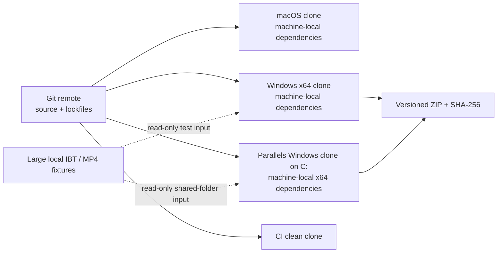
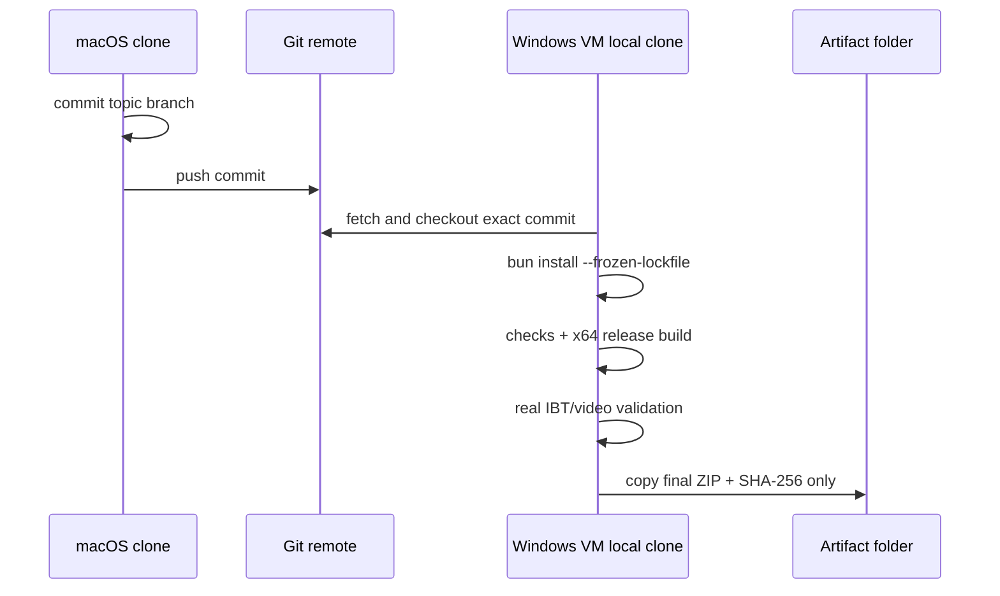
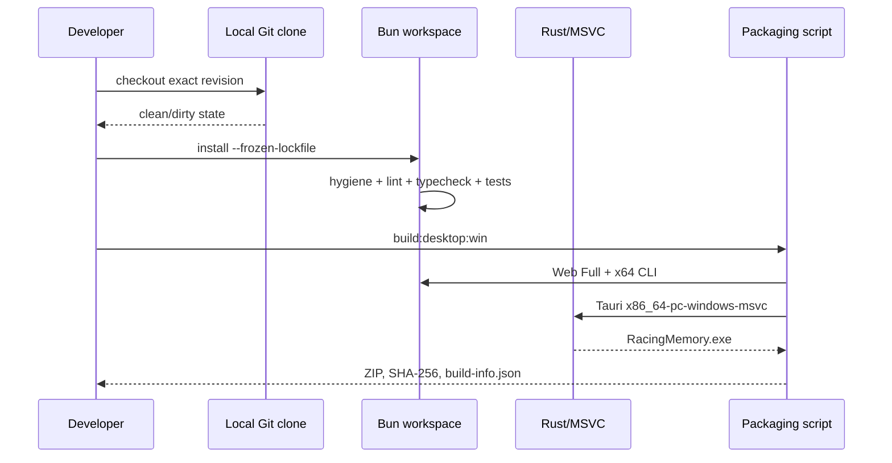

# Cross-machine development and Windows release builds

This is the canonical operating standard for collaborating on LapWing from
macOS, Linux, native Windows x64, and Windows 11 running in Parallels Desktop on
Apple Silicon. It applies to people, CI, and coding agents.

The core rule is simple:

> Git transfers source and lockfiles. Each machine installs its own dependencies
> and produces its own build output. File sharing transfers test inputs or final
> artifacts only.

Do not synchronize a working tree, `.git`, `node_modules`, `target`, `dist`, or
tool caches between operating systems.

## 1. Source-of-truth architecture

> Scope: developer workstations, the Git remote, CI, and Windows release output;
> updated 2026-11-10; evidence: `.gitignore`, `.gitattributes`, `.bun-version`,
> `rust-toolchain.toml`, `bun.lock`, `apps/desktop/src-tauri/Cargo.lock`,
> `scripts/build-windows-desktop.mjs`.



| Layer | Shared between machines | Never shared between machines |
| --- | --- | --- |
| Source | Git commits, branches, tags, PRs | copied working directories |
| Dependency contract | `bun.lock`, `Cargo.lock`, version files | `node_modules`, Cargo registry/cache |
| Configuration schema | `.env.example` | `.env`, credentials, OBS passwords |
| Test data | documented fixture source and hashes | personal recordings in the repository |
| Release | ZIP, SHA-256, build metadata | unpacked `dist`, `target`, sidecar intermediates |

## 2. Repository hygiene mechanisms

The repository enforces the policy with standard open-source files:

- `.gitignore` excludes dependencies, caches, generated builds, local telemetry,
  editor files, and OS metadata at every directory depth.
- `.gitattributes` normalizes source to LF, keeps Windows command files CRLF,
  marks binary formats, and routes published ZIPs through Git LFS.
- `.editorconfig` gives editors the same UTF-8, indentation, and line-ending
  defaults.
- `.bun-version` and `package.json#packageManager` pin Bun.
- `rust-toolchain.toml`, `bun.lock`, and
  `apps/desktop/src-tauri/Cargo.lock` pin native build inputs.
- `beta-proxy` is part of the root Bun workspace; its manual deploy uses a
  pinned `bunx wrangler` and must not create a nested npm lockfile.
- `bun run repo:hygiene` fails when generated directories, secondary lockfiles,
  or OS metadata become tracked, and confirms release ZIPs use LFS.
- CI runs the hygiene check before ESLint.

Run these checks before sending a PR:

```bash
bun install --frozen-lockfile
bun run repo:hygiene
bun run lint
bun run typecheck
bun run test:run
bun run build
```

`git clean -ndX` is useful only as a preview of ignored files. Do **not** turn it
into `git clean -fdX` in a real working copy: it would also delete intentionally
ignored `.env`, `data/`, and local recordings.

### Tracked versus generated files

| Category | Policy |
| --- | --- |
| `bun.lock` | commit; sole JavaScript dependency lock |
| Desktop `Cargo.lock` | commit; this is an application, not a Rust library |
| npm/yarn/pnpm lockfiles | reject |
| `node_modules/` anywhere | generate locally; never copy or commit |
| `dist*`, `target`, coverage, caches | generate locally; never commit |
| `data/`, IBT, MP4 | local only unless a deliberately small redistributable fixture is reviewed |
| `release/*.zip` | deliberate release artifact only; Git LFS + checksum |
| `.env*` secrets | local/CI secret store only; `.env.example` documents names |

## 3. Toolchain contract

| Tool | Required source |
| --- | --- |
| Git + Git LFS | current supported release |
| Bun | version in `.bun-version`; use the host architecture unless the Windows x64 rule below applies |
| Node | version in `.nvmrc`; only for hosting tooling that explicitly requires Node, not workspace installs |
| Rust | version in `rust-toolchain.toml` through rustup |
| Windows compiler | Visual Studio 2022 Build Tools, Desktop development with C++, MSVC x64 tools, Windows 11 SDK |
| Tauri runtime | Microsoft Edge WebView2, present on supported Windows 11 |
| Media tools | Windows x64 `ffmpeg.exe` and `ffprobe.exe` from the same release |

After changing a dependency:

1. change the relevant manifest;
2. run `bun install` and/or `cargo update -p <package>` intentionally;
3. review and commit the matching lockfile;
4. run the green checks;
5. never regenerate a lockfile independently on multiple machines and merge both.

## 4. Standard native Windows 11 x64 build

Build from a local NTFS path such as `C:\src\racing-memory`, not OneDrive, a
network drive, or a shared folder.

### One-time setup

```powershell
git lfs install
git config --global core.longpaths true
git clone https://github.com/<owner>/<repo>.git C:\src\racing-memory
cd C:\src\racing-memory

# Install the Bun version named in .bun-version, then:
bun --version
rustup show
rustup target add x86_64-pc-windows-msvc
```

Install Visual Studio Build Tools with the C++ workload and x64 MSVC/Windows SDK.
Keep FFmpeg outside the repository, for example under `C:\release-tools\ffmpeg`.

### Clean build from an exact revision

```powershell
cd C:\src\racing-memory
git fetch --all --prune
git switch <topic-branch>
git pull --ff-only
git lfs pull
git status --short

bun install --frozen-lockfile
bun run repo:hygiene
bun run lint
bun run typecheck
bun run test:run

$env:RACING_MEMORY_FFMPEG = "C:\release-tools\ffmpeg\bin\ffmpeg.exe"
$env:RACING_MEMORY_FFPROBE = "C:\release-tools\ffmpeg\bin\ffprobe.exe"
bun run build:desktop:win
```

The build script refuses non-Windows and non-x64 Bun processes, clears stale
release output, builds Web Full, compiles the x64 CLI sidecar and Tauri app,
smoke-tests packaged capabilities, and emits:

```text
dist/RacingMemory-win11-x64/
dist/RacingMemory-win11-x64.zip
dist/RacingMemory-win11-x64.zip.sha256
```

For a publishable release, `build-info.json` must contain the intended branch
and commit without a `-dirty` suffix. A `-dirty` package is suitable for local
validation only.

## 5. Standard Apple Silicon + Parallels Desktop build

The guest may be Windows 11 ARM, but the release remains Windows x64. Use the
x64 Bun runtime under Windows emulation and the Rust
`x86_64-pc-windows-msvc` target. `scripts/build-windows-desktop.mjs` verifies
that the Bun process reports `win32/x64`.

### Required layout

```text
macOS working copy           Git commit/push only
        │
        ▼
Git remote
        │ fetch/checkout exact commit
        ▼
C:\src\racing-memory         guest-local clone and dependencies
C:\release-tools             guest-local x64 FFmpeg
C:\build-validation          guest-local generated test output
\\Mac\BuildArtifacts         optional final ZIP/SHA handoff only
\\Mac\TestData               optional read-only IBT/MP4 input only
```

Never run the release build from `\\Mac\...`, `W:\...`, or a macOS working copy
mounted into Windows. Shared folders have different ownership, symlink,
case-sensitivity, locking, and I/O behavior. In particular:

- macOS `node_modules` contains Darwin native packages and Unix symlinks;
- Windows needs Windows x64 packages and Bun command shims;
- copying `.git` can trigger dubious-ownership failures;
- copying `target` or `dist` can make stale binaries look current;
- recursive mirroring can delete or duplicate local-only files.

### Handoff sequence



Prefer a temporary commit on a topic branch even for validation; it records
exactly what was built. If remote push is temporarily impossible, create a Git
bundle or `git diff --binary` patch and apply it to a disposable guest clone.
Do not use `robocopy /MIR` on the repository.

When automating from macOS, run user-facing tests as the logged-in Windows user:

```bash
prlctl exec "Windows 11" --current-user cmd.exe /c "whoami"
```

This matters because scorecard rendering launches headless Microsoft Edge.
`prlctl exec` without `--current-user` commonly runs as `SYSTEM`; Edge may fail,
Git may reject repository ownership, and the result does not represent the
Desktop user's environment.

Large IBT/MP4 inputs may remain on a read-only shared folder, but generate
reports and videos on `C:`. Copy only final evidence or release archives back to
the host.

## 6. Build and handoff interfaces

| Interface | Producer | Consumer | Preconditions | Output |
| --- | --- | --- | --- | --- |
| Git commit | any development machine | all other machines/CI | reviewed source and lockfile changes | immutable revision |
| `bun install --frozen-lockfile` | lockfile | local Bun cache | matching pinned Bun version | host-native dependencies |
| `bun run build:desktop:win` | Windows local clone | release tester | x64 Bun, Rust/MSVC, FFmpeg paths | portable ZIP + SHA |
| `build-info.json` | build script | tester/support | Git metadata readable | version, branch, hash, dirty state |
| shared test data | host storage | VM validation | read-only IBT/MP4 | input only |
| release artifact handoff | Windows builder | host/release process | build and smoke checks passed | ZIP and checksum only |

### Windows release build sequence



## 7. Validation and failure boundaries

Every Windows candidate should be validated in this order:

1. verify ZIP checksum and `build-info.json`;
2. confirm `delivery generate` appears in packaged CLI help;
3. run scorecard-only generation from a real IBT;
4. run full generation from IBT + MP4, accepting low-confidence sync only when
   evidence has been reviewed;
5. ffprobe every generated MP4;
6. open the Desktop result and human-readable HTML;
7. open LapWing deep analysis and confirm one telemetry request, HTTP Range video,
   map, laps, charts, and synchronization;
8. repeat a smoke test in a clean Windows user profile.

| Failure | Meaning | Recovery |
| --- | --- | --- |
| frozen install changes/fails | manifest and lockfile disagree, or dependency download failed | fix lockfile/network; never copy another OS's `node_modules` |
| `process.arch` is not x64 | wrong Bun executable in ARM guest | install/run Windows x64 Bun |
| Git dubious ownership | clone copied or executed as another account | use a user-owned local clone; do not copy `.git` |
| Edge screenshot fails under `SYSTEM` | wrong validation identity | rerun with `prlctl exec --current-user` |
| package hash is `unknown` | Git metadata unavailable to build | build inside the actual clone |
| package hash ends in `-dirty` | uncommitted tracked changes were built | local validation only; commit and rebuild for release |
| Windows-only `Intl` text differs | locale-sensitive assertion | make the test locale explicit; do not hide unrelated failures |
| output is unexpectedly old | stale local build directory or wrong ZIP | inspect `build-info.json` and checksum; rebuild from exact revision |

## 8. Agent checklist

Before an agent builds or validates on another machine:

1. read `AGENTS.md` and this document;
2. report branch, commit, and dirty status;
3. use Git for source handoff;
4. install dependencies locally with frozen lockfiles;
5. never copy ignored dependency/build directories;
6. use `--current-user` for Parallels UI/Edge validation;
7. record toolchain versions, input hashes, build-info, output checksum, and test
   results;
8. update the relevant numbered plan as validation proceeds.
