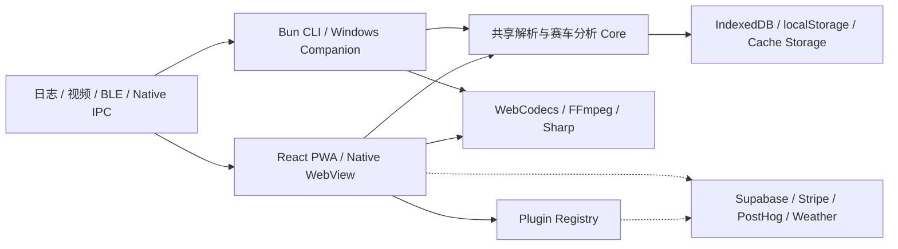
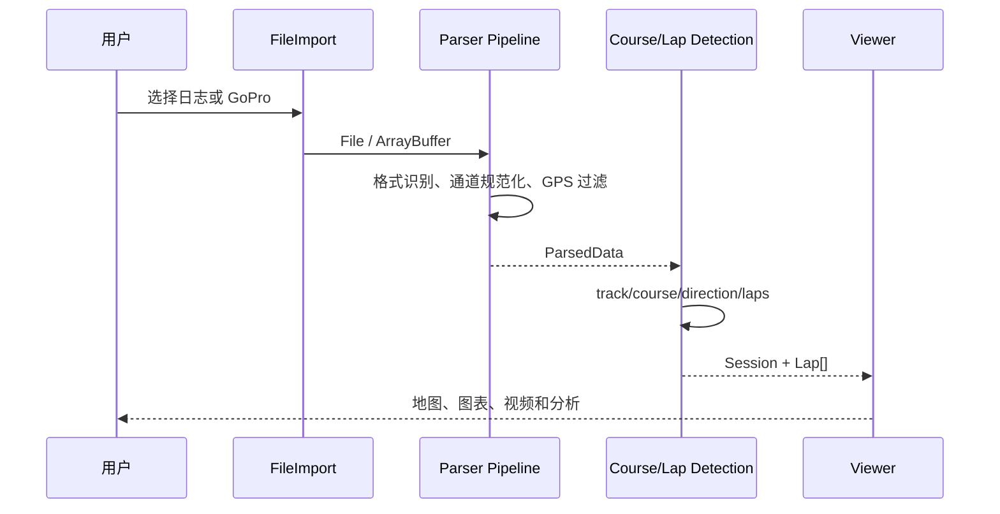
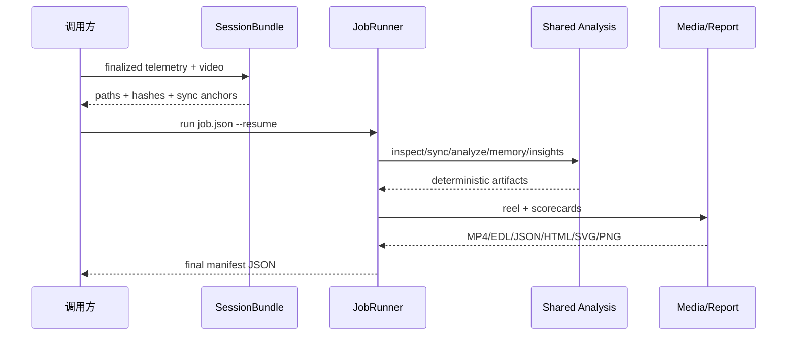

# LapWing 功能总览

> 文档用途：快速回答“这个项目现在能做什么”，并作为功能导航和维护入口  
> 系统范围：Dove's DataViewer / LapWing Web PWA、Native 壳、Bun CLI、可选云插件  
> 更新时间：2026-11-05  
> 主要证据：`apps/web/src/pages/Index.tsx`、`apps/cli/src/lapwing.ts`、
> `apps/web/src/plugins/`、`packages/telemetry-core/`、
> `README.md`、`docs/subsystems.md`

## 1. 一句话定位

LapWing 是一个 **offline-first 的赛车遥测查看、圈速分析和视频内容生产工具**。
它可以在浏览器或 Native 壳中读取多种实车/模拟器日志，自动识别赛道和圈次，
进行地图、图表、参考圈和驾驶差异分析，并把遥测与比赛录像同步。可选的云功能
提供跨设备同步、分享、排行榜和公开车手主页；Bun CLI 则把 iRacing/OBS 采集、
精彩视频、成绩单和驾驶建议串成可恢复的自动化流水线。

核心原则没有变化：

- 默认本地处理，遥测不需要上传；
- PWA 安装后可离线使用；
- 核心功能不依赖账号或后端；
- 云端、天气、在线地图、统计和 AI Coach 都是可选能力。

默认发布的是面向游戏的 **Sim Profile**；它保留 iRacing、普通视频、车库、
setup、分析、排行榜和云同步。**Full Profile** 额外启用 BLE/Native logger、
DFU、MyChron、Alfano、手机 logger 与 GoPro 遥测导入。Native/Web 与 Profile
是两个独立维度。

## 2. 能力地图

| 能力域 | 已有能力 | 默认运行位置 |
| --- | --- | --- |
| 数据接入 | 多格式文件、GoPro GPS、Web/Native 记录仪下载、合成 IBT | 浏览器 / Native / CLI |
| 圈速分析 | 自动赛道/方向/圈次、sector、sprint、drag、optimal、delta | 本地 |
| 可视化 | 地图、速度热力、制动区、多通道图、G-G、MiniMap、多圈叠加 | 本地 |
| 视频 | 遥测同步、GoPro 分段、overlay、MP4 导出、Racing Memory | 本地 |
| 车库与记录 | 文件、车辆、引擎、setup、修订历史、笔记、赛后胎压和重量 | IndexedDB |
| 硬件 | DovesDataLogger BLE、设备设置、赛道同步、固件 OTA | Web BLE / Native |
| 社区 | 云同步、共享链接、排行榜、车手主页、赛道提交 | 可选云 |
| 自动化 | Bundle、Job、同步建议、60/90 秒 reel、成绩单、驾驶建议 | Bun CLI |
| 平台 | PWA、Android/Tauri、固件模拟器、8 种语言、隐私控制 | 多平台 |

## 3. 用户可以完成的主要工作流

### 3.1 导入一场比赛并自动分析

支持自动识别：

- u-blox UBX；
- iRacing 原生 `.ibt`；
- Racelogic VBO；
- Dove / Dovex / 手机 `.dovep`；
- Alfano CSV；
- AiM CSV、XRK、XRZ；
- MoTeC CSV、LD；
- NMEA；
- 带 GPMF GPS 的 GoPro MP4/MOV。

导入后统一经过：

1. 格式检测和解析；
2. 通道名称规范化；
3. GPS 质量过滤；
4. 赛道、course 和行驶方向检测；
5. 圈次与 sector 计算；
6. 地图、图表、视频和后续分析。

未知赛道会进入 waypoint 模式。站立起步且符合直线加速特征的数据会优先进入
drag 模式，可输出 60/330/660/1000/1320 英尺分段和 ET。

主要入口：

- `src/lib/datalogParser.ts`
- `src/lib/courseDetection.ts`
- `src/lib/lapCalculation.ts`
- `src/lib/dragRunDetection.ts`
- `src/lib/gpsQualityFilter.ts`

### 3.2 查看圈速、线路和驾驶数据

Simple 模式提供：

- Leaflet 赛道地图；
- 速度热力图；
- 制动区；
- Canvas 遥测图；
- 圈次选择、范围裁剪和 sector 裁剪。

Pro Graph 模式提供：

- 多通道可组合图表；
- G-G 图；
- MiniMap；
- 可调整大小的图卡；
- 第二叠图和第二路同步视频；
- 同一赛道位置上的多圈同步光标。

参考比较包括：

- 当前会话多圈 overlay；
- Kabsch GPS 漂移对齐；
- 最快圈或手选圈作为 reference；
- 跨会话 Lap Snapshot；
- 外部文件 reference lap；
- 基于赛道位置或累计距离的 pace delta。

主要入口：

- `src/components/RaceLineView.tsx`
- `src/components/TelemetryChart.tsx`
- `src/components/graphview/`
- `src/lib/lapDelta.ts`
- `src/lib/lapAlignment.ts`
- `src/hooks/useReferenceLap.ts`
- `src/hooks/useLapSnapshots.ts`

### 3.3 管理赛道和计时方式

内置 Track/Course 数据来自 `public/tracks.json`。用户可以：

- 给会话分配 Track/Course；
- 创建本地自定义赛道；
- 编辑起终点线；
- 创建 circuit 或 sprint course；
- 编辑最多 25 条 timing line；
- 指定三条 major sector line；
- 绘制或自动生成 course layout；
- 登录后把本地赛道差异提交到社区库。

`Course.layout` 或 `public/drawings.json` 也会用于赛道图片和成绩单；没有布局时回退
到遥测 GPS 轨迹。

主要入口：

- `src/components/TrackEditor.tsx`
- `src/components/track-editor/`
- `src/lib/courseSectors.ts`
- `src/lib/trackSubmission.ts`

### 3.4 同步和导出比赛视频

视频能力包括：

- 单文件视频同步；
- GoPro 多 chapter 虚拟时间轴；
- 遥测播放光标联动；
- 9 类 overlay widget；
- H.264 + AAC MP4 导出；
- Native 壳硬件转码导出；
- Native Insta360 相机流和 360° 视角控制。

Racing Memory 会从 iRacing 遥测中识别：

- 最快圈；
- 名次提升；
- incident 增加；
- 会话结束。

浏览器可逐个导出片段；CLI 可按事件分数和多样性规划 60/90 秒预算，合并重叠窗口，
生成带舍弃原因的 EDL，并通过 FFmpeg 拼接成一条 reel。

主要入口：

- `src/components/VideoPlayer.tsx`
- `src/components/video-overlays/`
- `src/lib/videoPlaylist.ts`
- `src/lib/videoExport.ts`
- `src/lib/racingMemoryHighlights.ts`
- `src/lib/memoryStory.ts`
- `src/cli/reel.ts`
- `docs/racing-memory.md`

### 3.5 管理文件、车辆、Setup 和赛后记录

本地 IndexedDB 中可管理：

- Track → Course → Session 文件树；
- 车辆和引擎；
- 车辆类型与 setup 模板；
- setup 表；
- content-addressed setup revision；
- setup 和车辆历史；
- 每场 session 的笔记；
- 赛后胎压和重量；
- 视频同步、graph preferences 和 lap snapshot。

会话可以绑定车辆、引擎和某个冻结的 setup revision，便于在跨场次对比圈速时知道
当时实际使用的配置。

主要入口：

- `src/components/FileManagerDrawer.tsx`
- `src/components/drawer/`
- `src/lib/fileStorage.ts`
- `src/lib/setupRevisionStorage.ts`
- `src/lib/setupHistory.ts`
- `src/lib/vehicleHistory.ts`

### 3.6 连接 DovesDataLogger 和其它设备

目前设备侧能力包括：

- Web Bluetooth 连接 Fledgling / DovesDataLogger；
- 查看并下载设备日志；
- Native BLE IPC 下载同一硬件日志；
- 修改设备设置、LED 和时区；
- 同步 Track/Course 到记录仪；
- Web/Native 固件 OTA；
- Native Wi‑Fi 下载 MyChron 数据；
- 固件 WASM 模拟器；
- 手机 GPS Lap Timer。

Alfano Bluetooth Serial 目前只有 Web 侧协议 seam，Native Rust 后端仍是 skeleton；
手机 Lap Timer、座椅位置和药丸对齐工具仍标记为实验功能。

主要入口：

- `src/components/LoggerDownload.tsx`
- `src/lib/loggers/`
- `src/lib/ble/`
- `src/components/drawer/DeviceTracksTab.tsx`
- `src/pages/Simulator.tsx`
- `src/plugins/tools/`
- `docs/ble.md`
- `docs/ble-protocol.md`

### 3.7 使用云同步和社区功能

云功能由 `VITE_ENABLE_CLOUD` 和 `cloud-sync` 插件控制；关闭后核心应用仍可完整运行。

开启后可用：

- 邮箱账号、登录和找回密码；
- 文件和 garage 跨设备同步；
- 按文件选择是否上传；
- Lap Snapshot 云存储；
- opaque token 共享链接 `/s/:token`；
- 公开排行榜；
- 车手公开主页；
- 社区 Track/Course 提交；
- 云端用量和订阅管理；
- GDPR 数据导出和预约删号；
- Updates 博客。

Admin 构建还提供 Track、Course、提交、用户、排行榜、消息、支持工单、博客和封禁 IP
等后台管理页面。

主要入口：

- `src/plugins/cloud-sync/`
- `src/pages/Leaderboards.tsx`
- `src/pages/DriverProfile.tsx`
- `src/pages/Updates.tsx`
- `src/pages/Admin.tsx`
- `docs/backend.md`

### 3.8 用 CLI 自动生成比赛内容

CLI 入口是：

```bash
bun run lapwing -- <command>
```

当前命令包括：

- `inspect`：检查遥测、圈次和通道；
- `fixture ibt`：生成确定性合成 IBT；
- `bundle create|validate`：创建和验证带 hash 的 Session Bundle；
- `sync suggest`：给出 offset/rate、confidence 和 evidence；
- `analyze`：生成 session analytics；
- `memory detect|render|reel`：识别、单片段导出和精彩合集；
- `report render --images N`：生成 JSON、HTML、SVG 和 PNG 成绩单；
- `coach insights`：生成确定性驾驶优化建议；
- `run --resume|--from|--dry-run`：执行可恢复的完整流水线；
- `capture watch`：连接 mock 或 Windows iRacing + OBS companion。

完整 Job 流程为：

```text
inspect → sync → analyze → memory → reel → report → insights
```

Windows companion 可读取 iRacing shared memory，控制 OBS WebSocket，等待 IBT/MP4
停止写入，记录双时间锚点并输出 `SessionBundleV1`。当前 Bun FFI provider 仍需在真实
Windows 长赛、重连和句柄释放场景完成发布门禁验收。

主要入口：

- `apps/cli/src/lapwing.ts`
- `apps/cli/src/pipelineRunner.ts`
- `apps/cli/src/companion/`
- `apps/windows-companion/`
- `packages/telemetry-core/src/sessionBundle.ts`
- `packages/telemetry-core/src/jobManifest.ts`
- `src/lib/sessionAnalytics.ts`
- `src/lib/drivingInsights.ts`
- `docs/plans/0033-race-automation-pipeline.md`

## 4. 平台与功能边界

| 平台/模式 | 可用能力 | 明确边界 |
| --- | --- | --- |
| Web/PWA | 导入、分析、管理、BLE、视频、离线缓存 | Web Bluetooth 和 WebCodecs 取决于浏览器 |
| Android/Tauri | Web 能力 + Native BLE/Wi‑Fi/视频存储与导出 | 不注册 Service Worker；不在 App 内销售订阅 |
| Bun CLI | 批处理、FFmpeg、Sharp、Job、companion | 不是 SPA UI；媒体命令需要本机工具 |
| Offline-only build | 所有核心分析和本地管理 | 无账号、分享、排行榜、天气和在线瓦片 |
| Cloud-enabled build | 同步、分享、排行榜、主页、订阅 | 需要 Supabase、联网和相应构建开关 |
| Admin build | 社区内容和用户后台 | 需要 `VITE_ENABLE_ADMIN` 与管理员权限 |

## 5. 总体架构

> 图范围：当前仓库的稳定模块边界  
> 更新时间：2026-11-05  
> 实线证据：`src/main.tsx`、`src/pages/Index.tsx`、`src/plugins/`、`src/cli/`、
> `src/lib/dbUtils.ts`；虚线表示可选外部服务。



浏览器和 CLI 复用纯解析、圈速、同步、精彩事件、统计和驾驶建议模块。浏览器负责
交互式查看和本地数据管理；CLI 负责确定性批处理；Native 壳只补充浏览器无法访问的
硬件和文件系统能力；云端不参与核心遥测计算。

## 6. 核心数据时序

### 6.1 浏览器导入

> 失败边界：格式无法识别、文件损坏、GPS 无效、课程无法检测。解析失败保持本地，
> 用户可选择在线提交支持报告。



代码映射：

1. `src/components/FileImport.tsx`：输入入口。
2. `src/lib/datalogParser.ts`：格式路由。
3. `src/lib/channels.ts`、`src/lib/gpsQualityFilter.ts`：统一后处理。
4. `src/lib/courseDetection.ts`、`src/lib/lapCalculation.ts`：圈速模型。
5. `src/pages/Index.tsx`：会话编排。

### 6.2 CLI 自动化

> 失败边界：bundle hash 不一致、输入仍在写入、同步置信度低、FFmpeg/Sharp 不可用、
> Job dependency 失败。所有长任务进度写 stderr NDJSON，最终 stdout 保持单一 JSON。



代码映射：

1. `apps/cli/src/bundleCommands.ts`：输入完成和 bundle。
2. `apps/cli/src/pipelineRunner.ts`：状态机、hash、resume。
3. `apps/cli/src/pipelineHandlers.ts`：步骤适配。
4. `apps/cli/src/reel.ts`、`apps/cli/src/report.ts`：媒体与成绩单。

## 7. 在线依赖与隐私

默认离线能力不会上传遥测。以下功能才访问网络：

- CARTO/Esri 地图瓦片和 Wayback 元数据；
- 历史天气；
- 用户主动启用的云同步、分享、社区和订阅；
- 可选 AI Coach；
- 可选、cookieless、可关闭的 PostHog pageview/pageleave；
- 用户主动提交的支持消息或赛道贡献。

PostHog 不启用 autocapture、session replay、survey 或 feature flag；DNT/GPC、Native、
iframe、`?nosw=1` 和关闭 “Send usage stats” 时不发送。

详细说明：

- `src/pages/Privacy.tsx`
- `src/lib/analytics.ts`
- `docs/backend.md`

## 8. 已知未完成或实验性能力

- Alfano Native Bluetooth Serial 后端尚未实现；
- GoPro `.360` 已接受但缺少真实设备覆盖；
- 手机 Lap Timer、座椅位置和药丸对齐工具仍标记为实验；
- Windows iRacing shared-memory companion 使用 experimental Bun FFI，真实 Windows
  长赛验收仍是发布门禁；
- Native Insta360 相机流暂不能直接导出精彩片段；
- AI Coach 来自可选外部插件，不属于核心离线仓库能力；
- 天气、在线地图、分享和云同步无法在完全离线时工作。

## 9. 文档导航

- 架构与深层子系统：`docs/subsystems.md`
- 云端、订阅与 GDPR：`docs/backend.md`
- BLE 集成：`docs/ble.md`
- BLE wire protocol：`docs/ble-protocol.md`
- Android/Tauri：`docs/android.md`
- 国际化：`docs/i18n.md`
- Racing Memory：`docs/racing-memory.md`
- 比赛自动化 CLI：`docs/plans/0033-race-automation-pipeline.md`
- 插件开发：`src/plugins/README.md`

## 10. 维护约定

新增或删除用户能力时，应同步更新：

1. 本文对应能力域；
2. `README.md` 的 Features 或 Supported Formats；
3. `CHANGELOG.md`；
4. 相关专项文档；
5. `CLAUDE.md` 架构地图（仅当模块边界发生变化）。

平台限制或实验状态改变时必须同时修改本文第 4、8 节，避免把 skeleton、构建可选
或 Native-only 功能写成默认可用。
