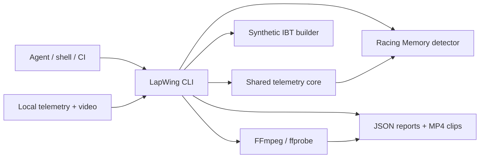
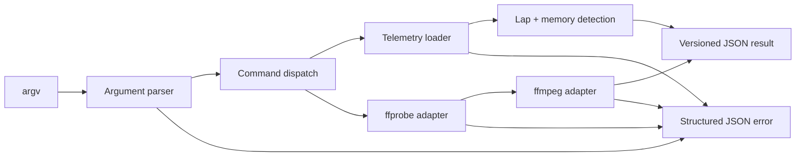
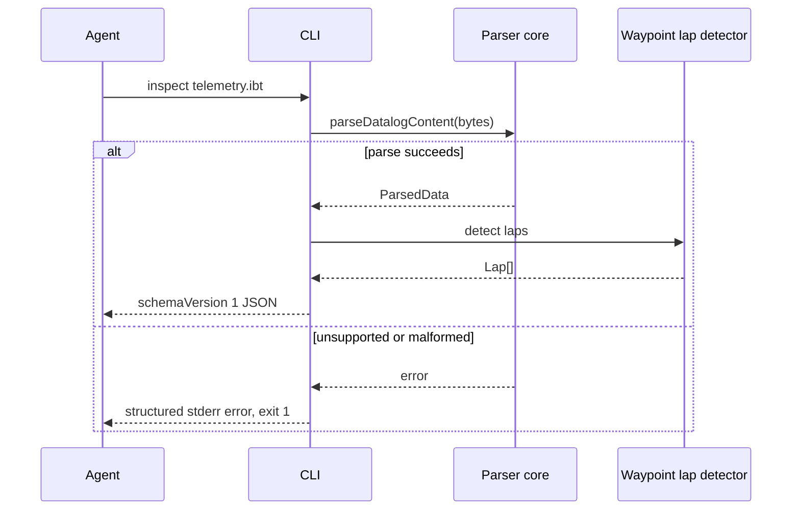
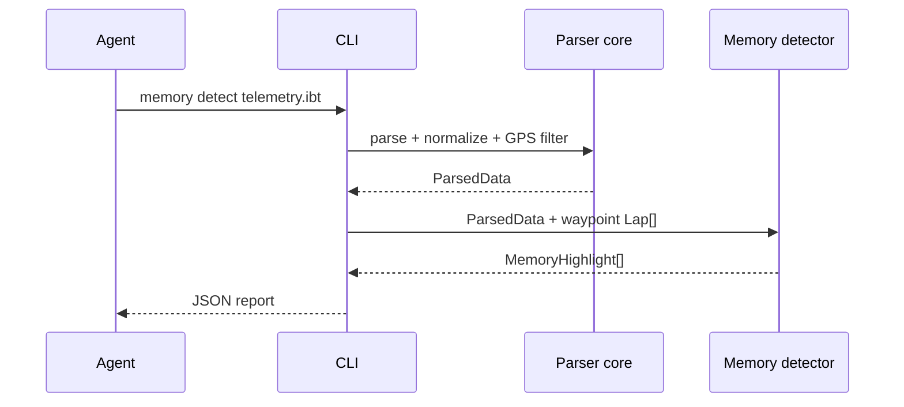
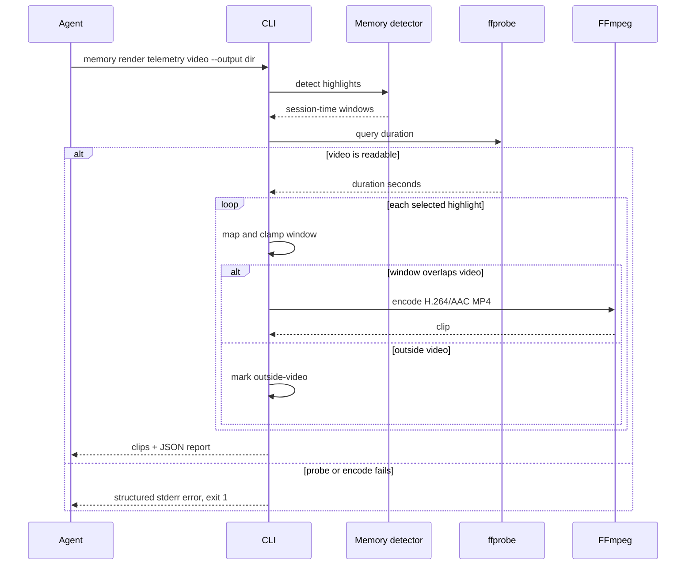
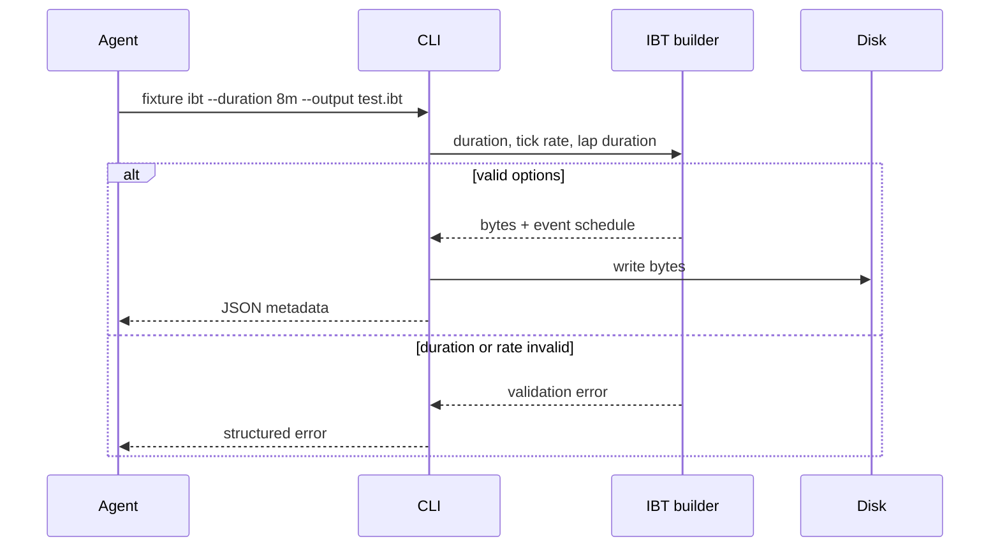

# Plan 0032 — Agent-friendly CLI

## 1. Goal and scope

LapWing's reusable telemetry logic is currently easiest to reach through the
React application. This plan adds a deterministic, non-interactive Bun CLI so
agents, scripts, and CI can parse telemetry, inspect sessions, detect Racing
Memory events, render clips with FFmpeg, and create synthetic `.ibt` fixtures.

MVP commands:

```text
lapwing inspect <telemetry>
lapwing memory detect <telemetry>
lapwing memory render <telemetry> <video> --output <directory>
lapwing fixture ibt --duration <duration> --output <file.ibt>
```

The CLI is offline-first. It reads local files, emits JSON, and makes no network
requests. Browser-only capabilities such as IndexedDB, Web Bluetooth, React
panels, and WebCodecs remain in the web adapter.

## 2. Overall module architecture

> Scope: headless telemetry and Racing Memory flow  
> Updated: 2026-11-04  
> Evidence: `src/cli/`, `src/lib/datalogParser.ts`,
> `src/lib/racingMemoryHighlights.ts`, `src/lib/videoTimeline.ts`



| Module | Responsibility | Code | Boundary |
| --- | --- | --- | --- |
| CLI entry | Parse arguments, dispatch commands, JSON errors | `src/cli/lapwing.ts` | stdin is unused; stdout is machine output |
| CLI orchestration | File loading, reports, lap fallback, FFmpeg calls | `src/cli/core.ts` | Node/Bun filesystem and subprocess APIs |
| Fixture builder | Produce deterministic parser-compatible IBT bytes | `src/cli/ibtFixture.ts` | Not claimed to be iRacing-authored telemetry |
| Parser core | Detect and parse telemetry, normalize channels | `src/lib/datalogParser.ts` | Existing shared `ParsedData` contract |
| Memory core | Generate deterministic highlight windows | `src/lib/racingMemoryHighlights.ts` | Pure `ParsedData + Lap[] → highlights` |
| Timeline core | Map session milliseconds to video seconds | `src/lib/videoTimeline.ts` | Pure offset/rate model |
| FFmpeg adapter | Probe video and encode clips | external executable | Required only by `memory render` |

## 3. CLI subsystem architecture

> Scope: one CLI process  
> Updated: 2026-11-04  
> Evidence: `src/cli/lapwing.ts`, `src/cli/core.ts`



Key decisions:

- Output schemas carry `schemaVersion: 1`.
- Success JSON goes to stdout; structured errors go to stderr.
- Commands are non-interactive and never prompt.
- Lap detection reuses the app's `autoDetectCourse` against the bundled
  `public/tracks.json` (or `--tracks <file>`), reporting `laps.source` as
  `track` (with `track`/`course` names) or `waypoint` when the session isn't at
  a known venue. Forcing waypoint mode everywhere split real OKC laps in half
  (~8 s / ~48 s), so known tracks win, exactly as on import in the app.
- Argument parsing is strict: unknown options, extra positionals, and value
  flags with a missing/empty value fail with exit 2 instead of being ignored —
  an agent's typo must never silently change the result.
- `memory render` requires locally installed `ffmpeg` and `ffprobe`; paths are
  overridable for hermetic runners.
- The detector moved from plugin ownership to `src/lib`, while a compatibility
  facade keeps existing plugin imports stable.

## 4. Interface catalog

| Command | Inputs | Preconditions | Output |
| --- | --- | --- | --- |
| `inspect` | telemetry path | supported synchronous parser format | telemetry and lap JSON |
| `memory detect` | telemetry path | race-state fields optional | inspect data plus highlights |
| `memory render` | telemetry path, video path, output directory | FFmpeg available, video readable | clips plus render report |
| `fixture ibt` | duration, output path | duration ≥30 seconds | synthetic `.ibt` and event schedule |

### Stable process behavior

| Stream/status | Meaning |
| --- | --- |
| stdout | One JSON document on success |
| stderr | One JSON error document on failure |
| exit `0` | Command completed |
| exit `2` | CLI usage or argument failure |
| exit `1` | Parse, filesystem, ffprobe, or FFmpeg failure |

Error codes: usage (exit 2) — `UNKNOWN_COMMAND`, `UNKNOWN_OPTION`,
`UNEXPECTED_ARGUMENT`, `INVALID_ARGUMENT`, `INVALID_KIND`, `MISSING_INPUT`,
`MISSING_OUTPUT`; runtime (exit 1) — `FILE_NOT_FOUND`, `FILE_UNREADABLE`,
`PARSE_FAILED`, `BINARY_NOT_FOUND`, `BINARY_FAILED`. `--report` paths and the
FFmpeg binary are checked before any work starts. Parser diagnostics may also
appear on stderr on success; use `bun run --silent lapwing` (or run
`src/cli/lapwing.ts` directly) to drop Bun's script echo. `lapwing version`
prints the app version as JSON.

## 5. Command sequence: `inspect`

> Scope: telemetry inspection  
> Updated: 2026-11-04  
> Evidence: `loadTelemetry`, `createInspectReport`



## 6. Command sequence: `memory detect`

> Scope: headless Racing Memory detection  
> Updated: 2026-11-04  
> Evidence: `createMemoryDetectReport`,
> `detectMemoryHighlights`



Missing race-state channels are not fatal. The detector still emits best-lap
when laps exist and finish when the session has samples.

## 7. Command sequence: `memory render`

> Scope: local clip rendering  
> Updated: 2026-11-04  
> Evidence: `renderMemoryClips`, `sessionMsToVideoSec`



Inputs affecting synchronization:

- `--sync-offset-ms`: session time corresponding to video time zero.
- `--sync-rate`: video/session clock-rate ratio.
- `--kind`: optional comma-separated highlight filter.

## 8. Command sequence: `fixture ibt`

> Scope: deterministic test data generation  
> Updated: 2026-11-04  
> Evidence: `src/cli/ibtFixture.ts`



The fixture contains a circular GPS trace, driver inputs, two position gains,
one incident-count increase, and a final position. It exercises LapWing's parser
and detector but is not intended for other iRacing tools.

## 9. Runtime and verification

Run from the repository:

```bash
bun run lapwing -- inspect session.ibt
bun run lapwing -- memory detect session.ibt
bun run lapwing -- memory render session.ibt recording.mp4 --output clips
bun run lapwing -- fixture ibt --duration 8m --output synthetic.ibt
```

Validation:

- fixture builder parses through the unified parser;
- race-state channels normalize to stable `custom:*` keys;
- duration parsing and timeline mapping have unit coverage;
- existing Racing Memory detector tests remain the regression source;
- an end-to-end render uses the generated fixture and a local MP4.

## 10. Limits and follow-ups

- MVP synchronous parsing excludes worker-backed XRK/XRZ and ranged GoPro
  telemetry extraction.
- CLI lap timing uses the bundled (or a supplied) `tracks.json`, not the
  browser's user-defined tracks in localStorage.
- `telemetry.format` is the file extension, not the detected parser.
- FFmpeg is an external runtime requirement and is not downloaded automatically.
- MVP renders one file per event; a single stitched reel is a follow-up.
- Future MCP or SDK adapters should invoke this CLI/core contract instead of
  duplicating parser or video logic.

## 11. Status

- [x] Shared Racing Memory detector extracted to `src/lib`
- [x] `inspect`
- [x] `memory detect`
- [x] `memory render`
- [x] `fixture ibt`
- [x] Unit tests for fixture generation, durations, and clip planning
- [ ] Stitched reel command
- [ ] Async XRK/GoPro parsing adapters
- [x] Bundled/user track-file input (`--tracks`) for precise CLI lap timing
- [x] Strict argument parsing + stable error codes
