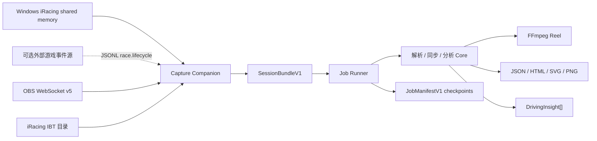
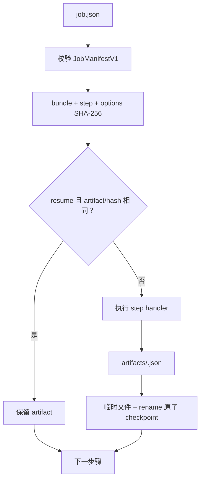
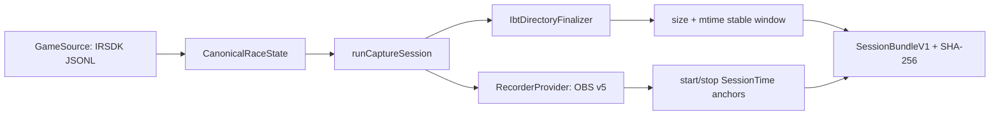
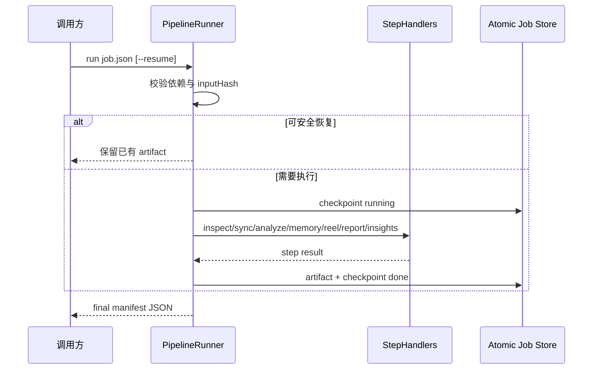
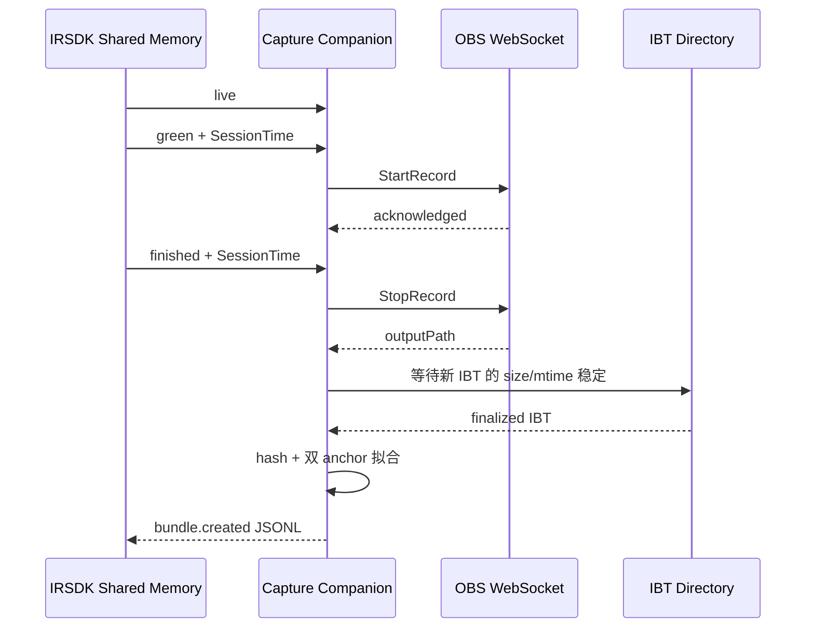

# Plan 0033：比赛自动化流水线

> 状态：已实现；真实 Windows + iRacing + OBS 验收待在目标机器执行  
> 范围：LapWing 离线 CLI、共享分析 core、Windows capture companion 协议  
> 更新时间：2026-11-04  
> 证据：`src/cli/`、`src/cli/companion/`、`src/lib/sessionBundle.ts`、
> `src/lib/jobManifest.ts`、`src/lib/memoryStory.ts`、`src/lib/sessionAnalytics.ts`、
> `src/lib/drivingInsights.ts`

## 1. 目标与边界

流水线把一场比赛的遥测与录像固化为版本化 Session Bundle，再以可恢复 Job
生成分析、精彩合集、成绩单图片和驾驶建议。所有分析和媒体处理均在本机完成。
浏览器仍负责交互式查看；CLI 负责批处理；Windows companion 负责 IRSDK 生命周期、
IBT 完成检测和 OBS 控制。TTS、配乐、旁白和云端处理不在本计划范围。

## 2. 总体模块架构

> 图范围：比赛采集到本地产物；更新时间：2026-11-04；实线证据见本文顶部代码，
> Windows IRSDK 事件生产进程是协议外部模块，故使用虚线。



模块职责：

- `src/cli/companion/`：消费规范化比赛事件、控制 OBS、等待 `.ibt` 稳定并创建 bundle。
- `src/lib/sessionBundle.ts`：跨进程会话、文件 hash、时间锚点和来源信息契约。
- `src/lib/jobManifest.ts`、`src/cli/pipelineRunner.ts`：步骤图、原子 checkpoint、hash 幂等和恢复执行。
- `src/lib/syncSuggestion.ts`：双 anchor 漂移拟合或低置信度文件时间候选。
- `src/lib/memoryStory.ts`、`src/cli/reel.ts`：目标时长 EDL、舍弃原因和 FFmpeg concat。
- `src/lib/sessionAnalytics.ts`、`src/lib/scorecardRenderer.ts`：统计模型和无网络成绩单。
- `src/lib/drivingInsights.ts`：以最快完整圈为参考的确定性时间损失证据。

## 3. 子系统架构

### 3.1 可恢复 CLI

> 图范围：`lapwing run`；证据：`src/cli/pipelineRunner.ts`、
> `src/cli/pipelineHandlers.ts`、`src/cli/jobStore.ts`。



状态转换为 `pending → running → done/failed/skipped`。进度只写 stderr NDJSON；
最终结果只写一个 stdout JSON。`--dry-run` 不改 manifest，`--from` 从指定步骤开始，
`--resume` 仅在输入 hash 和 artifact 均匹配时跳过。

### 3.2 Windows companion

> 图范围：iRacing + OBS 首版 provider；证据：`src/lib/companionProtocol.ts`、
> `src/cli/companion/capture.ts`、`obsRecorder.ts`、`jsonlGameSource.ts`。



`GameSource` 与 `RecorderProvider` 是游戏和录制器适配点。首版提供 Windows
`WindowsIracingSource`、通用 `JsonlGameSource`、`ObsWebSocketRecorder` 以及 CI 使用的 mock。浏览器和 Android
不访问 Windows shared memory。companion 不模拟 Alt-L；用户必须启用 iRacing
持续 telemetry logging。

## 4. 接口目录

- `lapwing bundle create|validate`：创建或验证文件稳定性、hash 和 bundle schema。
- `lapwing sync suggest`：输出 offset、rate、confidence、evidence 和 review gate。
- `lapwing analyze`：输出圈速、sector、车型/车手/赛道及数据质量 JSON。
- `lapwing memory reel`：输出 H.264/AAC MP4 与可审查 `.edl.json`。
- `lapwing report render`：输出 `analytics.json`、自包含 HTML、SVG 和 PNG。
- `lapwing coach insights`：输出结构化 `DrivingInsight[]`。
- `lapwing run`：执行完整 JobManifest 步骤图。
- `lapwing capture watch`：运行 mock 或 Windows `iracing-jsonl` capture provider。
- JSONL companion protocol：`race.lifecycle`、`recording.*`、`telemetry.finalized`、
  `bundle.created`、`companion.error`。

## 5. 重要接口时序

### 5.1 `lapwing run`

> 失败边界：manifest/schema 错误、hash 不匹配、低置信度 reel gate、FFmpeg/Sharp
> 失败或输入文件消失。失败步骤和稳定错误码写回 manifest。



核心映射：

1. 参数入口：`src/cli/lapwing.ts`。
2. 状态机：`src/cli/pipelineRunner.ts:runPipeline`。
3. 业务适配：`src/cli/pipelineHandlers.ts:createPipelineHandlers`。
4. 原子写和 hash：`src/cli/jobStore.ts`。

### 5.2 iRacing/OBS capture

> 前置条件：Windows、OBS WebSocket v5 已启用、iRacing 持续 telemetry logging
> 已启用。密码只从指定环境变量读取。其它游戏可通过 protocol v1 JSONL 接入。



失败边界：

- 非 Windows 使用真实 provider：立即拒绝；mock 仍可在 macOS/CI 运行。
- OBS 连接、认证或请求超时：停止且不产出伪成功 bundle。
- IBT 在超时内未出现或持续写入：`WATCH_TIMEOUT`。
- 录像时长与 SessionTime 跨度比例不合理：bundle 同步降为 `low` 并要求复核。

## 6. 数据契约摘要

`SessionBundleV1` 保存相对文件路径、`sha256:` hash、大小、完成时间、生命周期、
可选元数据、同步 anchors 和 provenance。显式 bundle 元数据优先于 iRacing
SessionInfo 推断值。

`JobManifestV1` 保存 bundle、输出目录、稳定 options、步骤依赖、每步输入 hash、
artifact、重试次数和错误。修改 bundle 或 options 会使对应步骤失去恢复资格。

`DrivingInsight` 保存圈号、参考圈、地图位置、沿圈距离、时间损失、证据列表、建议
和 low/medium/high confidence。当前只输出可由圈间 delta、制动区、最低速度、
80% 油门恢复或 sector time 直接支持的建议，不生成真实弯名。

## 7. 命令示例

```bash
bun src/cli/lapwing.ts bundle create race.ibt race.mp4 \
  --output session.bundle.json --job job.json
bun src/cli/lapwing.ts sync suggest session.bundle.json
bun src/cli/lapwing.ts memory reel session.bundle.json \
  --duration 60s --output reel.mp4
bun src/cli/lapwing.ts report render session.bundle.json \
  --images 4 --output report
bun src/cli/lapwing.ts coach insights session.bundle.json
bun src/cli/lapwing.ts run job.json --resume
```

低置信度同步默认阻止 reel。人工复核后，单命令使用
`--accept-low-confidence`；Job 使用 `options.acceptLowConfidence: true`。

Windows capture：

```powershell
$env:OBS_WEBSOCKET_PASSWORD = "<configured outside source control>"
bun src/cli/lapwing.ts capture watch `
  --provider iracing `
  --telemetry-directory "$HOME\Documents\iRacing\telemetry" `
  --output C:\LapWing\session.bundle.json
```

## 8. 验证

自动测试覆盖 bundle/job 严格校验、原子 manifest、resume、同步置信度、story
预算、analytics、SVG、driving insights、companion protocol 和 mock lifecycle。
本机端到端验收使用合成 IBT 与 487 秒测试 MP4，已生成 60/90 秒预算 EDL、reel、
4 张 1200×675 PNG、自包含 HTML、analytics 和 insights。

真实 Windows 手工验收清单：

1. 确认 iRacing 持续 telemetry logging 与 OBS WebSocket v5 已启用。
2. 验证 `connecting → live → green → finished` JSONL 及 SessionTime 单调递增。
3. 确认 green 后 OBS 开始、finished 后停止，并返回可播放文件。
4. 确认新 IBT 稳定后才创建 bundle，两个文件 hash 校验通过。
5. 确认双 anchor 为 high confidence；异常跨度必须降级而非静默接受。
6. 运行 `lapwing run job.json --resume`，核验 reel、N 张 PNG、HTML 和 insights。

当前开发环境是 macOS，无法声称第 1–6 项已在真实 iRacing/OBS Windows 主机执行；
该项是发布前目标机验收门禁，不影响 mock/协议和离线下游的自动化验证。
`WindowsIracingSource` 当前通过 Bun FFI 调用 `kernel32` 的只读 file-mapping API；
Bun 将 FFI 标为 experimental，因此目标机验收还必须覆盖长赛、重连和句柄释放。
若其稳定性不满足发布门槛，应只替换 `GameSource` 为 Node-API/Rust helper，不改动
companion protocol、bundle 或下游流水线。
