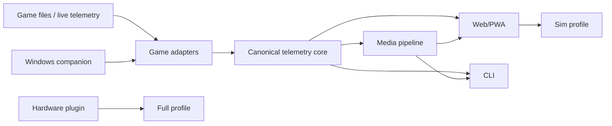
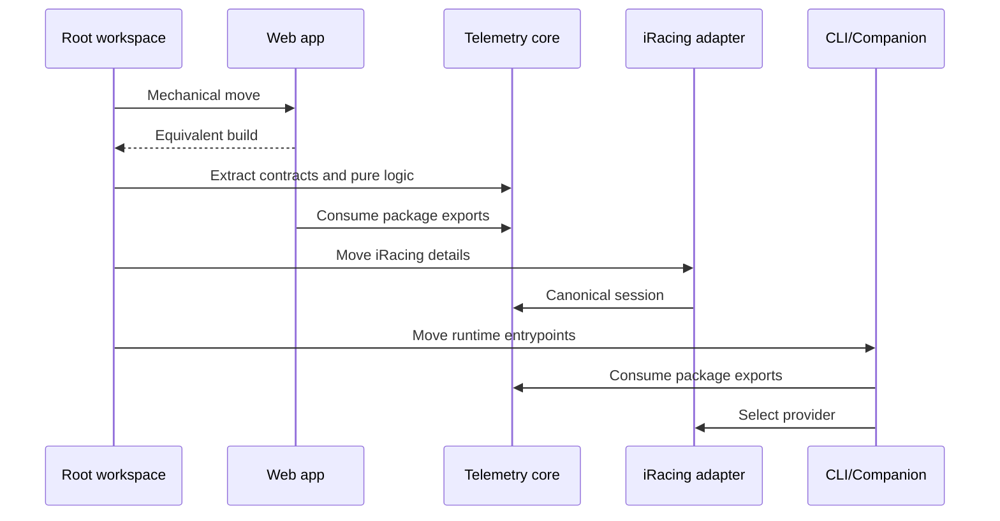

# Plan 0034：模拟赛车平台模块化

> 状态：实施中  
> 范围：Bun workspaces、Web/PWA、CLI、Windows companion、共享遥测核心、
> iRacing adapter、Sim/Full 产品 Profile  
> 更新时间：2026-11-05  
> 基线：`9b23c3b`，3341 tests passed / 1 skipped，lint、typecheck、build 通过

## 1. 目标与非目标

本计划把当前单 package 产品重组为面向模拟赛车的 monorepo。默认产品是 Sim，
实车记录仪、BLE、GoPro 和 DFU 作为 Full Profile 兼容能力保留，不删除用户数据或
已有工作流。

目标：

- Web、CLI、Windows companion 可以独立构建和发布；
- 共享核心不依赖 React、IndexedDB、BLE、Supabase、WebCodecs 或 Windows FFI；
- 游戏差异只能存在于 `GameAdapter`；
- 不提供 GPS 的游戏不需要伪造经纬度；
- 当前 iRacing、Web、CLI、云端和硬件能力保持兼容；
- 后续 F1、Forza、Dirt Rally、WRC adapter 必须 fixture-first。

本计划不直接实现未经验证的新游戏协议，也不拆成多个 Git 仓库。

## 2. 目标架构

> 图范围：仓库稳定模块边界  
> 证据：`src/lib/datalogParser.ts`、`src/cli/`、`src/plugins/`、
> `src/types/racing.ts`  
> 实线为本计划内实现；外部游戏协议使用 adapter 边界，不在 core 推断。



目标目录：

```text
apps/
  web/
  cli/
  windows-companion/
packages/
  telemetry-core/
  game-adapter-kit/
  game-adapter-iracing/
  media/
  hardware-plugin/
```

依赖方向：

```text
apps/* → packages/*
game-adapter-* → game-adapter-kit → telemetry-core
media → telemetry-core
hardware-plugin → telemetry-core
telemetry-core → no app/package
```

禁止 package 反向引用 app，禁止 core 读取 DOM、文件系统、数据库或网络。

## 3. Canonical telemetry

当前 `GpsSample` 强制 `lat/lon`，适合实车和 iRacing IBT，但不适合作为所有游戏的
唯一模型。新增模型允许多种空间表达：

```ts
type SpatialSample =
  | { kind: "geo"; lat: number; lon: number; altitudeM?: number }
  | { kind: "world"; x: number; y: number; z?: number }
  | { kind: "track"; progress: number; distanceM?: number };

interface TelemetryFrame {
  t: number;
  spatial?: SpatialSample;
  channels: Record<string, number>;
}

interface CanonicalSession {
  source: { game: string; format: string };
  frames: TelemetryFrame[];
  laps?: LapTiming[];
  metadata?: SessionMetadata;
  capabilities: GameCapability[];
}
```

现有 `ParsedData`、`GpsSample`、`Lap` 暂不删除。`LegacyParsedDataBridge` 只在
`spatial.kind === "geo"` 时生成旧模型；无 GPS 会话由 capability gate 隐藏地图、
天气和几何赛道检测，并优先使用游戏提供的 lap timing。

## 4. GameAdapter 接口

```ts
interface GameAdapter {
  id: string;
  capabilities: readonly GameCapability[];
  detectFile?(input: TelemetryInput): boolean | Promise<boolean>;
  parseFile?(input: TelemetryInput): Promise<CanonicalSession>;
  watchLifecycle?(options: WatchOptions): AsyncIterable<CanonicalRaceState>;
  finalizeTelemetry?(
    race: CanonicalRaceState,
    context: FinalizeContext,
  ): Promise<FinalizedTelemetry>;
  readMetadata?(input: TelemetryInput): Promise<SessionMetadata>;
}
```

Capability 至少覆盖：

- `telemetry.file` / `telemetry.live`
- `telemetry.geo` / `telemetry.world` / `telemetry.track-progress`
- `timing.game-laps` / `timing.geometry-laps`
- `clock.session`
- `race.position` / `race.incidents` / `race.pit`
- `metadata.driver` / `metadata.vehicle` / `metadata.track`

缺少 capability 时功能必须明确降级，不能生成虚假名次、incident、弯名或位置。

## 5. 子系统迁移

### 5.1 Web/PWA

当前 Web 源码整体移动到 `apps/web`，保留 `@/` 指向 app 内 `src`，避免机械改写全部
UI import。根脚本代理 workspace 命令，Cloudflare 继续由根 `wrangler.jsonc`
部署 `apps/web/dist`。

必须同步验证：

- `import.meta.glob` first-party plugin；
- optional Coach package；
- Supabase lazy chunk；
- XRK WASM worker；
- PWA precache 和 deferred assets；
- `version.json`；
- i18n dynamic imports。

### 5.2 Telemetry core

首批迁移纯类型、通道、bundle/job/companion contract、video timeline、sync、
memory story、analytics、scorecard 和 driving insights。GPS filter、course/lap/delta
仅在依赖完成解耦后迁移。

### 5.3 iRacing

`iracingParser`、SessionInfo、IBT fixture、IRSDK shared memory 和 IBT finalizer
进入 `game-adapter-iracing`。`SessionState` 数值、IRSDK channel 名和 YAML key 不得
泄漏到 core。

Race channels 规范为：

- `race_position`
- `race_class_position`
- `race_incidents`
- `race_on_pit_road`
- `lap_dist_pct`

Racing Memory 只读取 canonical id。

### 5.4 CLI 和 companion

CLI 移到 `apps/cli`，不再通过相对路径读取 Web 的 `public/tracks.json` 或
`package.json`。Windows FFI 与 OBS capture 移到 `apps/windows-companion`，
普通 Web/CLI 构建不能静态加载 `bun:ffi`。

### 5.5 Media

`packages/media` 保存 recorder contract、sync、EDL/story 和跨运行时媒体 contract。
WebCodecs renderer 留在 Web adapter，FFmpeg/Sharp 留在 CLI adapter，二者共享同一
story/scorecard model。

### 5.6 Hardware

Full Profile 加载：

- Web/Native BLE logger；
- DFU；
- device track sync；
- MyChron / Alfano；
- GoPro telemetry import；
- phone datalogger。

Sim Profile 不显示这些入口，也不生成对应 chunk。Garage、setup、notes、普通视频、
云同步、排行榜和分析继续属于 Sim。

## 6. 构建 Profile

`VITE_PRODUCT_PROFILE`：

- `sim`：默认；
- `full`：Sim + hardware plugin。

Native 是独立轴：

```text
sim-web
sim-native
full-web
full-native
```

CI 至少构建 `sim-web` 和 `full-web`。Bundle graph 测试确保 Sim 不重新引入 BLE、
GoPro、Sharp 或 Windows FFI；Supabase 仍按 cloud flag lazy-load。

## 7. 新游戏接入门禁

每个新 adapter 必须提供：

1. 官方或可审计协议来源；
2. 脱敏 golden fixture；
3. capability matrix；
4. parser/live contract tests；
5. 缺失字段降级测试；
6. SessionBundle 和 CLI smoke test。

建议顺序：

1. F1 版本化 UDP；
2. Forza Data Out；
3. 核验 Dirt Rally 2.0 与 WRC Generations；
4. 没有稳定原生协议时使用独立 SimHub/JSONL bridge。

每款游戏单独建立后续编号计划，不在 Plan 0034 中猜测协议。

## 8. 迁移时序



每一步完成后单独验证并保留可回滚边界；不得把目录迁移和算法重写混为一个步骤。

## 9. 验证和发布

根命令必须覆盖所有 workspace：

```bash
bun install --frozen-lockfile
bun run lint
bun run typecheck
bun run test:run
bun run test:coverage
bun run build:sim
bun run build:full
bun run cli:smoke
git diff --check
```

覆盖率范围必须包括 core、adapters、CLI、原有 hooks/lib，移动目录不能导致统计范围
缩小。Windows shared-memory 长赛、重连和 OBS 仍需目标机手工验收。

## 10. 文档联动

完成后同步：

- `README.md`
- `docs/feature-overview.md`
- `docs/subsystems.md`
- `docs/racing-memory.md`
- `docs/android.md`
- `src/plugins/README.md`
- `CLAUDE.md`
- `CHANGELOG.md`

新增或变更 FOSS 依赖时同步 README Credits 与 `CreditsDialog.tsx`。
