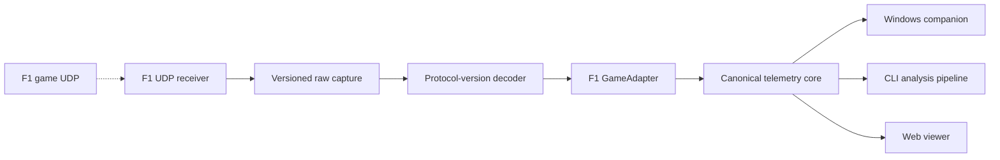
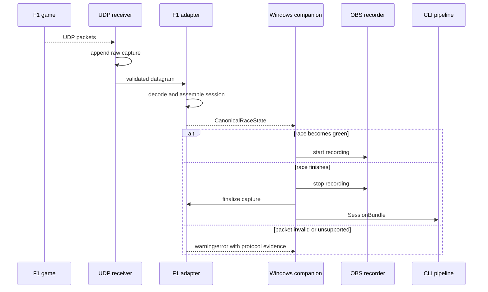

# Plan 0035：F1 UDP 游戏适配器

> 状态：实施中；F1 25 documented-packet decoder 与 raw capture 已实现，真实-game fixture/Windows end-to-end 验收待补
> 更新时间：2026-11-05  
> 前置：Plan 0034 模拟赛车平台模块化  
> 首版目标：EA SPORTS F1 25（Windows PC）；以 F1 25 官方 UDP 文档、packet format/version 与 golden capture 为唯一 decoder 依据
> 原则：fixture-first；只实现有协议文档和真实数据证明的字段

## 1. 目标

为 EA/Codemasters F1 系列增加独立 UDP adapter，使 LapWing 可以：

- 监听本机或局域网转发的 F1 UDP telemetry；
- 从 session、lap、car telemetry、participants 等数据包构建
  `CanonicalSession`；
- 自动识别比赛开始、绿旗、结束，驱动 Windows companion 录屏；
- 生成可回放的原始 capture 文件，供 CLI、测试和离线分析重复使用；
- 在没有 GPS 的前提下使用 `world` 和 `track-progress` 空间模型；
- 复用 Plan 0033 的同步、reel、成绩单和驾驶建议流水线。

首版不承诺支持所有年份。实际首个协议版本必须由用户提供的游戏版本、官方 UDP
说明和一份脱敏 capture 共同决定。不同年份使用独立 decoder，禁止“字段看起来一样”
就共用二进制布局。

## 2. 总体架构

> 范围：F1 UDP 接入到现有 LapWing 流水线；证据：
> `packages/game-adapter-kit/`、`packages/telemetry-core/`、
> `apps/windows-companion/`、`apps/cli/`。F1 数据包布局为待 fixture 核验外部边界。

实线表示仓库内已定义的模块关系；游戏到接收器为外部 UDP 输入，具体端口、包频率和
字段布局必须在实施前核验。

## 3. 包与职责

新增 `packages/game-adapter-f1/`：

- `protocol/header.ts`：只读取 packet format、game year、packet version、
  packet id、session UID、frame id 等版本路由字段；
- `protocol/<version>/`：每个已验证协议版本的二进制 decoder；
- `capture.ts`：版本化 length-prefixed UDP capture 读写，不依赖 Socket；
- `sessionAssembler.ts`：按 session UID/frame id 合并多类数据包；
- `lifecycle.ts`：将 session 状态转换为 `CanonicalRaceState`；
- `adapter.ts`：实现 `GameAdapter`；
- `fixtures/`：脱敏 golden capture 与来源说明。

`apps/windows-companion/` 增加 UDP runtime：

- Socket 绑定、广播/单播接收；
- 丢包和乱序统计；
- capture 原子落盘；
- 生命周期事件转发。

`packages/telemetry-core` 不新增 F1 专有字段。F1 packet id、车手数组索引、marshal
zone 等只能存在于 adapter 内部。

## 4. Canonical 映射

仅在 fixture 证实时映射：

- `world`：游戏世界坐标；
- `track-progress`：lap distance / track length；
- 通用通道：speed、rpm、gear、throttle、brake、steering、DRS；
- timing：current/last/best lap、sector、lap number；
- race：overall/class position、pit state、penalty/incident 的可证明子集；
- metadata：track、vehicle/team、driver、session type、weather。

首版不伪造经纬度，因此地图和 GPS 赛道自动检测保持关闭。赛道图优先使用游戏 track
id 到 LapWing 内置 layout 的显式映射；没有可信映射时，成绩单只显示赛道名称。

## 5. 接口目录

### `F1UdpReceiver.events()`

- 调用方：Windows companion；
- 输入：绑定地址、端口、允许的发送端、capture 路径；
- 输出：原始 packet 流及接收时间；
- 失败：端口占用、packet 超限、来源不允许、写盘失败；
- 安全边界：默认只绑定 loopback；开放局域网必须显式配置。

### `decodeF1Packet(bytes)`

- 调用方：live receiver、capture replay、测试；
- 输入：单个 UDP datagram；
- 输出：版本化 discriminated union；
- 失败：未知版本、长度不符、未知 packet id、非有限数值；
- 未知版本必须保留 capture 并给出可诊断错误，不能尝试按相近版本解析。

### `F1SessionAssembler.push(packet)`

- 调用方：F1 adapter；
- 输入：已验证 packet；
- 输出：零个或多个 telemetry frame、lap timing、metadata/lifecycle 更新；
- 失败：session UID 改变、严重乱序、缺关键 packet；
- 数据不完整时输出 warning 和降级 capability，不补零冒充真实值。

## 6. 实时时序

> 范围：比赛监听与录屏；证据：Plan 0033 capture contract、Plan 0034 adapter
> contract；F1 状态值待 fixture 核验。

## 7. 实施阶段

1. **协议证据与 fixture**
   - 确认目标 F1 版本和官方 UDP 文档；
   - 用户提供 2–3 分钟练习赛和一场短赛 capture；
   - 保存脱敏、可再分发的最小 golden fixture；
   - 记录端口配置和数据使用许可。
2. **纯 decoder**
   - header/version router；
   - 首版需要的数据包 decoder；
   - 长度、大小端、枚举和未知版本测试；
   - fuzz/截断包测试。
3. **capture 与 replay**
   - 定义 `f1udp` capture schema；
   - CLI `fixture replay`/`inspect`；
   - 丢包、乱序、重复 frame 测试。
4. **canonical session**
   - session assembler；
   - `world`/`track-progress`；
   - game-provided lap timing；
   - capability 降级测试。
5. **live companion**
   - UDP receiver；
   - lifecycle 到 OBS；
   - 原子 finalize 与 SessionBundle；
   - Windows 防火墙和端口占用错误提示。
6. **分析与产品接入**
   - 成绩单车型/赛道/圈速；
   - Racing Memory 使用 canonical race channel；
   - 无 GPS 时隐藏地图/天气；
   - Web/CLI 的 F1 文件类型与来源标识。

## 8. 测试与发布门禁

- 每个支持的协议版本至少一份 golden fixture；
- decoder 单测覆盖全部已实现 packet；
- 同一 capture replay 两次产生字节级稳定的 canonical JSON；
- 缺 packet、乱序、重复、截断、未知版本均有测试；
- 练习、排位、正赛生命周期分别验证；
- `bun run lint`、`typecheck`、`test:run`、`test:coverage`；
- Sim/Full 双构建；
- Windows 实机完成“启动游戏 → 自动录屏 → capture → bundle → 60 秒 reel”；
- capture 与遥测默认只写本地，不上传。

### 已实现（2026-11-05）

- 新增 `@lapwing/game-adapter-f1`：版本化、length-prefixed `.f1udp` 原始 datagram capture codec，及 F1 25 packet format 2025/game year 25/packet version 1 的 Motion、Session、Lap、Event、Participants、Car Telemetry decoder；
- Windows companion 的 `F1UdpReceiver` 默认绑定 loopback、可限制 sender、统计拒收包，并以临时文件 + rename 原子完成 capture；
- `f125Adapter` 将上述有文档字段转换为 canonical world、track-progress、操控/速度、圈时、名次、pit 与 driver capability；不制造 GPS，也不解析未实现 packet id。
- fixture 当前是按官方二进制结构构造的 conformance test，不声称为真实游戏 capture；真实练习/短赛 capture 仍是 decoder、录屏生命周期与成绩单发布门禁。

## 9. 需要用户确认/提供

实施前需要：

1. 已确认：首版优先支持 EA SPORTS F1 25（Windows PC）；
2. 游戏平台是 Windows PC，还是主机向 PC 转发 UDP；
3. 一份练习赛 capture 和一份短赛 capture；
4. 是否首版就要求自动 OBS，还是先完成 capture/replay；
5. 是否接受首版只支持一个协议版本，其他年份明确报“不支持”。

## 10. 后续

F1 adapter 稳定后再建立 Forza Data Out 计划。Dirt Rally 2.0 与 WRC
Generations 继续保持“待协议核验”，不复用 F1 的 packet 假设。
