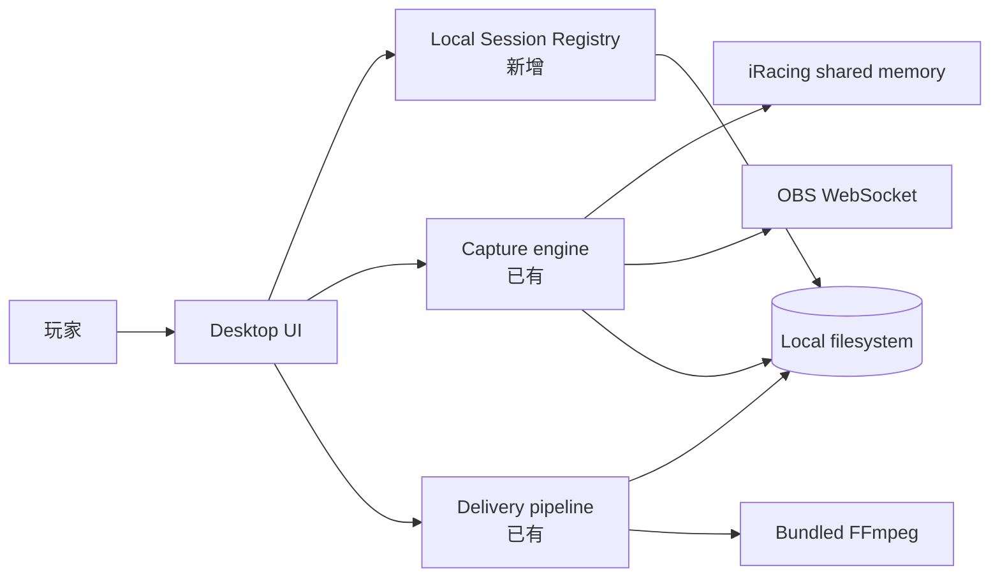
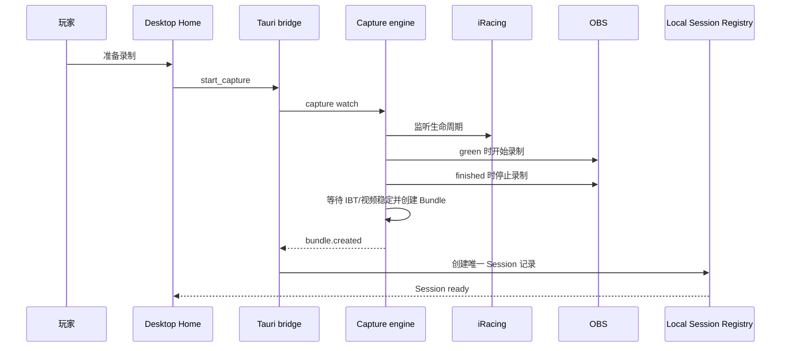
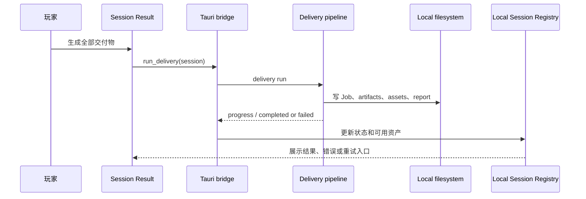

# Plan 0037：本地 Racing Memory Desktop MVP

> 状态：实施中；Windows 11 ARM 虚拟机中的 x64 构建、Desktop UI、OBS WebSocket 与合成 IBT 交付链已验收，真实 Windows x64 + iRacing 验收及 P3 安全凭据存储待补
> 更新时间：2026-11-09
> 前置：Plan 0031 Racing Memory、Plan 0033 比赛自动化流水线、Plan 0034 模拟赛车平台模块化  
> 范围：单用户、单台 Windows 电脑、本地优先的 iRacing + OBS 赛后回忆闭环  
> 非目标：本计划不引入账号、服务端、云同步、视频上传、多人协作、排行榜或 Web 产品重构

## 1. 问题与目标

当前仓库已有 Windows capture、Session Bundle、同步建议、可恢复 pipeline、最快圈/
OPT 视频、成绩单、reel、报告与驾驶建议等能力，但它们在 Desktop UI 中仍以工程操作形式
出现：用户填写目录和 OBS 配置，等待日志，之后通过 Bundle JSON 触发交付。

首版不应为了多人使用而先建设云端，也不应重写已存在的引擎能力。目标是将已有本地能力
包装成一个普通 iRacing 玩家能连续使用的单机产品：

```text
准备比赛 → 自动录制 → 自动定位 IBT 与录像 → 生成赛后交付物 → 在本地找回这场 Session
```

成功标准不是通用平台化，而是用户跑完一场比赛后，不需要找文件、不需要命令行、不需要理解
Bundle，即可拿到最快圈、OPT、成绩单，并长期保留遥测和赛后数据。

## 2. 已有能力基线

以下能力已有实现，不在本计划中重新开发：

| 能力 | 当前代码证据 | 说明 |
| --- | --- | --- |
| iRacing 生命周期监听 | `packages/game-adapter-iracing/src/windowsIracingSource.ts` | Windows-only IRSDK shared-memory source |
| OBS 开始/停止录制 | `apps/windows-companion/src/obsRecorder.ts` | OBS WebSocket v5 recorder provider |
| 等待 IBT / 视频稳定 | `apps/cli/src/companion/capture.ts`、`apps/cli/src/jobStore.ts` | 等待写入结束后再继续 |
| Session Bundle 与同步锚点 | `apps/cli/src/companion/capture.ts`、`packages/telemetry-core/src/sessionBundle.ts` | 记录 iRacing/OBS start/stop anchors、hash 与元数据 |
| 可恢复流水线 | `apps/cli/src/pipelineRunner.ts`、`packages/telemetry-core/src/jobManifest.ts` | 原子 checkpoint、input hash、`--resume` |
| 最快完整圈 / OPT / 纪念图 | `apps/cli/src/sessionAssets.ts` | 最快可用完整圈保留 HUD `Last`；OPT 分段拼接；SVG/PNG memento |
| 报告、reel、驾驶建议 | `apps/cli/src/report.ts`、`apps/cli/src/reel.ts`、`apps/cli/src/insights.ts` | 均已是 pipeline step |
| Windows 壳调用本地引擎 | `apps/desktop/src/main.tsx`、`apps/desktop/src-tauri/src/main.rs` | 随应用携带 CLI、FFmpeg/ffprobe 并读取进度事件 |

现有 `delivery run` 会创建 Job Manifest，并执行：

```text
inspect → sync → analyze → memory → reel → assets → report → insights
```

真实 Windows + iRacing + OBS 的端到端验收仍待在目标机器执行；在验证完成之前，以上只是
代码级实现事实，不应宣称为已向用户验证的产品能力。

## 3. 产品范围与关键决策

### 3.1 本地优先，不部署服务器

V1 不要求账号、网络、服务器、对象存储或云端数据库。所有计算在用户电脑完成，应用应可
离线运行。

### 3.2 原始视频不归档；遥测与赛后数据归档

原始 OBS 视频体积大，不复制、不移动、不纳入 Racing Memory 数据库。Session 仅保存视频的
路径、时长、hash、同步结果和本机可用状态。用户可以自行保留、移动或删除录像。

以下内容应持久化在 Racing Memory 本地数据根目录：

- Session 元数据、Bundle、Job Manifest、step artifacts；
- 原始 `.ibt` 遥测的归档副本；
- 分析 JSON、圈速/事件摘要、驾驶建议；
- 成绩单 PNG/SVG；
- 笔记和将来的 Setup 关联；
- 视频资产的本地引用与生成记录。

最快圈、OPT、reel 是用户主动导出的本地文件；V1 不复制第二份到内部归档。Library 可显示
其路径和可用性，文件被用户删除后应显示“本机产物不可用”，而非报数据损坏。

### 3.3 Session 是用户心智，不是 Bundle

`SessionBundleV1` 和 `JobManifestV1` 继续作为内部可审计契约，但 UI 不直接要求用户粘贴
`*.bundle.json` 路径。普通用户看到的是一场命名的 Session，而不是若干文件。

### 3.4 不重写 Web 端分析能力

V1 Desktop 优先提供赛前、赛后和历史入口。复杂 Web 分析能力的复用可在后续逐步接入，
不得阻塞本计划的本地闭环。

## 4. 总体模块架构

> 范围：单机 Racing Memory Desktop MVP；更新时间：2026-11-07；证据：
> `apps/desktop/`、`apps/cli/`、`apps/windows-companion/`、`packages/*`。
> 实线为已有代码关系；本地 Session Registry 为本计划新增模块。



| 模块 | 职责 | 代码位置 | 本计划变化 |
| --- | --- | --- | --- |
| Desktop UI | 赛前、赛后和历史 Session 用户流程 | `apps/desktop/src/` | 从配置表 + 日志升级为三页面工作流 |
| Desktop native bridge | 启动 sidecar、转发受控事件 | `apps/desktop/src-tauri/src/main.rs` | 增加 Session Registry 读写与受控文件操作 |
| Capture engine | 录制、IBT finalization、Bundle 生成 | `apps/cli/src/captureCommand.ts`、`companion/` | 复用；输出改为唯一 Session 目录 |
| Delivery pipeline | 分析和各类赛后产物 | `apps/cli/src/pipeline*.ts` | 复用；结果由 UI 按 manifest/artifacts 读取 |
| Local Session Registry | Session 索引、扫描、状态、路径与资产可用性 | 新增 | 本地持久化与 Library 查询 |

## 5. 本地目录与数据模型

默认数据根目录由用户在首次设置中选择，例如：

```text
RacingMemoryData/
  sessions/
    2026-11-07-watkins-glen-gt3-<session-id>/
      session.bundle.json
      racing-memory-job.json
      telemetry.ibt
      session.json
      artifacts/
      session-assets/
        session-memento.svg
        session-memento.png
        session-assets.json
      report/
      notes.md
  registry.json
```

`session.json` 是 UI 读取模型，不替代 Bundle：

```ts
interface LocalSessionRecord {
  id: string;
  createdAt: string;
  game: string;
  track?: string;
  course?: string;
  vehicle?: string;
  sessionType?: string;
  telemetry: { archivedPath: string; sha256?: string };
  video?: { originalPath: string; sha256?: string; available: boolean };
  sync?: { confidence: "high" | "medium" | "low"; requiresReview: boolean };
  delivery: { status: "not_started" | "running" | "partial" | "succeeded" | "failed" };
  assets: Array<{ kind: string; path: string; available: boolean }>;
}
```

实现初期可以使用原子写入的 `registry.json`；不必为了 V1 引入 SQLite、同步引擎或通用
数据库抽象。Registry 损坏或缺失时，应能扫描 `sessions/*/session.json` 重建。

## 6. UI 信息架构

### 6.1 Home：准备比赛

只显示用户下一步要做的事：

- iRacing telemetry、OBS、FFmpeg、输出目录的就绪状态；
- 一个主操作：**准备录制**；
- 最近完成的 Session 与“继续复盘”入口。

OBS 地址、密码、Telemetry 目录、默认输出目录只放在首次设置和 Settings。OBS 密码不得写入
日志、Bundle、Registry 或普通文本配置；本计划需评估并使用 Windows 安全凭据存储。

### 6.2 Session Result：赛后结果

收到 `bundle.created` 后，Desktop 创建/更新 LocalSessionRecord，自动打开这场 Session：

- 显示赛道、车辆、Session 类型、同步置信度；
- 提供“生成全部交付物”或继续/重试；
- 显示最快圈、OPT、成绩单、reel、报告的结果与打开位置；
- 当同步低置信度时，先显示证据与确认操作，不能静默导出；
- 失败时显示可行动的原因，而不是仅保留原始 stderr。

### 6.3 Session Library：本地历史库

按日期显示历史 Session，并至少可查看：

- 赛道、车辆、日期、Session 类型；
- 最快圈和完整圈数；
- 视频是否仍在本机；
- 交付状态和已有产物；
- 进入赛后结果页或打开输出目录。

高级地图、遥测图、参考圈和 Setup 页面不属于 MVP 门槛；可以在后续从 Web 复用。

## 7. 关键接口与时序

### 7.1 `start_capture`

| 项目 | 内容 |
| --- | --- |
| 调用方 | Desktop Home |
| 入口 | Tauri `start_capture` command |
| 前置条件 | iRacing telemetry 目录、OBS 配置、数据根目录均有效 |
| 成功结果 | 进入 waiting/recording；完成后收到 `bundle.created` |
| 失败边界 | 依赖缺失、OBS 连接失败、IRSDK 不可读、IBT/视频未稳定、写盘失败 |



### 7.2 `run_delivery`

| 项目 | 内容 |
| --- | --- |
| 调用方 | Session Result |
| 入口 | Tauri `run_delivery` command |
| 前置条件 | Bundle 输入文件 hash 匹配；若同步需复核则用户明确确认 |
| 成功结果 | Job Manifest、artifacts、最快圈、OPT、成绩单、报告等本地产物 |
| 失败边界 | 文件移动/删除、hash 不匹配、低置信度同步、FFmpeg/Sharp 失败、可用完整圈不足 |



## 8. 实施阶段

### P0：真实环境验收

不先改 UI。使用真实 Windows、iRacing、OBS、FFmpeg 运行一场可复现的比赛或测试会话，验证：

- 绿旗和结束状态是否可靠；
- OBS 录制是否正确开始/停止；
- 正确找到结束后的 IBT；
- Bundle 的视频/遥测 hash、同步 anchors 和置信度是否正确；
- `delivery run` 是否生成最快圈、OPT、成绩单和报告；
- 低置信度与缺文件错误是否可定位。

2026-11-09 已在 Apple Silicon Parallels 的 Windows 11 ARM 环境完成发布前置验收：

- 以 Windows x64 Bun 和 `x86_64-pc-windows-msvc` Rust target 构建便携包；
- Desktop Home、Session Library、Session Result 壳与本地 Registry 重启恢复正常；
- OBS WebSocket v5 完成真实 StartRecord/StopRecord，产出 MP4、稳定 IBT 与 Bundle；
- 合成 IBT 覆盖原生圈号、圈进度和 LastLapTime，可驱动最快圈/OPT 交付测试；
- 完整 `delivery run` 已通过 inspect、sync、analyze、memory、reel、assets、report、
  insights 与 training 全阶段，并生成最快圈、OPT、纪念图和四组报告图卡；
- Desktop 现在展示总进度及九个阶段的独立百分比；耗时的 reel、最快圈/OPT 和
  报告阶段还会按已完成的视频分段、OPT 分段与图卡持续更新，异步引擎失败会立即
  解除“正在生成”状态并允许重试；
- Session Result 只展示玩家可直接消费的视频、PNG 和 HTML，不再把内部 JSON/SVG
  当作交付物；图片提供缩略图，所有卡片和交付目录均可一键用 Windows 默认应用打开；
- 修复构建别名、Tauri 工作目录/图标、便携包静态资产、OBS socket 未释放，以及
  Bun 便携 sidecar 无法加载 Sharp 原生模块的问题；Windows 11 图卡改由系统内置
  Edge 的无头渲染引擎从本地 SVG 生成 PNG。
- 使用 `data/` 中 117 MB 的真实 Spa IBT 与 2.8 GB OBS 视频复验：两者起点由用户
  确认为对齐，视频在 1286.856 秒结束，IBT 持续 1763.217 秒；系统保持
  `syncOffsetMs=0`、`syncRate=1`，只在视频实际覆盖范围内选圈，不将视频拉伸到
  遥测结尾。完整交付在 macOS 和 Windows x64 便携包中均通过。
- `release/RacingMemory-win11-x64-2026-11-09.zip` 已作为 Git LFS 便携产物提供，
  包含 Desktop UI、CLI、FFmpeg/ffprobe、赛道和绘图资源，并附 SHA-256 校验值。

该环境仍不是发布门禁的替代品：iRacing、IRSDK shared memory、反作弊、方向盘驱动、
长赛重连与原生 Windows x64 性能仍必须在目标机器验收。

### P1：唯一 Session 目录与 Registry（已实现）

- 用唯一 capture 时间戳生成 Session 目录，并在完成 capture 后写入 iRacing Session ID；
- 不再将 Desktop capture 输出固定为 `latest-session.bundle.json`；
- 归档 IBT；原始视频只引用、不复制；
- 写入 `session.json` 与 `registry.json`；
- 支持扫描重建 Registry。

### P2：Desktop 三页面 MVP（已实现）

- Home：就绪检查（含 OBS 安装路径与 WebSocket 探测）、准备录制、最近 Session；Settings/release 说明 OBS 不随便携包分发；
- Session Result：进度、同步审核、产物入口、错误恢复；
- Session Library：浏览和打开本地 Session；
- 将 Bundle 路径从普通用户流程中移除。

### P3：配置与可维护性（部分实现）

- 默认数据根目录、IBT 目录和 OBS 地址设置；
- Session Library 重新扫描；
- 对 sidecar/FFmpeg 缺失给出安装包级错误。

仍待补：首次配置向导、OBS 密码的 Windows 安全凭据存储、打开本地目录和删除 Registry 记录等受控操作。

**工作流拆分**（IBT 手动导入、无视频成绩单、分档交付）见 **Plan 0039**，作为 0037 录制链路过脆的补充，不替代 Session 模型。

## 9. 明确不做

- 服务端、账号、云同步、订阅、多人协作、排行榜；
- 原始视频上传、视频云转码或视频长期归档；
- 远程控制用户电脑或开放入站端口；
- 为 V1 引入通用任务平台、事件总线、SQLite/ORM 或复杂插件系统；
- 将完整 Web PWA、BLE、实车设备、F1、社区功能塞入 Desktop MVP；
- 没有真实协议证据的自动比赛判责或“AI 教练”结论。

## 10. 验收标准

1. 新用户完成一次本地配置后，可从 Desktop 点击“准备录制”进入等待状态。
2. 一场符合条件的 iRacing + OBS 会话结束后，系统生成独立 Session 目录，既不覆盖此前 Session，也不复制原始视频。
3. 用户无需接触 Bundle JSON，即可从赛后结果页运行完整交付并看到进度。
4. 成功时可从 UI 打开最快圈、OPT、成绩单和报告；产物被手动删除后 UI 明确标记不可用。
5. 失败时可区分 OBS、IBT、同步、输入 hash、FFmpeg 和无完整圈等原因，并提供重试或修复指引。
6. 重启 Desktop 后，Session Library 仍可列出此前 Session；删除 Registry 后可从 Session 目录重建。
7. 在断网环境下完成上述流程。

## 11. 触点

- `apps/desktop/src/main.tsx`
- `apps/desktop/src/styles.css`
- `apps/desktop/src-tauri/src/main.rs`
- `apps/cli/src/captureCommand.ts`
- `apps/cli/src/companion/capture.ts`
- `apps/cli/src/pipelineHandlers.ts`
- `apps/cli/src/pipelineRunner.ts`
- `apps/cli/src/sessionAssets.ts`
- `apps/cli/src/jobStore.ts`
- `apps/cli/src/bundleCommands.ts`
- `packages/telemetry-core/src/sessionBundle.ts`
- `packages/telemetry-core/src/jobManifest.ts`
- `apps/windows-companion/src/obsRecorder.ts`

实施每个阶段时，提交信息必须引用 `plan 0037`。
