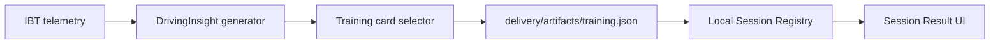

# Plan 0038：Racing Memory 成长闭环

> 状态：实施中；第一阶段“赛后单训练卡”已实现，真实 iRacing Session 验收待补
> 更新时间：2026-11-07
> 前置：Plan 0037 本地 Racing Memory Desktop MVP；Plan 0033 比赛自动化流水线
> 范围：帮助 iRacing 玩家提高成绩并获得可验证的正反馈
> 非目标：不以全球排行榜、神秘总分、无证据 AI 结论或自动比赛判责替代真实训练

## 1. 问题与产品方向

现有项目能生成遥测、圈速、视频、成绩单和确定性驾驶建议，但普通玩家仍会遇到两个问题：

1. 不知道下一次驾驶最应该练什么；
2. 即使投入时间，也难以持续感知自己在变快、变稳或变成熟。

本计划将已有数据能力压缩为可重复的成长闭环：

```text
跑一场 → 找到一个最重要的机会 → 完成一项小训练 → 下次复测 → 保存可回看的进步证据
```

产品定位不是泛化的“AI 教练”，而是面向普通爱好者的个人赛车成长档案。每条建议必须指向
具体圈次、区间、证据与验证方法；不足以判断时必须明确说“不足以判断”。

## 2. 成功口径

### 2.1 提高成绩

优先帮助同车、同赛道、条件可比的玩家改善：

- 最快完整圈；
- 常规有效圈的中心水平；
- 连续干净圈数与波动；
- 关键区间损失；
- 长距离和比赛中的节奏恢复。

### 2.2 提高正反馈

不只奖励 PB，还应保留五类可验证成长：

- 更快：PB 或关键区间改善；
- 更稳：有效圈波动缩小、连续目标圈增加；
- 更干净：incident 降低、无事故比赛；
- 更成熟：完成长距离、练习任务或比赛准备目标；
- 更有回忆：前后对比、PB 突破和值得保存的赛事片段。

## 3. 分阶段路线

| 阶段 | 交付 | 用户价值 | 依赖 |
| --- | --- | --- | --- |
| 0 | 本地 Session 捕获、归档与赛后交付 | 每场驾驶可可靠留档 | Plan 0037 |
| 1 | 单训练卡 | 每场结束后知道下次只练什么 | 已有 DrivingInsight、local delivery pipeline |
| 2 | 同车同赛道复测 | 证明训练是否有效，而非只看偶然 PB | Session Library、可比性门禁 |
| 3 | 成长时间线与前后对比视频 | 把真实改善转为持续正反馈 | Session、视频、成绩单 |
| 4 | Setup 实验室与比赛准备度 | 支持可复核的调校与比赛训练 | Setup revision、长期 Session 数据 |
| 5 | 好友、车队与真人教练协作 | 让成长可以交流与被支持 | 显式分享与权限模型 |

## 4. 第一阶段：赛后单训练卡

### 4.1 目标

在一场可分析的 Session 完成后，只展示一张“下次练什么”训练卡，而不是把所有图表和
所有建议同时丢给用户。

训练卡从已有的确定性 `DrivingInsight[]` 中选择证据最强、时间损失最大的一个机会。它必须
包含：

- 当前与参考圈；
- 问题区间与时间损失；
- 基于现有证据的动作建议；
- 一个可在下次 Session 验证的目标；
- 证据置信度；
- 无法生成卡片时的明确原因。

### 4.2 不做

第一阶段不：

- 宣称某个输入差异必然是唯一因果；
- 自动判定下一场训练“成功”或“失败”；
- 将不同车辆、赛道、游戏版本或未知条件的 Session 强行比较；
- 做大而全的课程系统、积分、徽章或全球排名。

复测属于第二阶段；第一阶段只把可复测的基线和目标写入本地 Session。

### 4.3 模块架构

> 范围：本地 delivery pipeline 到 Desktop Session Result；更新时间：2026-11-07；
> 证据：`apps/web/src/lib/drivingInsights.ts`、`apps/cli/src/pipelineHandlers.ts`、
> `apps/desktop/src-tauri/src/main.rs`。



### 4.4 训练卡契约

```ts
interface TrainingCard {
  schemaVersion: 1;
  title: string;
  detail: string;
  exercise: string;
  completionCriteria: string;
  baselineTimeLossMs: number;
  targetTimeLossMs: number;
  confidence: "low" | "medium" | "high";
  source: {
    insightId: string;
    lapNumber: number;
    referenceLapNumber: number;
    distanceMeters: number;
  };
  evidence: Array<{ metric: string; current: number; reference: number; unit: string }>;
}
```

`targetTimeLossMs` 是下次复测的目标，不是保证。它采用保守的“减少约一半损失、但不低于
100 ms”规则；后续复测必须注明比较条件和证据等级。

### 4.5 已实现内容

- delivery Job 在 `insights` 后新增 `training` step，产出 `artifacts/training.json`；
- 训练卡优先选择高置信度 Insight，再按时间损失排序；
- 无可靠 Insight 时写入原因而不是生成虚假任务；
- Local Session Registry 保存训练卡和原因，Desktop Session Result 显示“下次练什么”。

### 4.6 实施触点

- `apps/cli/src/trainingCard.ts`：从 `DrivingInsightsResult` 选择单卡；
- `apps/cli/src/trainingCard.test.ts`：无可用证据、优先级与目标值测试；
- `apps/cli/src/pipelineHandlers.ts`：新增 `training` pipeline step；
- `apps/cli/src/jobStore.ts`：将 `training` 放在 `insights` 之后；
- `apps/desktop/src-tauri/src/main.rs`：读取训练卡 artifact 并持久化到 Local Session；
- `apps/desktop/src/main.tsx`：在 Session Result 展示“下次练什么”；
- `apps/desktop/src/sessionModel.ts`：Desktop 训练卡模型。

## 5. 第二阶段门禁

开始自动复测前，必须先有：

- 可识别的同游戏、同车辆、同赛道/布局条件；
- 至少一个完成的训练卡与之后的新 Session；
- 明确的比较基线和可用数据质量；
- 对油量、轮胎、交通、辅助等未知条件的保守表述。

如果不满足，UI 只能显示“已保存训练目标，尚不具备可信复测条件”。

## 6. 验收标准

1. 有足够遥测证据的 delivery pipeline 生成一个 `training.json` artifact。
2. 多条 Insight 同时存在时，选择高置信度优先、再按时间损失排序的单一训练卡。
3. 没有可信 Insight 时，artifact 给出原因，Desktop 不伪造训练建议。
4. Desktop Session Result 展示训练动作、基线、目标、参考圈和置信度。
5. 训练卡与 Session 一起保存在本地，重启应用后仍可查看。
6. 不引入服务器、账号或网络依赖。

实施提交必须引用 `plan 0038`。
