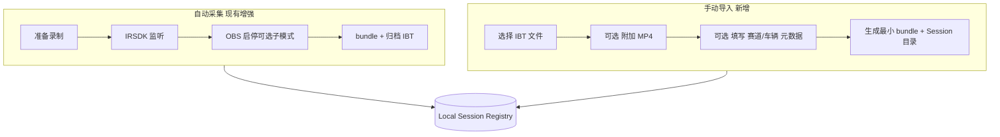

# Plan 0039：Desktop 工作流拆分（录制 / 导入 / 分档交付）

> 状态：设计中（2026-11-10）
> 前置：Plan 0037 Desktop MVP、Plan 0033 流水线、Plan 0032 CLI
> 动机：真实 Windows + iRacing + OBS 联调暴露大量「黑盒串联」故障；缺少分路径文档与 UI，用户无法在录制失败时仅用 IBT 拿成绩单。

## 1. 问题

当前产品默认心智是**一条绳**：

```text
准备录制 → IRSDK + OBS 自动 capture → 自动 bundle → delivery run（9 步全跑）→ 全量产物
```

对用户和调试都不友好：

| 痛点 | 现状 |
| --- | --- |
| 录制链路过长 | IRSDK 生命周期、OBS WebSocket、IBT 落盘、MP4 稳定、锚点写入 — 任一环失败即没有 Session |
| 交付「全有或全无」 | `delivery run` 使用固定 9 步；`reel` / `assets` 无视频即硬失败，连带拖垮整次生成 |
| 无「只想要成绩单」路径 | CLI 已有 `analyze` / `report render`，但 Desktop 未暴露；不能从 iRacing 导出 IBT 后单独导入 |
| 文档≈代码考古 | 用户不知道哪步需要 OBS、哪步只要 IBT |

目标：把**采集**与**交付**解耦，把交付拆成**可选档位**，让「录制挂了还能复盘」成为一等路径。

## 2. 能力矩阵（引擎层，已基本具备）

| 能力 | 输入 | 依赖视频/OBS | 已有 CLI |
| --- | --- | --- | --- |
| 解析 / 圈速 / 赛道 | `.ibt` | 否 | `inspect`、`analyze` |
| HTML/PNG 成绩单、报告 | bundle + IBT | 否 | `report render` |
| 驾驶建议 + 练习卡 | 分析结果 | 否 | `coach insights`、`training card` |
| 时间轴同步建议 | IBT +（可选）视频锚点 | 有视频时更准 | `sync suggest`、`delivery run` 内嵌 |
| 回忆片段检测 | IBT + sync | 间接依赖 sync | `memory detect` |
| Reel | IBT + MP4 + sync | **是** | `memory reel` |
| 最快圈 / OPT 视频、纪念图 | IBT + MP4 + sync | **是** | `session render` |

结论：**「仅成绩单」在引擎上只需 IBT（经 bundle 指向文件）**；视频向步骤应可跳过或单独重跑。

## 3. 建议的产品结构：两条轴

### 3.1 轴 A — Session 来源（互斥，可并存于历史库）



**导入 Session 最小 bundle**（`provenance: manual-import`）：

- `telemetry.path` → 归档副本或用户原路径（推荐归档到 `sessions/<id>/telemetry.ibt`）
- `videos[]` → 空数组，或用户选的单个 MP4（`durationSec` 可 ffprobe）
- `sync` → 缺省或 `requiresReview: true`、`confidence: low`、evidence 标明「无 OBS 锚点」
- `metadata` → 尽力从 IBT 解析；无法识别时 UI 允许选手动赛道

**不需要**为了导入而装 OBS 或开 iRacing。

### 3.2 轴 B — 交付档位（同一 Session 上可选）

| 档位 ID | 用户文案 | Pipeline 步骤 | 典型产物 |
| --- | --- | --- | --- |
| `telemetry` | 仅分析 | `inspect` → `analyze` | 分析 JSON（内部） |
| `scorecard` | **成绩单 + 报告**（默认推荐） | + `report` → `insights` → `training` | `scorecard-*.png`、`index.html`、练习卡 |
| `media-sync` | 同步校准 | + `sync`（有视频时） | 更新 bundle.sync、证据列表 |
| `media-clips` | 视频切片 | + `assets` | 最快圈 MP4、OPT、纪念图 |
| `media-reel` | 回忆 Reel | + `memory` → `reel` | `reel.mp4` |

**预设组合（UI 三选一即可，高级用户可展开勾选）：**

1. **成绩单包** — `scorecard`（你的核心诉求：录制失败仍能出分）
2. **完整分析** — `scorecard`（已含 insights/training）
3. **含视频** — `scorecard` + `media-sync` + `media-clips` + `media-reel`（= 今日「生成全部交付物」）

无视频时：`media-*` 步骤在 manifest 中标记为 `skipped`，reason 写入 `manifest.warnings`，**不得**让 `scorecard` 失败。

## 4. UI 信息架构（相对 0037 的增量）

### 4.1 首页 — 三条入口

| 入口 | 说明 |
| --- | --- |
| **自动录制下一场比赛** | 现有流程；OBS 就绪检测保留 |
| **从 IBT 创建 Session** | 文件选择器；副文案：「iRacing 已导出遥测、未录屏也可用」 |
| **历史 Session** | 现有 Library |

自动录制区增加**诚实文案**：录制需要 iRacing 运行中 +（若选 OBS）OBS WebSocket；失败时可改用「从 IBT 创建」。

### 4.2 Session 结果 — 分档生成 + 状态

替换单一按钮「生成全部交付物」：

- 主按钮：**生成成绩单**（`scorecard` 预设）
- 次按钮：**生成全部（含视频）** — 无视频时禁用并解释
- 高级：**选择交付项…**（勾选上表档位）
- 展示每档 `succeeded | partial | not_run`；失败显示**步骤级**错误（对齐 `delivery-progress.ndjson`）

### 4.3 设置 / 帮助 — 故障分流（文档进产品）

简短决策树（可链到 `docs/desktop-troubleshooting.md`）：

```text
录制没生成 Session？
  → 能否在 iRacing 里看到 IBT？是 →「从 IBT 创建」
OBS 连不上？
  → 仍可 IBT 导入；仅不要点含视频交付
delivery 在 reel 失败？
  → 重试「仅成绩单」；视频档单独重跑
```

## 5. 引擎与 CLI 改造（实现顺序）

### P0 — 无视频友好（优先，解锁「只生成成绩单」）

1. **`createJob(preset)`** — `jobStore.ts` 除 `createDefaultJob` 外增加 `scorecardOnlyJob`、`fullMediaJob`；步骤列表与 `dependsOn` 按档位生成。
2. **`delivery run --preset scorecard`**（或 `--steps report,insights,training`）— Desktop 调用显式 preset，而非写死全量。
3. **Pipeline 主动 skip** — 对标记 `optional: true` 的步骤：缺视频时 `emitProgress(..., "skipped", reason)` 并 `status: skipped`，不抛错（区别于依赖失败 skip）。
4. **Desktop `run_delivery`** — 请求体增加 `preset: "scorecard" | "full"`；Session Result UI 默认 `scorecard`。
5. **`import_session` Tauri 命令** — 选 IBT → 归档 → 写 bundle + registry（无 capture 副作用）。
6. **Vitest** — preset 步骤图；无视频 bundle 跑 scorecard 预设应全绿；full 预设应 skip media 步而非 fail。

### P1 — 导入体验与元数据

- 拖拽 IBT/MP4 到窗口
- IBT 解析后预填 track/vehicle；用户可改
- 可选「稍后附加视频」：更新 bundle `videos[]` 再跑 `media-sync` 档

### P2 — 录制链拆分（降低 OBS/IRSDK 耦合）

- Capture **子模式**：`iracing-only`（只盯 IBT，不启 OBS）用于先验证 telemetry 路径
- Capture 失败**部分成功**：已稳定 IBT 则仍写 Session，`warnings: ["obs_never_started"]`
- 将 `staleFinish`、IRSDK 状态机行为写入 `docs/desktop-troubleshooting.md`（对照 `staleFinish.test.ts`）

### P3 — 文档与可观测性

- `apps/desktop/README.md` 用户向「三条路径」说明
- Activity 面板区分 `capture` / `import` / `delivery` 与 step id
- 错误码表：`SYNC_REVIEW_REQUIRED`、`MISSING_INPUT`（无视频）→ UI 可操作文案

## 6. 数据契约（少量扩展）

- `SessionBundleV1.provenance.captureMode`: `"live" | "manual-import" | "live-telemetry-only"`
- `JobManifestV1.options.deliveryPreset`: `"scorecard" | "full" | "custom"`
- `LocalSessionRecord`: `source: "capture" | "import"`；`deliveryCapabilities: { scorecard, videoClips, reel }` 由 bundle 推断

不要求改 `schemaVersion`；新增字段 optional。

## 7. 验收标准

1. 用户在**未安装 OBS** 时，可从 iRacing 导出 IBT，导入 Desktop，**一键生成成绩单 PNG/HTML**，Library 可见该 Session。
2. 自动录制因 OBS 失败未产出 MP4，但若 IBT 已归档，仍可走导入或 partial Session，且 **scorecard 预设成功**。
3. 含视频 Session 可选「仅成绩单」与「含视频全套」，互不拖垮。
4. 首页与 Session 页文案明确：**便携包不含 OBS**；录制非唯一入口。
5. 文档决策树与 step 级失败信息能在真机上对照排障（与 0037 真机验收项合并）。

## 8. 与 Plan 0037 的关系

- 0037 交付「一场比赛闭环 MVP」；0039 **不推翻 Registry/Session 模型**，只拆开入口与 delivery 预设。
- 0037 首页「OBS 就绪」保留，仅作用于**自动录制**入口，不阻塞 IBT 导入。
- 0037 验收标准第 5 条（失败可区分原因）由本计划 P0/P3 具体化。

## 9. 建议迭代顺序（给实施用的一个冲刺切片）

```text
Week A: P0 preset + Desktop 成绩单按钮 + import_session（CLI 侧已有能力为主）
Week B: UI 三入口 + 分档进度展示 + release README 三条路径
Week C: P2 capture 部分成功 + troubleshooting 文档
```

---

**给用户的一句话**：录制是「锦上添花」的自动化；**IBT + 成绩单**应是永远可用的底线能力。实现上先用 `delivery preset` 和 `import_session` 落地，再逐步把 capture 从「全或无」改成「能留 IBT 就留 Session」。
