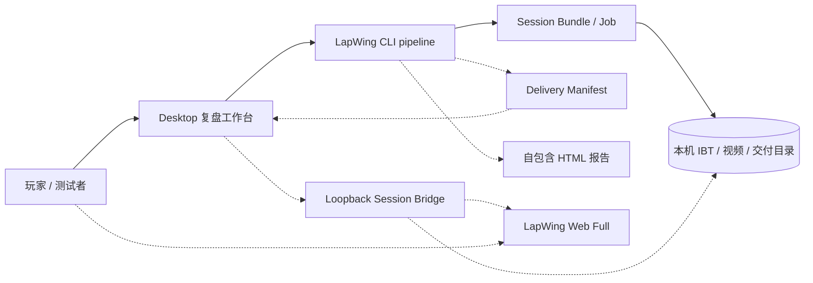
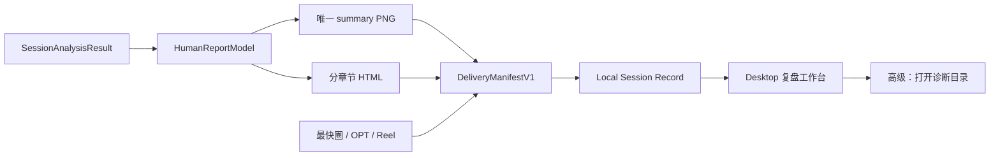
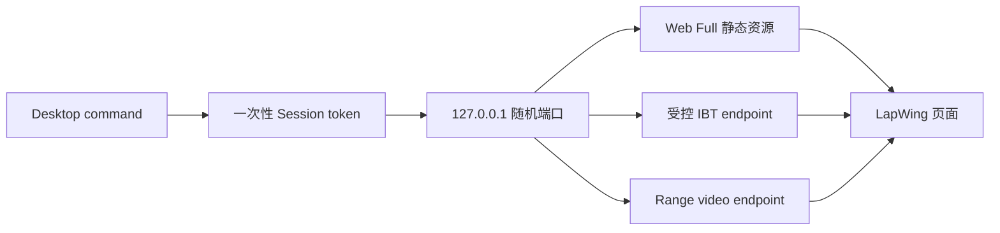
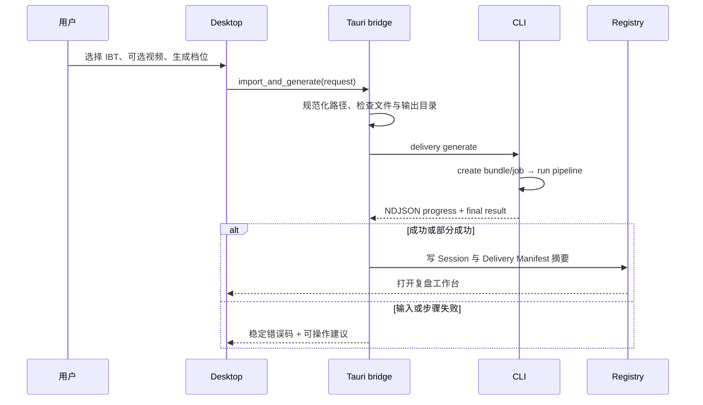
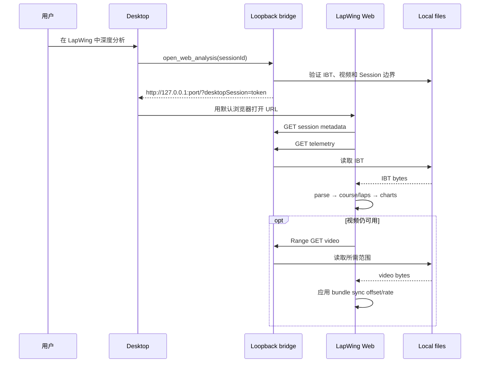

# Plan 0040：赛后交付与 LapWing 复盘工作台

> 状态：实施中；P0–P3 已在 Windows 11 x64 完成原生打包与真实 Spa IBT/视频验收
> 更新时间：2026-11-10
> 前置：Plan 0033 比赛自动化流水线、Plan 0037 Desktop MVP、Plan 0039 Desktop 工作流拆分
> 范围：Desktop 赛后结果页、面向人的 HTML 报告、LapWing Web 分析交接、手动 IBT/视频重跑入口、Windows 可复现构建
> 非目标：不重写 LapWing 图表引擎，不引入云端、账号或视频上传，不把内部 JSON/SVG 重新暴露给普通用户

## 1. 问题与目标

当前流水线已经能生成视频、成绩单、HTML、JSON、SVG 和训练建议，但“生成成功”还不等于
“用户能复盘”：

1. `summary`、`track`、`laps`、`insights` 四张成绩单主要复用同一布局，只替换标题，
   信息重复，截图中的四张卡片缺少明确优先级。
2. `index.html` 只有一张 summary SVG 和 `Machine-readable analytics` JSON，
   更像调试产物，不是给玩家阅读的赛后报告。
3. Desktop 通过扫描目录和文件名猜测资产语义，无法稳定表达主产物、分组、排序、摘要和
   “仅供诊断”的内部文件。
4. Desktop 没有把当前 Session 交给完整 LapWing Web 分析界面的入口。即使 Web 已支持
   `.ibt`，用户仍需再次手动选文件；浏览器也不能直接读取 Desktop 提供的任意本机路径。
5. 当前 Windows 构建只打包 Desktop 前端、CLI、FFmpeg 和静态赛道资源，没有把 LapWing
   Web Full 构建纳入同一个可验证产物；旧 `dist`/sidecar 可能让测试者误以为新功能已进入包。
6. 缺少一个明确入口，让测试者指定 IBT 和可选视频路径，创建 Session 并重新生成交付物。

本计划把赛后页面从“文件陈列柜”改成“复盘工作台”：

```text
指定或捕获 IBT/视频
  → 生成结构化交付清单
  → Desktop 先给结论、主视频和下一步训练
  → HTML 报告提供完整但可读的赛后总结
  → 一键进入 LapWing Web 做地图、圈速、图表和视频同步深挖
```

## 2. 关键产品决策

### 2.1 一个主成绩单，不再平铺四张近似图片

默认只生成并突出一个 `scorecard-summary.png`，用于保存、分享和快速回顾。其内容应包含：

- 赛道、车辆、日期与 Session 类型；
- 最快圈、平均有效圈、完整圈数、稳定性；
- 赛道轮廓；
- 最重要的一条有证据驾驶建议；
- “进入 LapWing 深度分析”的行动提示。

圈表、驾驶建议和赛道详情进入 HTML 报告的独立章节，不再各复制一张近似成绩单。若以后
确实需要社交分享模板，应按明确用途新增（例如“PB 分享卡”），而不是用报告章节名复制同一
画面。

### 2.2 HTML 是面向人的完整报告，JSON 是内部数据

新的 `index.html` 是离线、自包含、可直接阅读的报告，至少包含：

1. Session 概览；
2. 最快圈、平均圈、最佳理论圈与稳定性；
3. 完整圈表（最快圈和异常圈有视觉标识）；
4. 赛道图与关键机会位置；
5. 驾驶建议及证据；
6. 下次练习卡；
7. 生成时间、应用版本和数据质量说明。

`analytics.json`、`insights.json`、SVG 和 Job artifacts 保留给恢复、诊断和自动化，不在普通
交付列表展示。HTML 不直接倾倒 JSON；“诊断信息”仅在显式高级入口中打开所在目录。

### 2.3 资产清单是契约，不再由 UI 猜文件名

流水线新增 `delivery/delivery-manifest.json`，明确每个用户产物的角色、标题、分组、排序、
媒体类型、预览路径和可用状态。Desktop 只按 manifest 渲染；目录扫描仅用于旧 Session
兼容与 Registry 修复。

建议契约：

```ts
interface DeliveryManifestV1 {
  schemaVersion: 1;
  generatedAt: string;
  generator: { version: string; gitHash?: string };
  summary: {
    fastestLapMs?: number;
    completeLapCount: number;
    primaryInsight?: string;
  };
  items: Array<{
    id: string;
    role: "primary-video" | "scorecard" | "report" | "supporting-video";
    group: "overview" | "video" | "report";
    title: string;
    description?: string;
    path: string;
    mediaType: "video/mp4" | "image/png" | "text/html";
    previewPath?: string;
    order: number;
  }>;
  diagnosticsDirectory: string;
}
```

路径保持相对 Session 目录；读取时必须规范化并验证不能逃出该 Session。

### 2.4 Web 深度分析复用现有 LapWing，不复制图表

Desktop 增加“在 LapWing 中深度分析”主入口。发布包包含 `apps/web` 的 Full profile 静态
构建，由 Desktop 启动只监听 `127.0.0.1` 的短生命周期本地服务：

- 静态提供已编译的 LapWing Web；
- 用一次性随机 token 暴露当前 Session 的 IBT；
- 视频通过支持 HTTP Range 的本地流提供，避免把数 GB 文件整体读入内存；
- Web 根据 `?desktopSession=<token>` 自动加载 IBT、视频和 bundle 中的同步参数；
- 服务只允许访问当前 Session manifest 中已登记的文件，不接受 URL 传入任意绝对路径；
- Desktop 退出或 token 过期后停止访问；不注册 service worker，不依赖网络。

不采用 `file://` 或把绝对路径放进 query string：浏览器安全模型无法可靠读取本机任意文件，
且会泄漏用户目录。也不在 Desktop 中重写 LapWing 的地图、图表和视频同步能力。

### 2.5 手动重跑是正式入口，不是隐藏调试脚本

承接 Plan 0039 的手动导入，Desktop 首页新增“从已有文件生成”：

- IBT 路径：必填，提供文件选择器和最近路径；
- 视频路径：可选，提供文件选择器；
- 输出：默认创建新的独立 Session，不覆盖历史 Session；
- 生成档位：默认“成绩单与报告”，有视频时可选“完整视频交付”；
- 高级选项：同步 offset/rate、允许低置信度、仅重新生成当前 Session；
- 提交前显示输入文件、大小、可读性、视频时长和预计可生成能力。

同一能力同时提供稳定 CLI，便于自动测试：

```text
lapwing delivery generate --telemetry <race.ibt> [--video <race.mp4>]
  --output <session-directory> --preset scorecard|full
```

该命令内部复用 bundle 创建和 delivery pipeline，不另写第二套分析逻辑。默认不修改、不移动
原始视频；IBT 是否归档由显式 `--archive-telemetry` 或 Desktop 导入策略决定。

## 3. 总体模块架构

> 范围：本地输入到 Desktop、HTML 与 LapWing Web 复盘；更新时间：2026-11-10；
> 证据：`apps/desktop/`、`apps/cli/`、`apps/web/`、`packages/telemetry-core/`。
> 实线为当前已有关系；虚线为本计划新增关系。



| 模块 | 职责 | 代码位置 | 本计划变化 |
| --- | --- | --- | --- |
| Desktop | 导入、生成、结果摘要、交付分组、打开深度分析 | `apps/desktop/src/` | 重做 Session Result；新增文件入口和 Web 按钮 |
| Desktop native bridge | 路径选择、受控本地服务、sidecar 与 Registry | `apps/desktop/src-tauri/` | 新增 import/generate、loopback bridge、manifest 校验 |
| CLI pipeline | 建 Bundle、分析、生成产物和稳定进度 | `apps/cli/src/` | 新增 `delivery generate` 与 manifest 输出 |
| Report renderer | 生成面向人的离线 HTML 和唯一主成绩单 | `apps/cli/src/report.ts`、`apps/web/src/lib/scorecardRenderer.ts` | 报告信息架构与互异章节 |
| LapWing Web | 现有交互式遥测、地图、圈表、视频同步 | `apps/web/src/` | 新增受控 Desktop session handoff |
| Build | 生成 Windows 可携包并证明内容是最新版本 | `scripts/build-windows-desktop.mjs` | 纳入 Web Full、清理旧产物、版本和 smoke assertions |

## 4. 子系统设计

### 4.1 交付渲染与结果页

> 范围：pipeline report 到 Desktop Session Result；更新时间：2026-11-10；
> 证据：`apps/cli/src/report.ts`、`apps/web/src/lib/scorecardRenderer.ts`、
> `apps/desktop/src/sessionModel.ts`、`apps/desktop/src/main.tsx`。



结果页按用户任务排序：

1. 顶部摘要：最快圈、完整圈数、稳定性、交付状态；
2. 主操作：`在 LapWing 中深度分析`；
3. “下次练什么”：保留 Plan 0038 训练卡；
4. 视频：Reel、最快圈、OPT，带时长与明确用途；
5. 报告：一个主成绩单 + 一个完整 HTML；
6. 高级：重新生成、打开交付目录、查看诊断文件。

### 4.2 Desktop Session Bridge

> 范围：Desktop 打开本机 Web 分析；更新时间：2026-11-10；
> 证据：现有 Web `.ibt` 入口 `FileImport.tsx`/`Index.tsx` 和 Desktop Tauri command；
> 本子系统为计划新增。



失败边界：

- Web Full 静态资源未打包：按钮禁用并显示“安装包缺少分析模块”；
- IBT 不存在或 hash 已变化：拒绝打开并建议重新扫描/导入；
- 视频移动或删除：仍打开 IBT 分析，显示“视频不可用”；
- 端口占用：绑定随机空闲端口，不使用固定端口；
- token 错误、过期或请求路径逃逸：返回 404，不暴露本机路径；
- 浏览器关闭后允许服务空闲回收；重复点击可复用同一短生命周期实例。

### 4.3 可复现构建

Windows 构建必须按固定顺序执行并在任一步失败时停止：

```text
清理 Desktop dist / sidecar / Tauri target 中本项目旧产物
  → Web Full production build（禁用 SW，生成 build-info）
  → CLI Windows sidecar compile
  → Desktop frontend build
  → Tauri x64 build
  → 复制 FFmpeg、tracks、drawings、Web Full
  → package smoke assertions
  → zip + SHA-256
```

包内 `build-info.json` 至少记录版本、git hash、branch、build time 和 Web/CLI/Desktop
模块版本。Desktop 设置页显示这些信息，方便判断“功能没有重新编译进去”究竟是代码、构建还是
旧压缩包问题。构建脚本断言以下文件和功能标记存在：

- Desktop executable 与 CLI sidecar；
- FFmpeg/ffprobe；
- Web Full `index.html` 及入口 chunks；
- `delivery-manifest` schema 版本；
- `desktopSession` handoff 标记；
- `delivery generate` CLI smoke 成功。

## 5. 接口目录

| 接口 | 调用方 | 入口 | 前置条件 | 成功输出 |
| --- | --- | --- | --- | --- |
| `delivery generate` | Desktop / 测试者 | CLI | IBT 可读；视频可选 | 新 Session、Bundle、Job、交付物和 manifest |
| `import_and_generate` | Desktop UI | Tauri command | 路径通过规范化与文件检查 | Registry Session + 异步进度 |
| `open_web_analysis` | Session Result | Tauri command | Session IBT 存在；Web Full 已打包 | 本地 LapWing URL |
| `GET /api/session/:token` | LapWing Web | loopback bridge | 有效 token | Session 元数据、同步参数和能力 |
| `GET /api/session/:token/telemetry` | LapWing Web | loopback bridge | 有效 token；IBT 未变化 | IBT bytes |
| `GET /api/session/:token/video` | HTML video | loopback bridge | 有效 token；视频可用 | 支持 Range 的视频流 |

## 6. 关键接口时序

### 6.1 指定 IBT/视频并重新生成



输入不接受未经校验的目录遍历；输出目录已存在时默认创建新 Session ID，不静默覆盖。视频
步骤失败不应抹掉已成功的成绩单和报告，状态应为 `partial`。

### 6.2 打开 LapWing Web 深度分析



Web 解析失败时沿用现有 parser 错误信息，但不显示“发送原始文件”类网络动作作为默认恢复；
本地模式优先提供“回到 Desktop”“重新选择 IBT”和“打开 Session 目录”。

## 7. 实施阶段

### P0：交付去重与人类可读报告

状态：已实现。

1. 引入 `HumanReportModel`，避免 HTML、PNG 和 Desktop 分别拼装统计口径。
2. 将默认图卡从四张近似图改为一个 summary 图卡。
3. 重写离线 HTML：概览、圈表、赛道、建议、训练卡、数据质量。
4. 生成并校验 `DeliveryManifestV1`。
5. Desktop 结果页按 manifest 分组展示；旧 Session 才回退到目录扫描。
6. 更新对应 Vitest、Rust 单测和 `CHANGELOG.md`。

### P1：指定文件导入与可重复生成

状态：已实现；IBT、录像、数据根目录和 iRacing 遥测目录均提供 Windows 原生文件/目录选择器，同时保留可编辑路径以支持复制粘贴。

1. 实现 `lapwing delivery generate`，复用既有 bundle/job/pipeline。
2. 实现 Desktop 文件选择器、输入预检、preset 选择和步骤级进度。导入命令创建受限的
   `import-<timestamp>` 进度 ID 后立即返回；UI 每 500 ms 从固定 Session 目录读取
   NDJSON、错误文件和 Registry 完成状态，以磁盘状态作为可恢复事实源，Tauri live event
   仅作低延迟提示。进度 ID 只接受 ASCII 数字后缀，不能用于任意路径读取。
3. 支持当前 Session “重新生成”，清理本次受管输出但不删除原始 IBT/视频。
4. 无视频时默认成绩单档成功；有视频时才开放完整档。
5. 与 Plan 0039 的 `import_session` 合并实现，避免两个入口和两套契约。

### P2：LapWing Web Session handoff

状态：已实现并完成目标 Windows 包的 loopback/Range 真机验收；2026-11-10 点击回归发现 hash 校验在 Tauri 命令线程上分配 1 MiB 栈数组并触发 `0xc00000fd`，现已改为堆缓冲区。

1. Web 增加 `desktopSession` 一次性交接加载器。
2. Desktop 增加受限 loopback 静态/文件服务与 token 生命周期。
3. 复用 IBT parser、`useDataLoader` 和 `useVideoSync`，加入远程 Range URL 载入能力。
4. 从 bundle 应用 offset/rate/置信度；低置信度仍提示用户复核。
5. Session Result 增加主按钮，报告页增加深度分析说明。

### P3：全量重编译与安装包验收

状态：已在 Parallels Desktop Windows 11 x64 目标机完成构建和真实数据验收。

1. Web Full 构建纳入 Windows Desktop 打包。
2. 构建前清理、构建信息、内容断言、CLI smoke 与 zip SHA-256。
3. 在 Windows x64 包中用指定真实 IBT/视频执行一次 `delivery generate --preset full`。
4. 验证 Desktop 摘要、唯一成绩单、HTML、视频播放和 Web 地图/圈表/图表。
5. 记录包版本、git hash、输入 hash、输出目录和验收结果，避免测试旧包。

## 8. 易用性清单

- 结果页首屏回答三个问题：这场跑得怎样、最值得看什么、下一次练什么。
- 一个主按钮进入深度分析；“重新生成”和“打开目录”降为次级操作。
- 每个视频写明用途和时长，不只显示文件名。
- 资产卡片使用产品标题，文件名只作为次要信息或隐藏在详情中。
- HTML 报告默认中文跟随 Desktop；机器字段名不直接出现。
- 部分失败保留成功结果，并在对应分组显示重试，不把整场标成全失败。
- 生成前显示能力预览：“将生成报告/成绩单/最快圈/OPT/Reel”。
- 生成后显示生成版本和时间，明确当前界面是否来自最新构建。
- 视频缺失时仍可进入 LapWing 查看 IBT；IBT 缺失时禁止伪造分析结果。
- 高级诊断折叠收纳 JSON、SVG、Job Manifest、hash 和原始进度日志。
- 键盘可达、清晰 focus、长路径省略但可复制；窄窗口不再依赖双列图片墙。

## 9. 测试与验收

### 自动测试

1. 四种 report variant 不再默认重复生成；summary 内容包含核心指标和首要 Insight。
2. HTML 不出现 `Machine-readable analytics` 或原始 JSON dump，包含圈表、建议与训练章节。
3. Delivery manifest 路径逃逸、未知 schema、缺文件和旧 Session fallback 测试。
4. `delivery generate` 覆盖：仅 IBT、IBT+视频、低置信度、部分媒体失败、重新生成。
5. loopback token 过期、非法路径、Range、视频缺失和并发 Session 测试。
6. Web handoff 使用 IBT fixture 自动进入已加载 Session，而不是停在文件上传页。
7. 构建 smoke 证明 Web Full、CLI 新命令和 Desktop 新入口都存在于发布目录。

### 人工验收

1. 从 Desktop 指定真实 `.ibt` 和 `.mp4`，不依赖 iRacing/OBS 正在运行即可生成。
2. 结果页不再出现四张近似成绩单，也不展示 JSON/SVG。
3. `index.html` 可独立离线打开，普通玩家无需理解内部格式即可读完。
4. 点击“在 LapWing 中深度分析”后自动看到本次 IBT 的赛道、圈表和图表。
5. 视频存在时可在 Web 中播放并按 bundle 同步；视频删除后 IBT 分析仍正常。
6. 重新生成不会覆盖另一场 Session，也不会改写或删除用户原始视频。
7. Windows 便携包界面显示的 git hash 与构建记录一致，新入口和新报告均在包内。

### Windows 11 验收记录（2026-11-10）

- 目标包：`dist/RacingMemory-win11-x64.zip`，238,837,639 bytes；
  SHA-256 `6192b720b1d57b3318e98be0e2012753627a9c37d0fea88425cf6dc10b8f9a2e`。
- 构建标识：`42fed03c3196-dirty`，明确标注本次尚未提交的 Plan 0040 工作树。
- Windows TypeScript build mode、34 项 Plan 0040 定向 Vitest、Desktop Rust 5 项测试通过。
  全量 Vitest 3379 项通过，唯一失败是 Windows `Intl.NumberFormat` 将 USD 显示为
  `US$1` 而测试固定期待 `$1`，与本计划改动无关。
- 使用真实 Spa IBT（117,083,428 bytes）和录像（2,805,158,137 bytes）执行
  `delivery generate --preset full --accept-low-confidence` 成功；manifest 只公开一个成绩单、
  一个 HTML 报告和三支视频，三支视频均通过 ffprobe。
- 浏览器真机验收曾发现 `desktopSession` effect 因不稳定回调反复下载 117 MB IBT；
  修复为稳定 ref 后，最终包只请求一次 telemetry，并自动进入第 5 圈地图/图表页面，
  视频 endpoint 以 HTTP 206 Range 响应。
- 后续逐按钮回归在 Windows Application Error 中复现“在 LapWing 中深度分析”导致
  `RacingMemory.exe` 以 `0xc00000fd`（stack overflow）退出；根因是 `sha256_file`
  在命令线程栈上创建 1 MiB 缓冲区。缓冲区迁移到堆后进程保持运行；同轮验收又发现
  Edge 首次导航偶发只停留在 Landing，刷新才消费 query token。loopback 现将 token
  同时注入 HTML meta，Web 以 query/meta 双路径启动，并用一次性 `desktopReady=1`
  bootstrap redirect 强制 Edge 完成首次真实导航。真机复测证明 URL 与 token 均正确，
  但也暴露异步 handoff 在首次页面生命周期清理时会被取消，而提前写入的 loaded ref
  会阻止同一 token 重试；loaded 标记现延后到解析和载入全部成功之后，生命周期重启可
  安全重试。Edge CDP 网络日志随后给出更直接的失败证据：Session descriptor 返回 200，
  但 117 MB telemetry 响应以 `ERR_CONTENT_LENGTH_MISMATCH` 中断。loopback listener
  为轮询 accept 使用 non-blocking；Windows 上接受的连接现显式恢复 blocking，避免大
  IBT/视频在首次 `WouldBlock` 时截断。
- 最终包 `265c13bed584`（ZIP SHA-256
  `ae20b1217be68340bf144763e1502c61a7cc66d3b670ef95016b7efb84f78515`）
  已在 Parallels Windows 11 x64 从全新 Desktop 进程按“历史 Session → Spa Session
  → 在 LapWing 中深度分析”逐项真实点击；无需刷新即进入第 5 圈分析图表，Desktop
  进程保持运行。原生 IBT、录像、数据目录和 telemetry 目录选择器均已分别打开验证；
  最快圈视频、HTML 报告和 PNG 原图入口也已点击，HTML 在 Edge、PNG 在 Windows
  Photos 中正常打开。
- 上述验收截图随后暴露圈时口径错误：Web waypoint fallback 显示 121.333 秒，
  但真实 IBT 中本段遥测可画出的最快完整圈 `Last` 为 138.696 秒。文件元数据另有
  138.406 秒 Session Best，但它发生在遥测捕获开始前，没有对应采样，不能伪造成
  可画图圈。iRacing 的 `Lap`、0–100 `LapDistPct` 与过线后稳定的正数
  `LapLastLapTime` 现成为 Web/CLI 共用的权威圈界与圈时；没有官方有效值的圈直接省略。
- 既有文件导入曾在 Home 原地只把按钮改成“正在导入并生成”，用户无法确认是否已进入
  流水线。点击后现立即切换到独立进度页，复用逐阶段进度组件。首轮真机验收继续发现
  live event 可能早于 listener/状态更新而丢失，表现为流水线已经完成但页面仍为全阶段
  0%。导入现返回不可路径逃逸的进度 ID，UI 轮询落盘 NDJSON、错误文件与 Registry，
  不再依赖瞬时事件，并在 Registry 出现新 Session 后自动进入 Session Result。
  Parallels GUI 启动命令同时统一为 PowerShell `Start-Process`；
  禁止用会让宿主终端随 GUI 生命周期一直挂起的 `cmd start`。

## 10. 触点

- `apps/cli/src/lapwing.ts`
- `apps/cli/src/args.ts`
- `apps/cli/src/bundleCommands.ts`
- `apps/cli/src/pipelineHandlers.ts`
- `apps/cli/src/report.ts`
- `apps/desktop/src/main.tsx`
- `apps/desktop/src/sessionModel.ts`
- `apps/desktop/src/styles.css`
- `apps/desktop/src-tauri/src/main.rs`
- `apps/web/src/pages/Index.tsx`
- `apps/web/src/hooks/useDataLoader.ts`
- `apps/web/src/hooks/useVideoSync.ts`
- `apps/web/src/lib/scorecardRenderer.ts`
- `scripts/build-windows-desktop.mjs`
- `CHANGELOG.md`

实施提交必须引用 `plan 0040`。执行中如接口、安全边界或阶段发生变化，应同步更新本计划。
