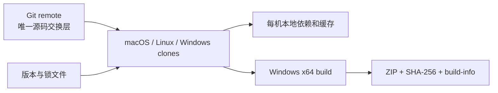

# Plan 0041：跨机器协作与可复现 Windows 构建标准

> 状态：已实施
> 更新时间：2026-11-10
> 范围：macOS、Linux、Windows x64、Apple Silicon Parallels Windows 11、CI
> 操作规范：[跨机器开发与 Windows 构建](../development/cross-machine-development.md)

## 1. 背景

同一工作区曾通过 Parallels 共享盘和 `robocopy` 在 macOS 与 Windows 间同步。
这会混合 Darwin/Windows 原生依赖、Unix 软链接、Git 所有权、旧 `dist` 和 Rust
`target`，导致重复依赖、无法复现的构建以及“实际测试了旧二进制”的风险。

本计划把协作边界改为开源项目的标准模型：Git 传源码，锁文件传依赖契约，每台机器
独立安装依赖和构建，最终只传 ZIP、校验和与测试证据。

## 2. 决策

1. `bun.lock` 是唯一 JavaScript 锁文件；Desktop 作为 Rust 应用提交 `Cargo.lock`。
2. `.bun-version`、`packageManager` 和 `rust-toolchain.toml` 固定工具链。
3. `.gitignore`、`.gitattributes`、`.editorconfig` 统一生成目录、换行和编辑器行为。
4. `bun run repo:hygiene` 与 CI 阻止生成目录、次级锁文件和 OS 元数据进入 Git。
5. Windows release 只能由 Windows x64 Bun 进程生成；Parallels ARM guest 使用 x64
   emulation 与 `x86_64-pc-windows-msvc` target。
6. Parallels 共享目录只用于只读测试输入或最终产物，不用于源码、`.git`、依赖和中间输出。
7. Agent 入口统一为根目录 `AGENTS.md`，详细规则只在 canonical 开发文档维护。

## 3. 架构

> 范围：跨机器源码与产物流；更新时间 2026-11-10；证据：
> `.gitignore`、锁文件、`scripts/check-repository-hygiene.mjs`。

## 4. 实施内容

- 扩充根 `.gitignore`，统一忽略任意层级依赖、构建、缓存与 OS 文件。
- 增加 LF/CRLF 与二进制属性、EditorConfig。
- 固定 Bun/Rust 版本并提交 Desktop Cargo lock。
- 新增 repository hygiene 检查并接入 lint CI。
- 所有 Bun CI workflow 从 `.bun-version` 读取版本。
- 新增 `CONTRIBUTING.md` 和跨机器开发操作规范。
- `CLAUDE.md` 与 `AGENTS.md` 第一时间暴露不可跨 OS 复制目录的规则。

## 5. 验收

1. `bun run repo:hygiene` 通过。
2. Git 不追踪 `node_modules`、`dist*`、`target`、coverage、data 或 OS 元数据。
3. Bun、Cargo 和 release LFS 契约均可由脚本验证。
4. native Windows 与 Parallels 的构建步骤、失败边界、验收清单均有单一文档入口。
5. 新 Agent 无需读取历史聊天即可知道 Git handoff 和 Windows `--current-user` 规则。

与本计划相关的提交必须引用 `plan 0041`。
