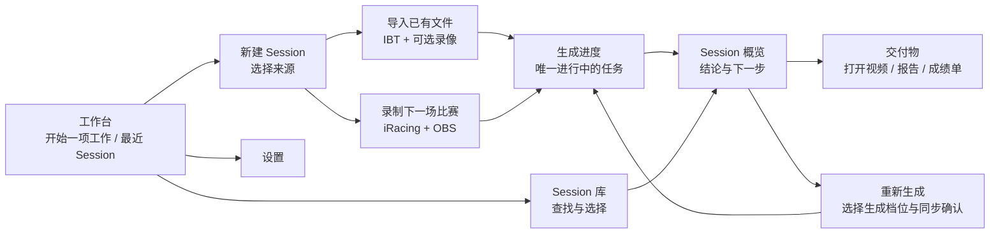
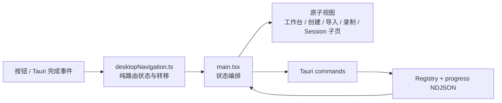
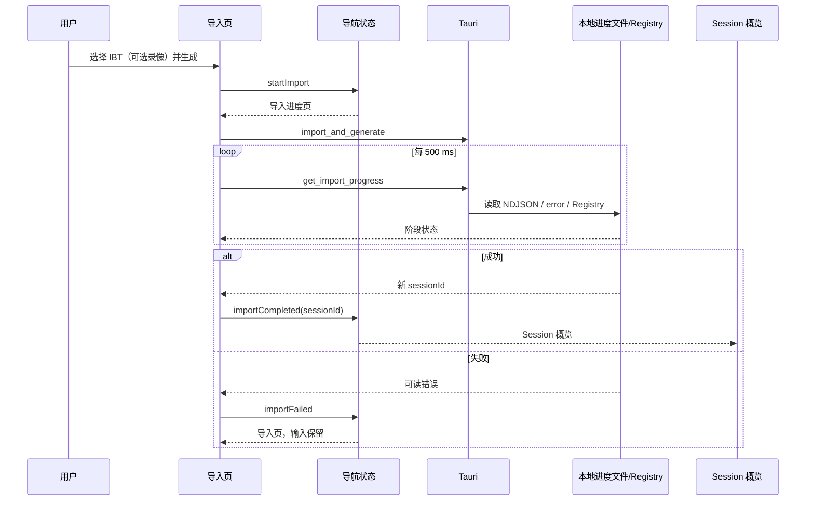

# Plan 0042：Racing Memory Desktop 任务导向工作流

> 状态：已实施并验证  
> 更新时间：2026-11-10  
> 范围：`apps/desktop/` 的信息架构、导航状态、导入/录制/Session 复盘流程与 Windows 真机验收  
> 非目标：不修改 IBT 解析、交付 pipeline、LapWing Web 分析或 Session 数据格式

## 1. 问题与设计依据

当前 Desktop 的首页并列了自动录制、环境状态、已有文件导入和最近 Session；Session Result
又并列了摘要、训练建议、进度、重新生成和全部交付物。用户在单一页面扫描多个不相干任务，
也无法从页面结构判断“下一步应该做什么”。

本设计采用两项经过公开 UX 指导验证的原则：

1. **任务导向分组与渐进披露**：首屏只显示高频主任务，低频或只在特定上下文相关的能力进入
   明确标记的二级页面。NN/g 指出这能降低学习成本、提高效率并减少误操作；证据：
   <https://www.nngroup.com/articles/progressive-disclosure/>、
   <https://www.nngroup.com/articles/complex-application-design/>。
2. **一页一件事的分步输入**：导入不与录制、状态卡或历史内容竞争；每一页只要求一个明确决定
   或执行一个动作，并保留返回路径。GOV.UK 的表单结构指南指出该方式有利于聚焦、错误恢复
   和分支流程；证据：<https://www.gov.uk/service-manual/design/form-structure>。

## 2. 目标信息架构

> 范围：Desktop React UI；更新时间：2026-11-10；证据：
> `apps/desktop/src/main.tsx`、`apps/desktop/src/sessionModel.ts`。

| 位置 | 单一用户目标 | 保留的能力 | 刻意不展示 |
| --- | --- | --- | --- |
| 工作台 | 开始或继续复盘 | 两个入口、最近 Session、就绪简报 | 路径输入、OBS 密码、交付物 |
| 新建 Session | 选择数据来源 | 导入已有文件 / 自动录制 | 表单细节 |
| 导入 | 创建一场已有比赛 | 文件选择、生成档位、低置信度确认 | 自动录制和历史列表 |
| 录制 | 准备下一场直播录制 | OBS 密码、状态、开始/复位 | 手动导入和交付物 |
| 生成进度 | 等待当前任务结束 | 阶段进度、明确完成/失败去向 | Session 内容和重新生成选项 |
| Session 概览 | 判断这场比赛下一步 | 摘要、训练卡、LapWing | 文件卡片和生成参数 |
| 交付物 | 打开已生成的内容 | 分组文件卡片、诊断目录 | 分析结论和生成参数 |
| 重新生成 | 选择新产出 | 档位、同步确认、进度 | 文件浏览和历史列表 |

## 3. 导航子系统

### 3.1 模块架构

> 范围：React 状态编排；更新时间：2026-11-10；证据：
> `apps/desktop/src/main.tsx` 中现有 `setView`、导入轮询与交付轮询。

`desktopNavigation.ts` 是唯一可写入页面状态的纯函数边界。它表达：

- Session 总是以概览页打开；
- “交付物”和“重新生成”只在有已选 Session 时可进入；
- 导入失败回到“导入已有文件”并保留用户输入，不回到工作台；
- 导入完成或录制完成进入新 Session 的概览；
- 重新生成完成保持在该 Session 的重新生成页，用户可主动查看概览或交付物；
- 全局导航不会丢弃正在进行的任务；进行中的进度路由始终优先。

### 3.2 接口目录

| 接口/RPC | 调用方 | 入口 | 成功去向 | 失败边界 |
| --- | --- | --- | --- | --- |
| `import_and_generate` | 导入页 | `importAndGenerate()` | 导入进度 → 新 Session 概览 | 回到导入页，保留文件与档位 |
| `get_import_progress` | 导入进度页 | 500 ms 轮询 | 新 Session 概览 | 导入页显示落盘错误 |
| `start_capture` | 录制页 | `startCapture()` | 录制状态 → 新 Session 概览 | 保持录制页与可恢复状态 |
| `run_delivery` | Session 重新生成页 | `generateDelivery()` | 重新生成进度 → 该页完成态 | 该页显示错误与重试 |
| `get_delivery_progress` | 重新生成页 | 500 ms 轮询 | 保持 Session 上下文 | 该页显示错误 |

### 3.3 时序：已有文件导入

## 4. 验收与回归策略

### 自动测试

1. `desktopNavigation.test.ts` 覆盖每条页面转移、完成与失败回退、Session 子页切换、
   进行中任务保护和未知 Session 防护。
2. 既有 `sessionModel.test.ts` 保持 progress、状态和资产展示行为。
3. 完整 `lint`、`typecheck`、`test:run`、`build`。

### Windows 11 x64 真机点击验收

使用 release ZIP 的解压目录，而不是构建输出，验证：

1. 工作台 → 新建 → 导入 → 文件浏览 → IBT 生成 → 进度 → 新 Session 概览；
2. 同一 IBT + MP4 的完整交付，确认低置信度分支、实时进度和结果页；
3. 工作台 → 新建 → 自动录制页面，验证设置跳转和返回不丢失状态（不启动真实录制）；
4. 历史库 → 概览 → 交付物 → 重新生成 → 概览，逐按钮验证页面标题、Session ID 和返回目标；
5. 生成失败时从进度页返回导入页，路径与档位仍在；
6. LapWing、报告、PNG、视频和目录入口按已验证的本机打开契约继续可用。

实施提交必须引用 `plan 0042`。

## 5. 实施记录与验证结果

- 2026-11-10：新增 `desktopNavigation.ts`，将页面与 Session 子页转移收敛为可测试的纯状态机；
  导入失败明确回到保留输入的导入页，导入完成进入新 Session 概览，交付完成保留在当前
  Session 的“生成与重试”页。
- 2026-11-10：Desktop 主导航调整为“工作台 / 新建 Session / 历史 Session / 设置”；
  自动录制、已有文件导入、交付物和重新生成各自位于独立任务页。活动记录只位于录制工作区。
- 2026-11-10：自动验证通过：`bun run lint`、`bun run typecheck`、`bun run test:run`
  （3397 passed、1 skipped）、`bun run build`。
- 2026-11-10：在 Parallels Windows 11 ARM guest 的 guest-local
  `C:\src\racing-memory-main-01ebd48` 中，以 x64 Bun 1.4.4 及
  `x86_64-pc-windows-msvc` 成功运行 `bun run build:desktop:win`。
  Windows UI Automation 实机点击验证了：工作台 → 新建 Session → 导入已有文件、
  IBT 原生文件选择器、历史 Session → 概览 → 交付物 → 生成与重试，以及
  新建 Session → 自动录制。每个终点均检查了对应页的可访问控件及页面标题。
