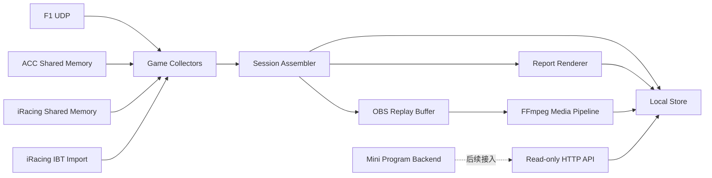
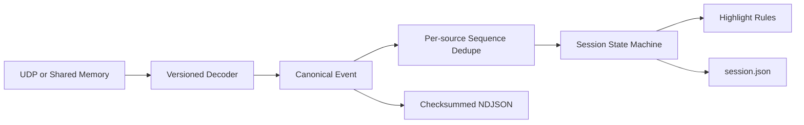
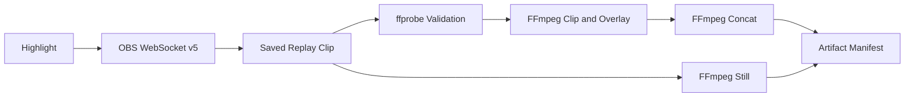
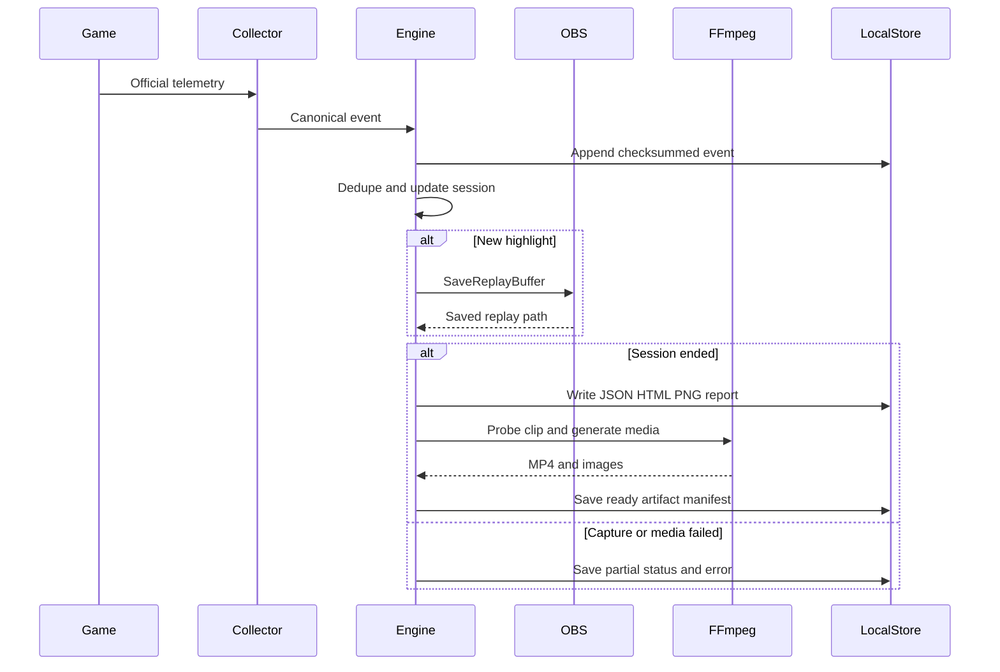
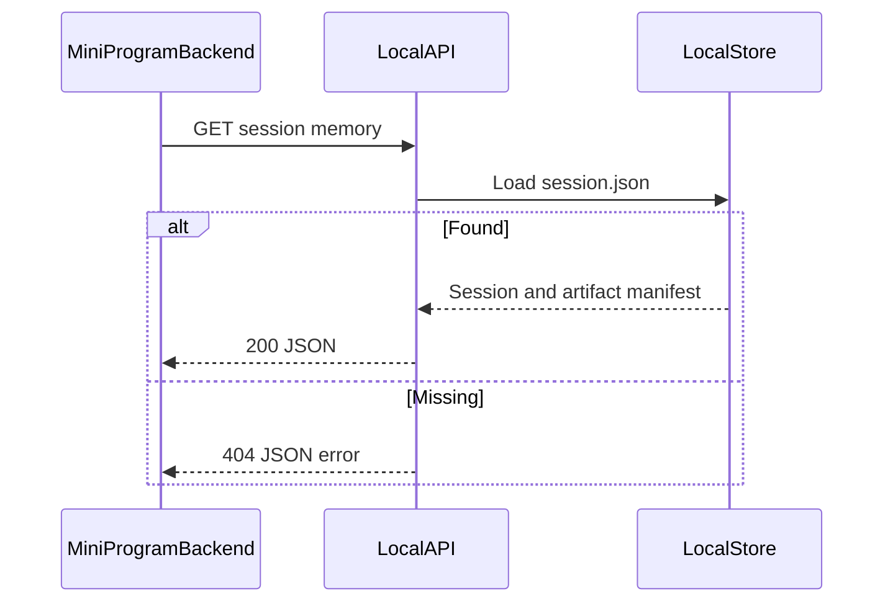
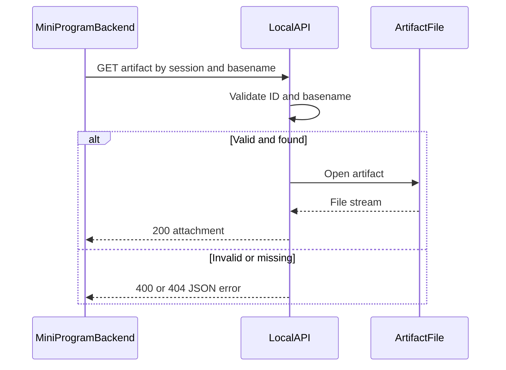

# 赛车回忆流水线

> 范围：本地伴侣程序（iRacing IRSDK/.ibt、F1 UDP、ACC Shared Memory）
> 更新时间：2026-11-04
> 代码证据：`cmd/racing-companion`、`internal/racing`、`configs/racing.example.json`
>
> 开源生态、同类项目和许可证调研见 [open-source-landscape.md](open-source-landscape.md)。

## 1. 能力与边界

本流水线采集游戏官方暴露的只读遥测，生成会话归档、成绩单、精彩视频和图片，并通过本机 HTTP API 提供给后续小程序后端。它不会注入游戏进程、读取未公开进程内存或控制车辆。

首期已实现：

- iRacing IRSDK Header v2 动态变量解析、Windows 共享内存实时采集与跨平台 `.ibt` 导入。
- iRacing SessionInfo、练习/排位/正赛边界、组别名次、事故数和匿名全场排名。
- F1 2025/2026 UDP 的会话、参与者、圈史和最终排名包。
- ACC Physics/Graphics/Static 三个 Windows Shared Memory 页面。
- 圈速、超车、冲线精彩事件，OBS Replay Buffer 保存，FFmpeg 裁切、叠字、拼接和截图。
- JSON、HTML、PNG 成绩单，本地落盘及只读查询/下载 API。

首期边界：

- F1 每年协议会变化，遇到未知 `packetFormat` 会明确拒绝；车型/赛道枚举需随官方文档更新。
- ACC 共享内存结构只在 Windows 真实游戏环境可最终验收；非 Windows 使用 fixture。
- 最终排名以官方 Final Classification 为准；ACC 未提供最终分类时标记为 `derived`。
- macOS 可完整测试 IRSDK 格式与 `.ibt` 导入，但 Windows named mapping/event、真实车辆字段和游戏状态切换仍需实机验收。
- iRacing 仅使用官方 SDK 与用户主动提供的 `.ibt`；默认本地处理，不上传、不注入进程、不公开其他会员身份。
- AI 生成式剪辑、云存储、小程序 UI/鉴权不在首期。

## 2. 总体模块架构

图信息：范围为本机伴侣程序；实线是当前代码关系，虚线是外部运行依赖。



| 模块 | 职责 | 代码位置 |
| --- | --- | --- |
| Companion | 进程生命周期、配置、信号与 HTTP 服务 | `cmd/racing-companion/main.go` |
| Collectors | F1 UDP 解码、ACC 共享内存轮询 | `internal/racing/collector` |
| Session | 去重、会话状态、圈次与精彩规则 | `internal/racing/session` |
| Engine | OBS、报告、媒体任务编排 | `internal/racing/app` |
| Store | 追加事件日志、原子会话快照、产物目录 | `internal/racing/store` |
| HTTP API | 查询会话、回忆清单与下载产物 | `internal/racing/api` |

## 3. 采集与会话子系统



- 每个来源拥有单调递增的 `sequence`；重复序号被忽略。
- 原始规范事件先写 `events.ndjson`，每行包含序号和 SHA-256。
- `session.json` 使用临时文件加原子重命名更新。
- 最佳圈得分 100，冲线 90，超车 80；窗口默认为事件前 12 秒至后 5 秒。

## 4. 媒体子系统



OBS 密码只从 `RACING_OBS_PASSWORD` 环境变量读取，不写入配置或日志。每个 Replay Buffer 文件的精彩时刻位于文件尾部，因此媒体管线按窗口长度从尾部取片；若配置了连续录像 `video_input`，则按会话时间轴裁切。

## 5. 接口目录

| 接口 | 成功输出 | 失败边界 |
| --- | --- | --- |
| `GET /healthz` | 本机服务状态 | 进程不可达 |
| `GET /v1/racing/sessions` | 按开始时间倒序的会话列表 | 存储不可读时 500 |
| `GET /v1/racing/sessions/{id}` | 完整 `Session` | ID 不存在时 404 |
| `GET /v1/racing/sessions/{id}/memory` | highlights 与 artifacts 清单 | ID 不存在时 404 |
| `GET /v1/racing/artifacts/{id}/{name}` | 带下载响应头的文件 | 非法路径 400；文件不存在 404 |

服务默认只监听 `127.0.0.1:8090`，首期不提供公网认证。若供小程序使用，应由具备用户鉴权、访问控制、对象存储签名 URL 的后端代理，不应直接暴露伴侣程序端口。

## 6. 关键时序

### 6.1 遥测到回忆产物



### 6.2 查询回忆



### 6.3 下载产物



## 7. iRacing 配置与验证

### macOS 离线导入

`.ibt` 解析器不依赖 Windows，可以在 Mac 上读取 Header、DiskSubHeader、SessionInfo YAML、动态变量表和 telemetry rows：

```bash
go run ./cmd/racing-import-ibt \
  -file /path/to/session.ibt \
  -data-dir ./racing-data
```

可通过 `-video` 传入与 SessionTime 对齐的连续录像。同一 `SubSessionID + SessionNum` 使用稳定目录名，重复导入会被拒绝。仓库测试只生成匿名合成 `.ibt`，不包含会员姓名、custid 或真实赛事数据。

### Windows 实时采集

1. 配置 `"game": "iracing"`，启动伴侣程序。
2. 程序只读打开 `Local\IRSDKMemMapFileName` 与 `Local\IRSDKDataValidEvent`，未启动 iRacing 时持续等待。
3. 进入 Practice、Qualifying 或 Race 后，程序按 `SessionUniqueID + SessionNum` 建立独立会话。
4. 方格旗、赛段切换或连接断开会结束当前会话；程序继续等待下一场，不需要重启。

实时 Reader 会从多缓冲选择最新 tick，并在复制前后复核 tick，避免读取撕裂帧。字段按 VarHeader 名称动态发现，缺失字段保持空值。

不能由 macOS fixture 最终证明的内容包括：Windows mapping/event 权限、真实唤醒节奏、360 Hz 配置行为、各车辆字段集合和游戏更新后的兼容性。

## 8. Windows 配置与运行

1. 安装 OBS 30+，在“工具 → WebSocket 服务器设置”启用服务，并配置 Replay Buffer 和录制目录。
2. 安装 FFmpeg，确保 `ffmpeg.exe`、`ffprobe.exe` 位于 `PATH`。
3. 复制 `configs/racing.example.json`，F1 使用 `"game":"f1"`；ACC 使用 `"game":"acc"`。
4. F1 游戏内开启 UDP，地址指向本机，端口与 `f1_udp` 一致；ACC 无需插件。
5. 设置 `RACING_OBS_PASSWORD`，执行 `racing-companion.exe -config <配置路径>`。
6. 查询 `http://127.0.0.1:8090/v1/racing/sessions`，产物位于 `<data_dir>/sessions/<id>/artifacts`。

构建与验证：

```bash
make test
make race
make build-windows
make demo
make run
```

`make demo` 会用 FFmpeg 生成一段无版权测试视频和合成遥测，完整产出成绩单、精彩片和图片，适合安装真实游戏前检查环境。

真实 Windows 冒烟应分别核对：游戏/车辆/赛道、完整圈数、最佳圈、最终位置、OBS 保存路径、MP4 可播放、PNG/HTML 可打开，以及 API 下载文件与 manifest 一致。

## 9. 隐私、失败与恢复

- 遥测和录像默认仅保存在用户指定目录；不会自动上传。
- 录像可能包含用户名和语音，接入云端前必须增加明确同意、删除和保留期设置。
- 事件日志损坏可由 `store.VerifyEvents` 检出；已完成阶段产物使用固定文件名，重复生成会覆盖而不会重复追加。
- OBS 不可用时启动失败；单次保存或 FFmpeg 失败时会话保留 `partial` 状态和错误，成绩单仍可查看。
- ACC/F1 协议版本、FFmpeg 编解码器和 OBS 场景配置是实机验收的主要兼容性风险。
- iRacing API 仅返回本地车手身份；其他参赛车手按车号匿名。OBS 原始绝对路径不会通过 HTTP API 返回。
- SDK 源码许可不等于遥测商业使用授权。云上传、公开排行榜、真实 `.ibt` 再分发或商业部署前需重新审查 iRacing 条款并取得必要许可。
