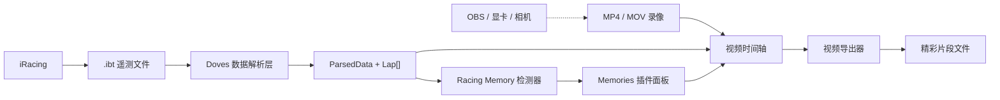
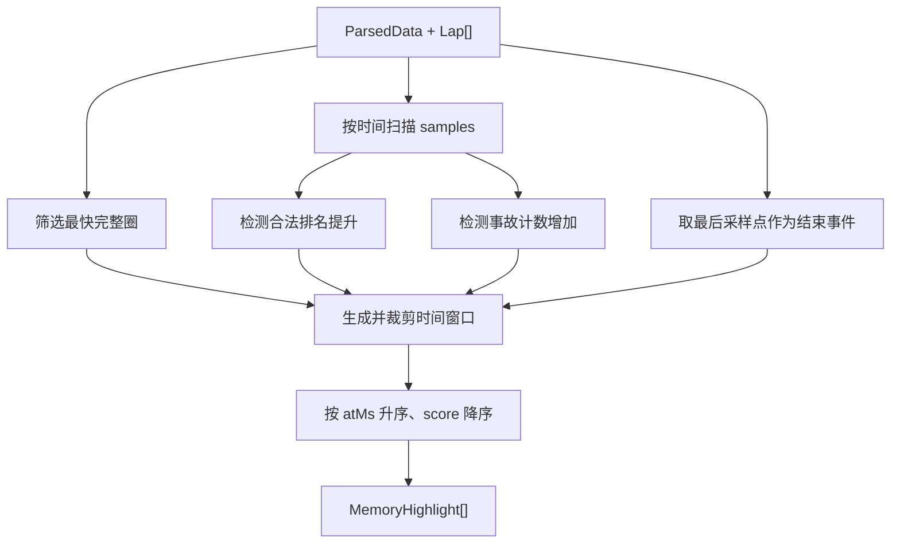
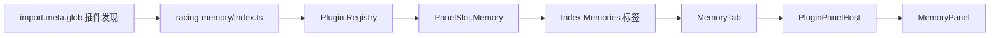
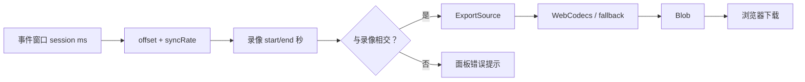
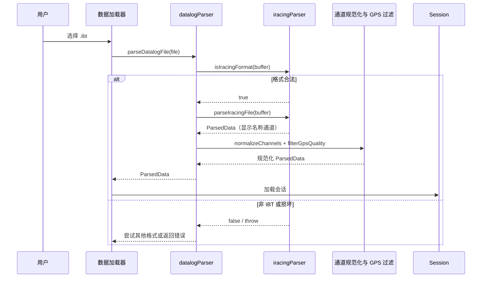
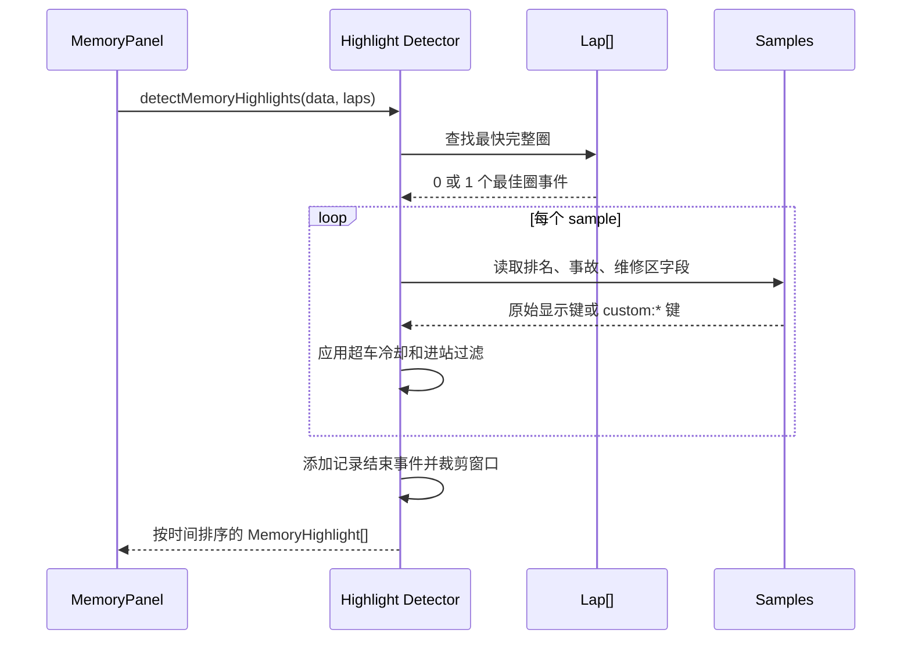
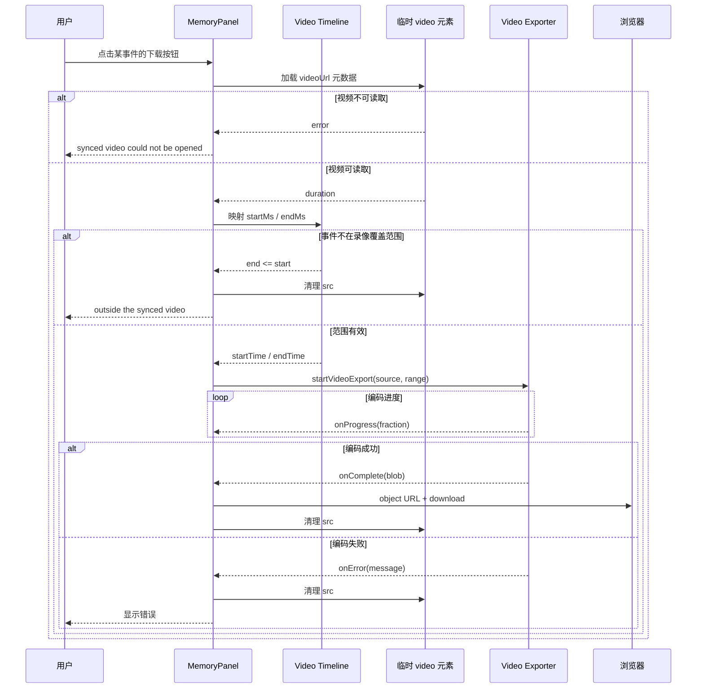

# Racing Memory：IBT 精彩时刻识别与视频片段导出

> 文档状态：MVP 实现说明与后续开发基线  
> 系统范围：DovesDataViewer / LapWing 浏览器端应用  
> 更新时间：2026-11-04  
> 开发分支：`feature/racing-memory-mvp`  
> 代码证据：`src/lib/iracingParser.ts`、`src/lib/datalogParser.ts`、`src/lib/racingMemoryHighlights.ts`、`src/lib/videoTimeline.ts`、`src/lib/videoExport.ts`、`src/plugins/racing-memory/`
> 测试证据：`src/lib/iracingParser.test.ts`、`src/plugins/racing-memory/highlights.test.ts`、`src/plugins/racing-memory/realIbt.integration.test.ts`

## 1. 文档目的

本文记录 Racing Memory MVP 的需求边界、技术选型、代码结构、数据契约、
精彩时刻算法、视频同步与导出链路、测试数据、验证方法、已知限制和后续演进方向。
后续开发者应以本文和上述代码为共同基线；当实现与文档不一致时，以当前代码为准，
并在同一个变更中更新本文。

Racing Memory 的核心目标是：

1. 用户导入 iRacing 原生 `.ibt` 遥测文件；
2. 应用从遥测中自动识别最佳圈、超车、事故和冲线等精彩时刻；
3. 用户另行导入并同步比赛录像；
4. 应用将精彩时刻的遥测时间映射到录像时间；
5. 用户把某个精彩时刻导出为本地视频片段。

`.ibt` 只包含遥测和比赛状态，不包含视频帧或音频。视频必须来自 OBS、显卡录制、
iRacing Replay 录屏、GoPro 或其他录制设备。因此本功能不是“从 `.ibt` 还原视频”，
而是“用 `.ibt` 决定应该从已有录像中截取哪一段”。

## 2. 当前交付范围

### 2.1 已实现

- 浏览器本地解析 iRacing `.ibt`；
- 从 `.ibt` 暴露车手排名、组别排名、事故计数和维修区状态；
- 自动识别单场数据中的：
  - 最快完整圈；
  - 排名提升事件；
  - 事故计数增加事件；
  - 数据记录结束事件；
- 为每个事件生成前 12 秒、后 5 秒的建议窗口；
- 在主界面增加 `Memories` 标签；
- 展示事件类型、时间、窗口、分数和预计片段总时长；
- 复用 DovesDataViewer 的视频同步模型；
- 复用 DovesDataViewer 的浏览器端视频编码器；
- 单独导出某个精彩时刻；
- 通过 Bun CLI 生成可审查 EDL，并把多个事件拼接为 60/90 秒预算的 H.264/AAC 合集；
- 以 Session Bundle 和原子 Job Manifest 支持一键执行、断点续跑和输入 hash 幂等；
- 输出 JSON/HTML 成绩单、可配置数量的 SVG/PNG 图片和确定性驾驶优化建议；
- 定义 Windows iRacing lifecycle + OBS WebSocket + IBT finalize companion 协议及 mock provider；
- 无遥测、无事件、无视频、视频不覆盖事件和编码错误时显示受控状态；
- 单元测试、真实 `.ibt` 集成测试、类型检查、Lint 和生产构建验证。

### 2.2 未实现

- 片头、片尾、转场、背景音乐和字幕模板；
- 根据速度、刹车、方向盘、圈间差值进行更高级的精彩度评分；
- 区分主动超车、对手退赛、黄旗下掉位和进站造成的所有名次变化；
- 使用 iRacing Replay 控制接口自动定位并录制回放；
- OBS Replay Buffer 控制（首版 companion 只控制普通录制开始/停止）；
- 云端上传、云端编码或分享链接；
- 原生 Insta360 视频源的片段导出；
- 用户可配置的事件规则和窗口长度。

## 3. 总体模块架构

> 图范围：Racing Memory 浏览器本地链路  
> 更新时间：2026-11-04  
> 实线证据：本文顶部列出的代码文件  
> 虚线含义：用户在应用外部完成的录像行为，不属于本仓库



系统由以下模块构成：

| 模块 | 代码位置 | 职责 | 输入 | 输出 |
| --- | --- | --- | --- | --- |
| 统一文件路由 | `src/lib/datalogParser.ts` | 识别文件格式、调用 `.ibt` 解析器、规范化通道并过滤 GPS 异常 | `File` 或 `ArrayBuffer` | `ParsedData` |
| iRacing 解析器 | `src/lib/iracingParser.ts` | 读取 IBT 头、变量表和采样记录 | `.ibt` 二进制 | 解析器级 `ParsedData` |
| 圈速管理 | `src/hooks/useLapManagement.ts` | 从会话数据和赛道线生成圈记录 | `ParsedData`、赛道配置 | `Lap[]` |
| 精彩时刻检测器 | `src/lib/racingMemoryHighlights.ts` | 根据圈和比赛状态生成确定性事件，供浏览器插件与 CLI 共用 | `ParsedData`、`Lap[]` | `MemoryHighlight[]` |
| 插件注册 | `src/plugins/racing-memory/index.ts` | 注册 Racing Memory 面板 | 插件 Registry | `PanelSlot.Memory` contribution |
| Memories 标签宿主 | `src/components/tabs/MemoryTab.tsx` | 向插件传递当前会话快照 | Session Context | 插件面板 |
| 面板与导出编排 | `src/plugins/racing-memory/MemoryPanel.tsx` | 展示事件、映射时间、启动导出、下载结果 | 事件和 VideoSyncState | 视频片段下载 |
| 时间轴模型 | `src/lib/videoTimeline.ts` | 在遥测时间和录像时间之间换算 | offset、rate、时间点 | 视频秒数或覆盖状态 |
| 视频导出器 | `src/lib/videoExport.ts` | 逐帧读取、H.264 编码并复用 MP4 muxer | 视频源、时间范围 | `Blob` |

## 4. 子系统架构

### 4.1 IBT 解析与通道规范化

> 图范围：`.ibt` 从文件到插件可消费数据  
> 更新时间：2026-11-04  
> 证据：`src/lib/datalogParser.ts`、`src/lib/iracingParser.ts`、`src/lib/channels.ts`



```mermaid
flowchart LR
    File["File / ArrayBuffer"]
    Detect["isIracingFormat"]
    Parse["parseIracingFile"]
    Vars["读取 varHeader"]
    Rows["读取固定长度采样行"]
    Raw["显示名称 extraFields"]
    Normalize["normalizeChannels"]
    Filter["filterGpsQuality"]
    Data["插件收到的 ParsedData"]

    File --> Detect --> Parse --> Vars --> Rows --> Raw --> Normalize --> Filter --> Data
```

`.ibt` 采用小端二进制布局。当前解析器关注的主要结构：

| 结构 | 大小或位置 | 用途 |
| --- | --- | --- |
| `irsdk_header` | 112 字节 | 版本、tick rate、变量数量、变量表偏移、数据行长度 |
| `irsdk_diskSubHeader` | 32 字节 | 会话开始时间、磁盘记录行数 |
| Session Info | `sessionInfoOffset` | YAML 元数据；`WeekendInfo` 用于加强格式识别 |
| `varHeader[]` | 每项 144 字节 | 通道类型、行内偏移、数量、名称、描述和单位 |
| Data Records | `varBuf[0].bufOffset` | 固定长度采样行 |

格式识别不是只看扩展名。`isIracingFormat` 会校验版本、tick rate、变量数量、
buffer 长度和各偏移范围，并确认 Session Info 中存在 `WeekendInfo`。这降低了把随机
二进制误识别为 `.ibt` 的概率。

Racing Memory 新增消费的原始通道如下：

| iRacing 原始变量 | 解析器显示名称 | 规范化后的实际键 | 当前用途 |
| --- | --- | --- | --- |
| `PlayerCarPosition` | `Player Position` | `custom:player_position` | 总排名变化、冲线排名文案 |
| `PlayerCarClassPosition` | `Player Class Position` | `custom:player_class_position` | 已解析，MVP 暂未参与判断 |
| `PlayerCarMyIncidentCount` | `Incident Count` | `custom:incident_count` | 事故计数增量 |
| `OnPitRoad` | `On Pit Road` | `custom:on_pit_road` | 排除维修区名次变化 |

解析器自身输出显示名称；统一文件入口随后调用 `normalizeChannels`，把未知通道转为
稳定的 `custom:*` 键。精彩时刻检测器同时接受两种形式：

- 解析器级单元测试可以直接传显示名称；
- 浏览器真实导入路径传 `custom:*` 键。

真实 `.ibt` 集成测试必须经过 `parseDatalogContent`，不能只直接调用
`parseIracingFile`，否则会绕过通道规范化，无法代表 UI 中的实际数据。

### 4.2 精彩时刻识别

> 图范围：确定性规则检测器  
> 更新时间：2026-11-04  
> 证据：`src/lib/racingMemoryHighlights.ts`



`MemoryHighlight` 是检测器、UI 和导出编排之间的内部契约：

```ts
interface MemoryHighlight {
  id: string;
  kind: "best_lap" | "overtake" | "incident" | "finish";
  atMs: number;
  startMs: number;
  endMs: number;
  score: number;
  title: string;
  detail?: string;
  lapNumber?: number;
}
```

字段语义：

| 字段 | 单位 | 语义 |
| --- | --- | --- |
| `id` | 无 | 当前会话内稳定的 React key 和导出任务标识 |
| `kind` | 无 | 事件分类 |
| `atMs` | 毫秒 | 事件在遥测会话中的绝对相对时间 |
| `startMs` | 毫秒 | 建议片段起点，已裁剪到会话边界 |
| `endMs` | 毫秒 | 建议片段终点，已裁剪到会话边界 |
| `score` | 0–100 约定值 | MVP 固定优先级，不是机器学习置信度 |
| `title` / `detail` | 文本 | UI 展示信息 |
| `lapNumber` | 圈号 | 仅最佳圈事件提供 |

当前规则：

| 事件 | 触发条件 | 分数 | 细节 | 保护条件 |
| --- | --- | --- | --- | --- |
| 最佳圈 | 所有 `!incomplete && lapTimeMs > 0` 圈中用时最短者 | 100 | 圈号和圈速 | 不完整圈不参与 |
| 超车 | 当前总排名数值小于上一有效总排名 | 80 | `P旧 → P新` | 单次最多提升 4 位；当前与上一采样均不在维修区；3 秒冷却 |
| 事故 | 当前事故计数大于上一有效事故计数 | 60 | `旧x → 新x` | 缺失或非有限数值不参与 |
| 冲线/结束 | 存在最后采样且会话时长大于 0 | 90 | 有效时显示最终排名 | 当前实质是“记录结束”，不保证已收到正式方格旗 |

所有事件默认窗口：

```text
startMs = max(0, atMs - 12_000)
endMs   = min(sessionDurationMs, atMs + 5_000)
```

这意味着普通事件最长 17 秒。靠近会话开始或结束的事件会被裁短。面板中的
`Reel length` 当前只是所有窗口长度的直接求和，不做重叠区间合并，因此它是“逐段
分别导出的总时长估计”，不是未来拼接视频去重后的精确长度。

算法复杂度：

- 最佳圈：`O(L)`，`L` 为圈数；
- 采样扫描：`O(S)`，`S` 为采样数；
- 最终排序：`O(H log H)`，`H` 为事件数；
- 除输出事件外，不建立与采样数同规模的新数组。

### 4.3 插件和 UI 接入

> 图范围：插件发现、标签展示和面板渲染  
> 更新时间：2026-11-04  
> 证据：`src/plugins/index.ts`、`src/plugins/panels.ts`、`src/pages/Index.tsx`、`src/components/tabs/MemoryTab.tsx`



接入细节：

1. `src/plugins/index.ts` 使用 `import.meta.glob("./*/index.ts", { eager: true })`
   发现一方插件；
2. Racing Memory 以 `id = "racing-memory"` 注册；
3. 插件向 `PANELS_POINT` 贡献 `PanelSlot.Memory` 面板；
4. `Index.tsx` 使用 `usePanelsForSlot(PanelSlot.Memory)` 判断是否显示标签；
5. `MemoryTab` 和 `MemoryPanel` 均采用懒加载；
6. `PluginPanelHost` 为插件提供 `Suspense` 和局部 Error Boundary；
7. 面板只接收稳定的 `PluginPanelProps`，视频状态通过现有 Session Context 读取。

懒加载的目的，是避免用户尚未打开 Memories 时就把视频导出相关依赖加入首屏执行路径。

### 4.4 视频时间轴与导出

> 图范围：一个精彩时刻从遥测时间到下载文件  
> 更新时间：2026-11-04  
> 证据：`src/plugins/racing-memory/MemoryPanel.tsx`、`src/lib/videoTimeline.ts`、`src/lib/videoExport.ts`



遥测与录像的换算公式：

```text
videoSec = syncRate × (sessionMs - syncOffsetMs) / 1000
sessionMs = syncOffsetMs + (videoSec / syncRate) × 1000
```

- `syncOffsetMs`：录像虚拟时间 0 对应的遥测会话时间；
- `syncRate`：相机时钟与遥测时钟的速率比，默认 `1`；
- `syncRate` 不为 `1` 时，可修正长录像中的时钟漂移；
- 多章节录像使用 `exportChunks` 组成一条连续的虚拟时间轴。

面板会把事件窗口映射到录像时间，并进行边界裁剪：

```text
startTime = max(0, mappedStart)
endTime   = min(videoDuration, mappedEnd)
```

若 `endTime <= startTime`，说明录像完全不覆盖该事件，编码器不会启动，用户会看到
`This moment is outside the synced video.`。

## 5. 接口目录

这里的“接口”包括关键内部函数和插件扩展点；MVP 没有新增 HTTP API、RPC 或云端服务。

| 接口 | 调用方 | 入口 | 前置条件 | 成功输出 |
| --- | --- | --- | --- | --- |
| IBT 格式识别 | 文件路由 | `isIracingFormat(buffer)` | 二进制可读 | `boolean` |
| IBT 解析 | 文件路由 | `parseIracingFile(buffer)` | 合法 IBT 且含 GPS | `ParsedData` |
| 统一解析 | UI 数据加载器 | `parseDatalogFile(file)` / `parseDatalogContent(content)` | 支持的文件格式 | 规范化后的 `ParsedData` |
| 精彩识别 | `MemoryPanel` | `detectMemoryHighlights(data, laps)` | 已解析会话 | `MemoryHighlight[]` |
| 时间映射 | `MemoryPanel` | `sessionMsToVideoSec(...)` | 已知 offset/rate | 录像虚拟秒 |
| 视频导出 | `MemoryPanel` | `startVideoExport(...)` | 可读视频源和有效范围 | 回调返回 Blob 或错误 |
| 面板注册 | 插件初始化器 | `plugin.setup(ctx)` | Registry 已初始化 | Memory slot contribution |

## 6. 关键接口时序

### 6.1 导入 `.ibt`

> 图范围：浏览器文件导入  
> 更新时间：2026-11-04  
> 证据：`src/lib/datalogParser.ts`、`src/lib/iracingParser.ts`、`src/lib/channels.ts`



输入与失败边界：

- 文件太短、头字段越界、YAML 标记缺失：不识别为 IBT；
- 缺少 `Lat` 或 `Lon`：解析失败；
- 没有有效 GPS 采样：解析失败；
- 速度超限、坐标无效或疑似瞬移：对应采样被过滤；
- 某个可选比赛状态通道不存在：该字段缺失，但其他数据仍可使用。

### 6.2 识别精彩时刻

> 图范围：`detectMemoryHighlights`  
> 更新时间：2026-11-04  
> 证据：`src/lib/racingMemoryHighlights.ts`



检测器是纯函数，不读取浏览器状态、不访问网络、不修改输入数据，适合独立测试和未来迁移
到 Web Worker。

### 6.3 导出一个精彩片段

> 图范围：Memories 面板单片段导出  
> 更新时间：2026-11-04  
> 证据：`src/plugins/racing-memory/MemoryPanel.tsx`、`src/lib/videoExport.ts`



导出参数：

| 参数 | 当前值 | 说明 |
| --- | --- | --- |
| `includeOverlays` | `false` | MVP 不烧录遥测 Overlay |
| `quality` | `standard` | 复用 Doves 标准质量档 |
| `range` | `full` | API 兼容字段，实际由 `startTime/endTime` 限制 |
| `destination` | `device` | 生成本地文件 |
| `startTime` | 映射后并裁剪的秒数 | 精彩片段开始 |
| `endTime` | 映射后并裁剪的秒数 | 精彩片段结束 |

WebCodecs 可用时，现有导出器逐帧 seek、H.264 编码并通过 `mp4-muxer` 生成 MP4；
音频路径由现有导出器处理。WebCodecs 不可用时，单文件录像会进入现有
MediaRecorder fallback；多章节录像会明确报错，因为 fallback 无法跨章节。
因此要稳定获得 MP4，建议使用支持 WebCodecs 的当前版本 Chrome 或 Edge。

## 7. UI 状态和用户操作

### 7.1 标准操作流程

1. 启动应用并导入 `.ibt`；
2. 确认圈速和轨迹已正常显示；
3. 打开 `Pro > Video`；
4. 导入对应比赛录像；
5. 使用已有同步工具，把录像画面与遥测位置对齐；
6. 打开 `Memories`；
7. 检查自动识别的事件和时间窗口；
8. 点击某个事件右侧下载按钮；
9. 等待编码进度结束；
10. 检查下载的视频片段。

### 7.2 面板状态

| 状态 | UI 行为 |
| --- | --- |
| 未加载遥测 | 提示先加载 telemetry session |
| 已加载但无事件 | 提示没有检测到精彩时刻 |
| 有事件但无录像 | 展示事件，导出按钮禁用并提示加载、同步录像 |
| 普通浏览器视频已加载 | 导出按钮启用 |
| 原生 Insta360 流 | 当前禁用导出 |
| 正在导出 | 所有事件下载按钮禁用，当前按钮显示 loading |
| 事件不在录像范围 | 显示覆盖范围错误 |
| 编码器错误 | 显示导出器返回的错误文本 |
| 导出完成 | 触发浏览器本地下载并恢复按钮 |

当前输出文件名格式：

```text
racing-memory-<kind>-<event-seconds>s.mp4
```

例如：

```text
racing-memory-best_lap-695s.mp4
```

## 8. 测试数据与自动化验证

### 8.1 测试数据分层

| 层级 | 数据 | 目的 | 是否进入仓库 |
| --- | --- | --- | --- |
| 解析器单测 | 测试中构造的最小 IBT ArrayBuffer | 校验头、变量、单位和比赛状态通道 | 是 |
| 检测器单测 | 手工构造的 `GpsSample[]` 和 `Lap[]` | 精确覆盖规则、冷却、进站过滤和窗口裁剪 | 是 |
| 真实 IBT 集成测试 | 外部 Spa 比赛 `.ibt` | 验证真实文件、统一路由、规范化和事件识别 | 否，通过环境变量提供 |
| 浏览器视频验证 | 临时生成的长测试 MP4 | 验证同步覆盖和真实编码完成 | 否 |

真实 IBT 不直接提交到仓库，原因包括文件体积、来源许可和可能包含车手/会话元数据。
集成测试用环境变量显式启用；未提供时测试自动 skip。

### 8.2 定向测试

```bash
npm run test:run -- \
  src/lib/iracingParser.test.ts \
  src/plugins/racing-memory/highlights.test.ts
```

真实 IBT：

```bash
RACING_IBT_GOLDEN=/absolute/path/to/session.ibt \
  npm run test:run -- \
  src/plugins/racing-memory/realIbt.integration.test.ts
```

该集成测试确认：

- 会话时长符合真实比赛量级；
- 统一解析入口生成 `custom:player_position`；
- 统一解析入口生成 `custom:incident_count`；
- 至少识别一个事故；
- 至少识别一个排名提升；
- 最后一个事件为结束事件。

### 8.3 完整验证

```bash
npm run typecheck
npm run lint
npm run test:run
npm run build
git diff --check
```

2026-11-04 的实现验证结果：

- TypeScript 类型检查通过；
- ESLint 通过；
- 完整测试：221 个测试文件通过、1 个 skip；
- 完整断言：3265 项通过、1 项 skip；
- 真实 Spa `.ibt` 集成测试单独通过；
- Vite 生产构建通过；
- 浏览器加载 15 分 30 秒测试视频后，最佳圈片段编码约 14.5 秒完成；
- 编码过程中未出现 UI 错误，完成后下载回调正常结束。

构建会报告主 bundle 大于 500 kB 的既有警告；Racing Memory 面板和导出器采用懒加载，
没有把视频编码器直接加入首页首屏路径。

## 9. 安全、隐私与资源边界

### 9.1 本地处理

当前 Racing Memory 链路不需要账号、云服务或后端：

- `.ibt` 在浏览器本地读取；
- 事件识别在浏览器内存中执行；
- 视频通过本地 Object URL 读取；
- 编码在浏览器本地执行；
- 输出通过浏览器下载；
- 插件本身不上传遥测或视频。

仓库其他可选云插件不属于 Racing Memory 数据流。若未来增加云分享或云编码，必须单独
设计用户同意、上传范围、保留期限和删除机制，不能默认复用本地处理声明。

### 9.2 不可信输入

`.ibt` 和视频均应视为不可信文件。现有 IBT 检查包括：

- 最小文件长度；
- header 数值范围；
- session/变量表偏移范围；
- data row 长度；
- 变量头不能越过文件边界；
- GPS 坐标、速度和瞬移过滤。

仍建议后续补充：

- 对每个变量的行内 offset 和类型大小做更严格的 `bufLen` 边界校验；
- 为畸形 record count、极端变量数量和截断数据增加 fuzz/property 测试；
- 把大型 IBT 解析移入 Worker，避免恶意或超大文件阻塞 UI；
- 为视频编码增加显式取消和组件卸载清理。

### 9.3 已知供应链注意事项

本功能没有新增第三方依赖，复用了仓库已有 React、WebCodecs 和 `mp4-muxer` 链路。
仓库中的 `scripts/build-xrk-wasm.sh` 会下载并执行外部 `wasm-bindgen`，且当前未固定
下载产物哈希；它与 Racing Memory/IBT 链路无直接关系，开发本功能时没有运行该脚本。

## 10. 失败边界与故障排查

### 10.1 `.ibt` 无法导入

检查：

1. 文件是否为 iRacing 原生 `.ibt`，而不是重命名的 CSV；
2. 文件是否完整写盘；
3. 文件是否包含 `Lat`、`Lon`；
4. 浏览器控制台是否出现头字段或 GPS 错误；
5. 用 `isIracingFormat` 和解析器定向测试复现。

### 10.2 只有最佳圈和结束，没有超车/事故

检查：

1. `.ibt` 是否包含 `PlayerCarPosition` 和 `PlayerCarMyIncidentCount`；
2. `data.fieldMappings` 是否出现对应 `custom:*` 通道；
3. 测试是否错误地绕过 `parseDatalogFile/parseDatalogContent`；
4. 该场次是否实际发生计数变化；
5. 超车是否发生在维修区或 3 秒冷却窗口内。

### 10.3 导出按钮禁用

检查：

- 是否已加载录像；
- 是否为当前不支持的原生相机流；
- 是否已有另一个片段正在导出；
- 录像是否通过 Pro 面板进入当前会话。

### 10.4 提示事件不在视频范围

这通常不是识别错误，而是录像覆盖范围或同步偏移问题：

- 录像可能比遥测晚开始；
- 录像可能在事件前结束；
- 同步点可能设置错误；
- 长录像可能存在时钟漂移，需要额外同步锚点修正 `syncRate`。

### 10.5 多章节视频导出失败

多章节录像跨 chunk 导出依赖 WebCodecs。确认浏览器支持：

```js
typeof VideoEncoder !== "undefined"
```

不支持时应升级 Chrome/Edge，或先在外部把章节合并为一个普通视频文件。

## 11. 许可证与分支策略

本仓库 `package.json` 声明 `GPL-3.0-or-later`，根目录 `LICENSE` 为 GNU GPL v3。
Racing Memory 作为仓库内一方插件，与仓库使用同一许可证。分发修改后的应用时，需要
遵守 GPL 对源代码和许可证保留的要求。

建议 Git 策略：

- `upstream` 指向原始 DovesDataViewer；
- `origin` 指向个人 fork；
- 上游同步基于 `upstream/main`；
- Racing Memory 在 `feature/racing-memory-mvp` 及后续功能分支开发；
- 不把旧 Go 原型源码直接复制进本仓库；
- 旧 Go 原型可作为未来 Windows/iRacing/OBS companion 的独立仓库。

## 12. 已知限制

1. “Finish” 当前代表遥测记录结束，不一定是官方冲线；
2. 超车基于总排名数值变化，不能完全区分赛道超车、对手事故和掉线；
3. `Player Class Position` 已解析但尚未用于组别超车；
4. 固定分数是产品优先级，不是基于模型训练的精彩度；
5. 时间窗口固定为前 12 秒、后 5 秒；
6. 浏览器面板的 `Reel length` 仍不合并重叠窗口；CLI story planner 会合并并执行预算；
7. 浏览器每次只能导出一个连续片段；CLI 可输出多段 concat reel；
8. 当前导出不包含遥测 Overlay；
9. 原生 Insta360 流导出被禁用；
10. MediaRecorder fallback 不能跨多章节，且不保证 MP4 容器；
11. 导出控制器尚未在面板卸载时主动 cancel；
12. 大型 IBT 解析仍运行在主线程；
13. 文案尚未接入完整 i18n；
14. 合成 IBT 可由 `lapwing fixture ibt` 确定性生成；真实硬件差异仍需可选 golden IBT 验证。

## 13. 后续演进建议

### P0：把 CLI 回忆视频能力带回浏览器

- 复用 CLI 已实现的不连续 `segments[]`、窗口合并和按分数/多样性选片规则；
- 添加片头、事件标题、片尾和转场；
- 在浏览器也输出单个 MP4 reel（CLI 已实现）；
- 增加导出取消和卸载清理；
- 为 fallback 输出正确的容器扩展名或明确要求 WebCodecs。

### P1：提高识别准确度

- 结合 `Player Class Position` 支持组别赛事；
- 结合速度骤降、制动、横纵向 G 和方向盘判断失控；
- 区分主动超车、被超、进站交换和事故掉位；
- 从 Session Info 读取正式比赛状态或方格旗信号；
- 合并同一事故造成的连续事故计数变化；
- 使用赛道位置和圈号生成更可读的事件文案。

### P2：提升产品体验

- 规则、分数和窗口可配置；
- 在时间轴上预览和手工调整片段；
- 支持 Overlay、字幕、车手名和圈速；
- 支持模板化音乐，但必须处理音乐版权；
- 保存编辑工程，允许再次打开；
- 增加中英文 i18n。

### P3：实时与桌面能力

- 将当前 JSONL companion protocol 对接到独立 IRSDK shared-memory 事件生产进程；
- OBS Replay Buffer 联动；
- iRacing Replay SDK/控制接口可行性验证；
- 将已实现的 Bun/FFmpeg 多段拼接包装为可发布桌面工具；
- 保持 companion 与 GPL Web 应用之间清晰的协议和许可证边界。

## 14. 变更联动清单

修改下列内容时必须同步检查：

| 变更 | 必查代码/测试/文档 |
| --- | --- |
| 新增 IBT 比赛状态通道 | `iracingParser.ts`、parser fixture、通道规范化、真实 IBT 测试 |
| 修改事件规则 | `highlights.ts`、规则单测、分数和限制章节 |
| 修改时间窗口 | 检测器测试、UI 时长、导出范围、本文公式 |
| 修改视频同步模型 | `videoTimeline` 测试、MemoryPanel 映射、部分录像边界 |
| 修改导出 API | `MemoryPanel` 回调与清理、WebCodecs/fallback、多章节测试 |
| 修改插件 slot | `panels.ts`、`Index.tsx`、`MemoryTab.tsx`、插件注册 |
| 增加完整 reel | 接口目录、导出时序、重叠窗口算法和资源上限 |
| 增加云端能力 | 隐私、安全、认证、保留期限和删除机制 |

## 15. MVP 验收标准

- [x] `.ibt` 可通过统一文件入口解析；
- [x] 比赛状态通道经过规范化后仍可被检测器读取；
- [x] 最佳圈、超车、事故和结束事件有确定性规则；
- [x] Memories 标签由插件 contribution 自门控显示；
- [x] 无视频时不会启动导出；
- [x] 事件窗口能映射到同步视频时间；
- [x] 录像不覆盖事件时给出明确错误；
- [x] 支持浏览器本地单片段编码和下载；
- [x] 真实 `.ibt` 经过与 UI 相同的统一解析路径测试；
- [x] 类型检查、Lint、完整测试和生产构建通过；
- [x] 没有新增云端上传或账号依赖；
- [x] 开发、验证、安全、许可证和限制已形成文档。

## 16. Plan 0033 自动化流水线

CLI 现已用 `SessionBundleV1` 把 finalized IBT、视频、SHA-256、来源元数据和同步
证据固定为一次会话，再由 `JobManifestV1` 编排
`inspect → sync → analyze → memory → reel → report → insights`。每步产物与输入 hash
写入原子 checkpoint，`lapwing run job.json --resume` 可安全复用未过期结果。

独立命令和 Windows companion 的完整架构、JSONL 时序、失败边界、命令示例与真实
Windows 验收清单见
[`docs/plans/0033-race-automation-pipeline.md`](plans/0033-race-automation-pipeline.md)。
